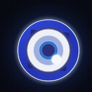
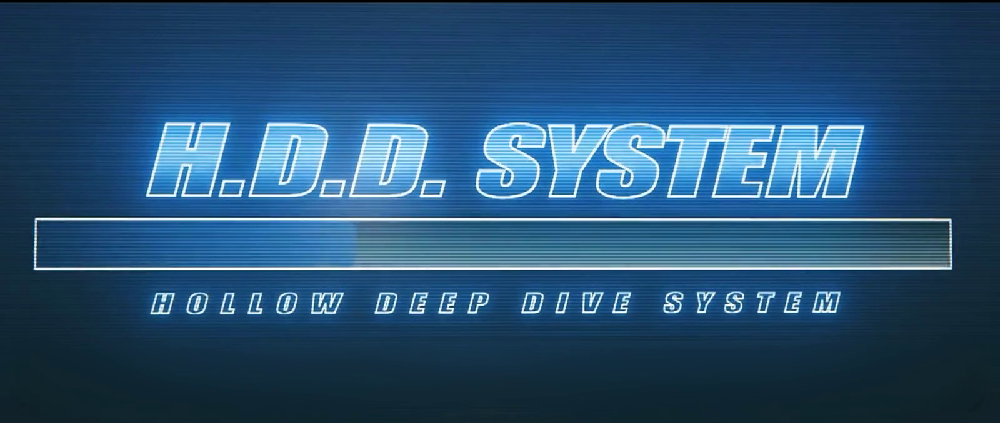
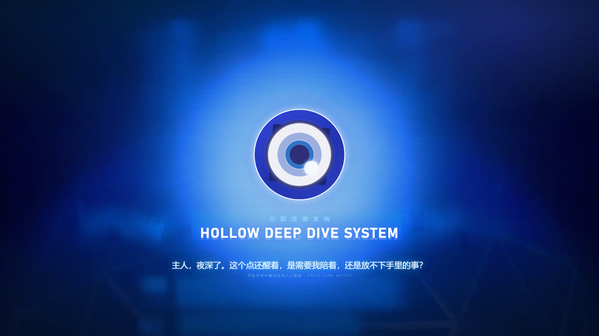
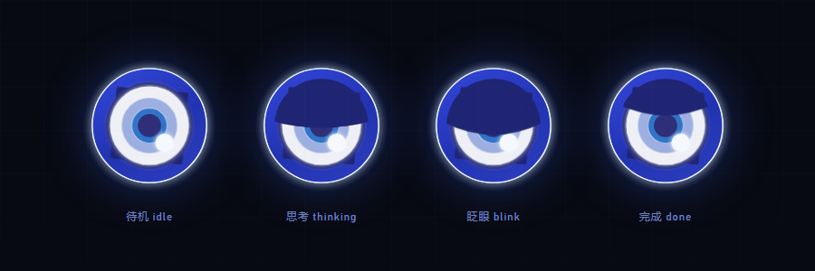

<div align="center">



# Fairy Ⅲ · Zenless Zone Zero H.D.D theme for DeepSeek Harness

Boot animation → greeting → docked eye badge, plus a "Wire-Net Terminal" host skin, an always-on fee readout and optional local voice playback.

[中文](README.md) · [Changelog](docs/CHANGELOG.md) · [Technical notes](docs/TECHNICAL.md) · [Performance report](docs/PERFORMANCE.md)


[](https://www.npmjs.com/package/@sky_wing_dn/dsh-fairy-zzz)


**安装（一行）**

```powershell
dsh plugin --profile desktop add @sky_wing_dn/dsh-fairy-zzz
```

</div>



## What this is

A client plugin for [DeepSeek Harness](https://github.com/deepseek-ai) that turns the DSH Web GUI into Fairy's Hollow Deep Dive System: a boot video, a greeting picked by time of day, an eye badge docked to the sidebar, and a paper-white / ink-black "Wire-Net Terminal" host skin.

It is not a pure theme pack. The plugin ships a small host half too: static asset routes, the TTS queue, and the session-log parsing behind the fee readout.

**Zero runtime dependencies.** The host half only uses Node built-ins; the client half is a single hand-written ESM file with no bundler and no `node_modules`.

**Self-update (since v2.0.0).** The plugin asks npm whether a newer version exists; a small 「可更新 / update available」 pill shows next to the Fairy wordmark in the sidebar, and one click on the confirmation popover installs it — refresh the page or restart DSH when prompted. This only works for copies installed from npm via `dsh plugin --profile <name> add ...`; a `link:` install pointing at a local folder has no registry source and never shows the button (edit the source and refresh the page instead). Failed updates explain the reason (network, unavailable or incompatible version, host refusing to replace a running plugin) and offer a re-check button; versions incompatible with the current DSH are skipped automatically. **2.0.2 fixes the chain itself** — in 2.0.0 / 2.0.1 the check never ran and the install always failed, so a machine on either version needs one manual install of 2.0.2 before the button can update it.

## Credits

This plugin started from [AssassinVIX/fairy-zzz-plugin](https://github.com/AssassinVIX/fairy-zzz-plugin) (MIT, video [BV1d4HK6eE3g](https://www.bilibili.com/video/BV1d4HK6eE3g)). Thanks to the original author for packaging the H.D.D skin, the boot video and the greeting recordings into a plugin that ran out of the box — without that starting point none of the later work would have had anywhere to land.

Since v1.1.0 the rendering, placement, voice and skin paths have largely been rewritten; what still comes straight from upstream is the plugin skeleton, the H.D.D skin concept, the boot video with its audio, and 5 base greeting recordings. The eye glyph artwork and its motion geometry come from [Chengzhibense/Fairy-DSH](https://github.com/Chengzhibense/Fairy-DSH) (Apache-2.0, reference video BV1SD4C63EZz) — thanks there too. Where the rest comes from:

| Part | Origin |
| --- | --- |
| Plugin skeleton, H.D.D skin concept, boot video and its audio, 5 base greeting recordings | AssassinVIX/fairy-zzz-plugin (MIT) |
| Eye glyph artwork, motion geometry and timings | Chengzhibense/Fairy-DSH (Apache-2.0) |
| Performance layer (rAF → CSS timelines, static eyelid, no per-frame filters, asset compression, ETag/304) and the eye runtime (single SVG, 15 fps redraw, dock dragging) | This repo, v1.1 – v1.6 |
| "Wire-Net Terminal" host skin, greeting library, fee readout, letter wall | This repo, v1.4 – v1.7 |
| One-click self-update | This repo, v2.0 |
| `scripts/build-client.mjs` (single-source skin CSS inlining) | This repo, v1.7.1 |

Full third-party license texts live in [licenses/](licenses/); per-item attribution in [NOTICE-fairy-dsh.md](NOTICE-fairy-dsh.md).

> **Status**: a solo hobby project, built with DSH itself and still unfinished. Beyond living on GitHub and npm, it has not been announced anywhere; issues are welcome, but replies come as time allows.

## Screenshots

| Greeting | Eye states |
| --- | --- |
|  |  |

> Screenshots come from an earlier build; details differ slightly from the current skin. The current Wire-Net Terminal look is specified in [docs/UI-DESIGN.md](docs/UI-DESIGN.md) and [docs/skin/](docs/skin/).

## Features

**Boot and greeting**

- Full-screen H.D.D boot video with its original audio. If the browser blocks autoplay with sound, it plays muted and asks for one click to unmute.
- The video is letterboxed with `object-fit: contain`; the leftover area is filled with a blurred frame, so no window ratio produces hard black bars.
- The greeting fades in with the eye glyph and the `HOLLOW DEEP DIVE SYSTEM` title, then plays one of 5 pre-recorded lines for the current slot (night / morning / noon / afternoon / evening / late night), never repeating the previous one.

**Eye badge**

- About 1.9 s after the greeting it flies to the vertical middle of the conversation's left edge and stays there as a status indicator.
- Its state comes from the host's agent registry: `idle` / `thinking` / `working` / `done`; the eyelid stays half-closed while thinking or working, and opens/closes with the breath.
- Eyelid, blade rotation, lens breathing and gaze drift are drawn from a single static SVG by a 15 fps ticker (vector mid-frames, not rotated bitmaps). Halo, pulse rings and ambient light run on CSS `steps()` timelines — no resident `requestAnimationFrame` loop.
- Hold right mouse button to drag, double right-click to reset. Dragging and docking stay inside the conversation area and step aside when a higher `z-index` widget covers the landing spot.
- "Show eye badge" hides the badge; the fee readout stays.

**Wire-Net Terminal skin (since v1.7.0)**

- The host shell redrawn in the Zenless Zone Zero site language: paper white / ink black, fluorescent lime, cut corners, Impact numerals, white pills.
- Dark only for now: the light variant is unfinished, so since v1.7.5 the appearance is pinned to dark and no longer follows the host theme.
- Pure static CSS plus token overrides — no new React components, no new animation layers. Spec: [docs/UI-DESIGN.md](docs/UI-DESIGN.md).
- Since v1.7.5 the `body` paints `assets/zzz-pattern.webp` as a letter wall with corner vignettes; intensity is `--fz3-wall-veil`.
- Since v2.0.4 the title layer (wordmark, section headings, welcome headline, settings nav title, fee dock heading) uses **Anton bundled with the package** (SIL OFL 1.1, `assets/anton/`), so it no longer depends on Impact being installed; body text, chat and code keep their original fonts, and English titles render at Anton's native 400 without synthetic bolding.

**Fee readout**

- Three rows pinned above the sidebar footer: balance, today's spend, and the countdown to the next rate change; the last line spells out the billing windows.
- Data comes from the host's `GET /fairy-zzz/usage`, which incrementally parses session logs: 20 s polling, one extra fetch 2.5 s before a rate switch, local per-second countdown.


**Voice (optional)**

- Greeting lines are pre-recorded mp3s and need no engine.
- Reading replies aloud needs a local GPT-SoVITS with CPU inference. **This repository ships no model weights, reference audio or inference engine.**
- The settings panel can point at an engine directory, start / stop it, preview greetings and test synthesis.
- Since v2.0.4 replies are cleaned into speakable sentences before synthesis: fenced code blocks are skipped, inline code paths / units / numbers are rewritten into Chinese reading, and long replies are read from the first sentence to the last (no total-length or chunk-count cut-off).

## Install

Requires DeepSeek Harness (desktop app or `dsh web`). The plugin only uses host-provided slots and webServer; it never imports `@deepseek-ai/*` directly.

### 1. Install from npm (recommended)

```powershell
dsh plugin --profile desktop add @sky_wing_dn/dsh-fairy-zzz
```

That is the npm route: DSH forwards it to pnpm inside the profile directory, so the package is pulled from `registry.npmjs.org` into `~/.dsh/profiles/<profile>/node_modules` and its name is registered in `dsh.profile.bundles`.

DSH only looks at dependencies inside the profile — **do not** use `npm install` or `npm i -g`, which would land in the current directory or globally where the host never looks.

In the GUI, the "add plugin" box wants the **package name** (`@sky_wing_dn/dsh-fairy-zzz`), a GitHub URL or a local path — pasting the whole `dsh plugin ...` command there fails with "not a package name the registry accepts".

Fully quit and reopen DSH afterwards (tray icon included) — the host half only reloads on restart. After that, skin changes just need a page refresh.

### 2. Install from source

Clone the repo, then in a DSH session:

```text
plugin_manager install_bundle  target=<cloned directory>
```

That runs `pnpm add` against the current profile and appends `@sky_wing_dn/dsh-fairy-zzz` to `dsh.profile.bundles`. The CLI does the same:

```powershell
dsh plugin --profile <profile> add <cloned directory>
```

### 3. Merge into the profile by hand

Copy the `insert` block from `cordis.patch.yml` into your profile's `cordis.patch.yml`:

```yaml
- insert:
    - id: fairy-zzz-skin
      name: '@sky_wing_dn/dsh-fairy-zzz'
```

### 4. Windows one-liner

```powershell
powershell -ExecutionPolicy Bypass -File .\install-windows.ps1
```

`-Uninstall` removes it. The script also switches the DSH theme to dark; the skin is pinned to dark either way, so this only affects the rest of the host UI.

> **Fully restart DSH** (not just refresh) to load the host half. After that, `client.js`-only changes need a page refresh; skin CSS changes go through method 2 plus a refresh.
> `presets/fairy-mode.patch.yml` is an **optional** "Fairy mode" agent preset that depends on several `@deepseek-ai/dsh-*` plugins and is disabled by default.

## Settings (Settings → Fairy)

| Control | Description |
| --- | --- |
| Auto-read replies | Speak the assistant's answer when it finishes; the per-message button still works when off |
| Voice engine | Status light: green = ready, amber = starting, grey = not running |
| Engine directory | Type a path → `Save` (writes `<plugin>/voice-home.txt`), `Test` (validate only), `Clear` (back to auto-detection); the line below shows the active directory and its source |
| Start / Stop engine | Host-managed engine lifecycle |
| Refresh status | Re-probe immediately |
| Preview greeting | Play a random one of the 5 lines for this slot and show its text |
| Replay boot | Run boot → greeting → dock again |
| Test voice / Stop | Synthesize one test line / stop playback |
| Show eye badge | Toggle the badge only |
| Reset badge | Same as double right-click; back to the default position |

## Voice engine (optional)

The skin, boot animation and pre-recorded greetings need no engine; only "read replies aloud" does.

```text
<engine dir>/
  fairy_server.py        # entry point (--port)
  GPT-SoVITS/            # engine
  models/                # Fairy .pth / .ckpt and reference audio
  py311/                 # optional portable Python
```

Lookup order (an explicit choice always wins):

1. `<plugin>/voice-home.txt` — whatever was saved in the settings panel
2. `FAIRY_VOICE_HOME` environment variable
3. a sibling `voice/` directory (portable bundle)
4. the legacy `FAIRY_TTS_DIR` variable

If none exists the skin still works; the settings panel just asks for a directory.

| Variable | Default | Meaning |
| --- | --- | --- |
| `FAIRY_TTS_PORT` | `9800` | Engine port |
| `FAIRY_CACHE_DIR` | `<plugin>/cache` | Synthesized audio and disk cache |

The engine writes `server.log` next to itself. CPU loading takes about 20 s; until then the panel shows "starting".

## HTTP routes

The host half only registers these local routes (prefix `/fairy-zzz`):

| Method | Path | Description |
| --- | --- | --- |
| GET | `/fairy-zzz/assets/<file>` | `boot-opt.mp4` / `poster.jpg` / `hero.webp` / `icon-180.png` / `zzz-pattern.webp` / `voice/greet-*.mp3` (ETag/304, HEAD, Range) |
| GET | `/fairy-zzz/audio/<hash>.wav` | Synthesized audio cache (Range) |
| POST | `/fairy-zzz/tts` | `{ text }` → `{ url, cached, seconds }` |
| GET | `/fairy-zzz/health` | `{ ok, engine, voice, speed, home }` |
| GET | `/fairy-zzz/mood` | `idle` / `thinking` / `working` / `done` (from the host's agent registry) |
| GET/POST | `/fairy-zzz/voice-home` | Read / save / validate the engine directory |
| GET/POST | `/fairy-zzz/engine` | Engine process state; `{ action: "start" }` or `{ action: "stop" }` |
| GET | `/fairy-zzz/usage` | Balance, today's spend, rate countdown |

Static assets carry strong ETags and answer 304; audio under `cache/` is immutable for a year. `/mood`, `/engine`, `/voice-home` and `/usage` are memoized for 300–3000 ms (`?diag=1` bypasses).

## Performance

The original drove its animations from a resident `requestAnimationFrame` loop; this edition moves them to CSS timelines plus a small vector redraw. Same-machine, headless Chrome, 10 s steady state:

| Scenario | Original main thread | This edition |
| --- | --- | --- |
| Sidebar idle | 31.2% | **1.8%** |
| Model thinking | 30.9% | **1.6%** |
| Greeting screen idle | 41.1% | **2.5%** |

- Idle dock GPU: 43.1% → **5.1%** (v1.2.0, after removing two full-screen animation layers); the single-SVG redraw in v1.6.0 measures **1.52%** in an isolated harness.
- First-load download: ~9.0 MB → ~2.9 MB, with ETag/304 revalidation.
- Opening a 21k-character conversation costs the same as without the skin (measured in v1.7.4) — the skin is not the cause of desktop lag.

Method, attribution and rejected experiments: [docs/PERFORMANCE.md](docs/PERFORMANCE.md).

## Repository layout

```text
cordis.patch.yml       # one insert entry (the skin itself)
client.js              # client: skin, boot / greeting / badge, settings panel, voice actions
index.js               # host: static assets, TTS queue and cache, mood, usage parsing, engine supervisor
assets/                # boot-opt.mp4 / poster.jpg / hero.webp / icon-180.png / zzz-pattern.webp / voice/*.mp3 / anton/ (title font + OFL licence)
docs/skin/             # single editable source of the skin CSS (inlined at build time)
docs/                  # TECHNICAL.md / UI-DESIGN.md / PERFORMANCE.md / CHANGELOG.md / research
presets/               # optional "Fairy mode" agent preset
scripts/               # build-client.mjs (inline the skin CSS, idempotent check)
screenshots/           # listing screenshots
licenses/              # third-party license texts
install-windows.ps1    # Windows install / uninstall helper
```

## Development

No `node_modules`, no bundler; `client.js` is a hand-written ESM file.

Edit the skin only in `docs/skin/wire-net-terminal.css`, then inline it:

```bash
node scripts/build-client.mjs          # inline the skin CSS
node scripts/build-client.mjs --check  # verify it is up to date
node --check client.js                 # syntax check
```

The script locates the skin block through two markers and leaves every other hand-written region of `client.js` untouched.

### Publishing

The version number lives in `package.json`, the README badge and `docs/CHANGELOG.md`. To cut a release:

```bash
node scripts/build-client.mjs --check
node --check client.js
npm version patch   # or minor / major; also tags the commit
npm publish --access public
git push --follow-tags
```

Attach the tarball from `npm pack` to the GitHub Release; npm-installed users will see the「可更新」pill on their next visit.

- The official wordmark is an inline SVG with no replaceable text node, and `sidebar.brand.mark/name` is a `single` slot won by the first registrant. The skin can only hide the official wordmark and overlay its own in the same place, so a host DOM change may require selector updates.
- The desktop shell's window title, menus and some sidebar labels belong to the app; the plugin cannot change them.
- Coexisting with other corner-hogging plugins (whale widget, desktop pet) makes the badge step aside along its snap edge; if the other widget covers too much there may be no free spot.
- The voice engine is an optional external dependency; this repository ships no model, engine or reference audio.
- The system "reduce motion" setting is not honored: the plugin always plays the full animation set.

## Troubleshooting

| Symptom | Fix |
| --- | --- |
| Engine stays "not running" | Check the directory contains `fairy_server.py`, `GPT-SoVITS/` and `models/`; read `<engine>/server.log` |
| Saved directory is ignored | The running host predates that route — fully restart DSH |
| Greetings play but replies are silent | Greetings are mp3s and bypass the engine; without an engine only reading aloud fails |
| No badge or wordmark | Make sure the profile patch contains `fairy-zzz-skin`, then refresh the page |
| Badge stays half-closed while idle | The host's agent registry is authoritative; if it persists, restart DSH and inspect `<plugin>/cache/mood.log` |
| Fee readout shows "—" | The host still runs an old `index.js` without `/usage`; restart DSH and refresh. A 0.5–0.6 s first parse is normal |

## Changelog

Milestones: v1.1–v1.6 performance and eye-runtime rewrite; v1.7 Wire-Net Terminal skin, fee readout, boot colour correction; v2.0 one-click self-update; v2.0.3 the fee dock sits above the footer and no longer covers the session list; v2.0.4 bundled Anton title font and speakable-text preprocessing. User-visible changes per release live in [docs/CHANGELOG.md](docs/CHANGELOG.md); implementation notes and trade-offs in [docs/TECHNICAL.md](docs/TECHNICAL.md).

## License

This repository's own code is released under the **MIT** license, see [LICENSE](LICENSE).

Zenless Zone Zero and the Fairy character visuals, including the boot video assets, are © miHoYo / HoYoverse. This project is not affiliated with miHoYo and is intended for personal, non-commercial desktop customization only. It ships **no** GPT-SoVITS model weights, reference audio or inference engine.
