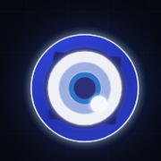
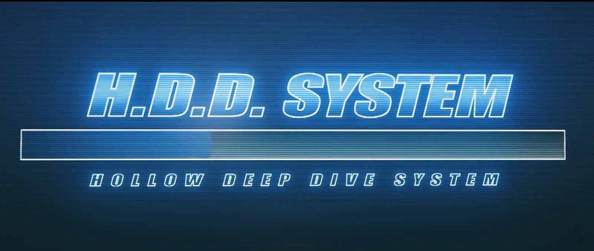
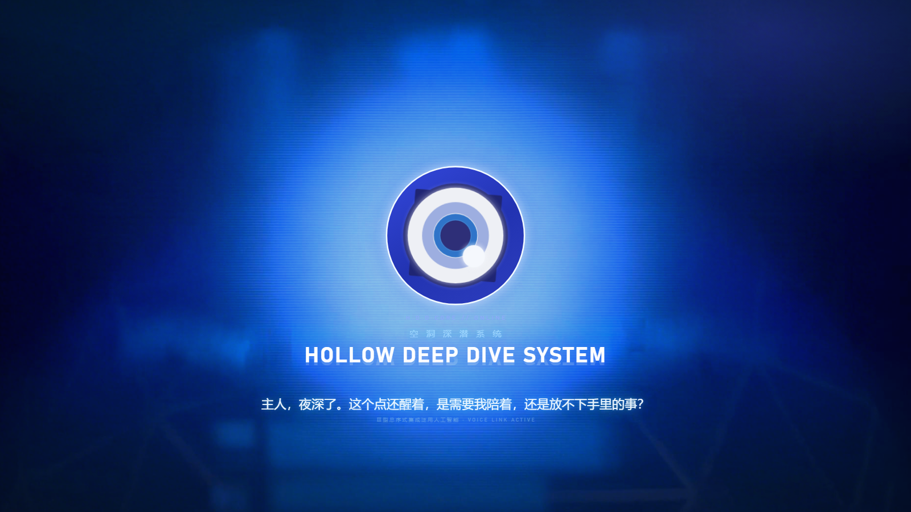
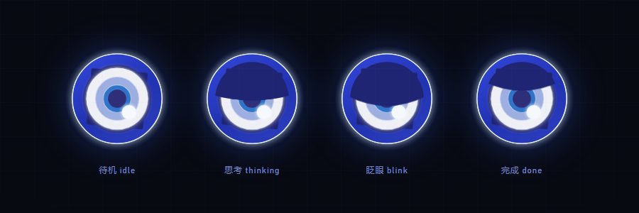

<div align="center">



# Fairy Ⅲ ·《绝区零》H.D.D 主题 for DeepSeek Harness

开机动画 → 居中问好 → 收成眼徽，外加一整套「绳网终端」宿主皮肤、常驻电费读数和可选的本地语音朗读。

[English](README.en.md) · [变更记录](docs/CHANGELOG.md) · [技术说明](docs/TECHNICAL.md) · [性能报告](docs/PERFORMANCE.md)


[](https://www.npmjs.com/package/@sky_wing_dn/dsh-fairy-zzz)


**安装（一行）**

```powershell
dsh plugin --profile desktop add @sky_wing_dn/dsh-fairy-zzz
```

</div>



## 这是什么

一个 [DeepSeek Harness](https://github.com/deepseek-ai) 的客户端插件：把 DSH 的 Web GUI 换成《绝区零》里 Fairy 的「空洞深潜系统（H.D.D）」——启动动画、按时段随机播报的问候、常驻侧栏的眼徽，再加上一套纸白 / 墨黑的「绳网终端」宿主皮肤。

它不是纯主题包，插件还带一小块宿主代码：静态资源路由、语音合成队列、以及电费读数需要的会话日志解析。

**运行时零依赖**：宿主半边只用 Node 内置模块，客户端半边是一份手写 ESM，不经过打包器，也不需要 `node_modules`。

> **项目状态**：一个人自娱自乐写着玩的，功能还不完善。除了把代码放在 GitHub 上、发到 npm 上，没在别的地方提过；用出问题欢迎开 issue，但不保证随叫随到。

## 来源与致谢

这个插件的起点是 [AssassinVIX/fairy-zzz-plugin](https://github.com/AssassinVIX/fairy-zzz-plugin)（MIT 许可，B 站 [BV1d4HK6eE3g](https://www.bilibili.com/video/BV1d4HK6eE3g)）。感谢原作者把 H.D.D 皮肤、开机视频和问候语音整理成一套能直接跑起来的插件——有这个起手式，后面这些改动才有地方落脚。

从 v1.1.0 起，渲染、定位、语音、皮肤几块基本都重写过，今天仍直接沿用上游的是插件骨架、H.D.D 皮肤概念、开机视频与开场音效、5 条基础问候录音。眼徽的美术与动效几何来自 [Chengzhibense/Fairy-DSH](https://github.com/Chengzhibense/Fairy-DSH)（Apache-2.0，参考视频 BV1SD4C63EZz），一并致谢。其余部分的来历：

| 部分 | 来源 |
| --- | --- |
| 插件骨架、H.D.D 皮肤概念、开机视频与开场音效、5 条基础问候录音 | AssassinVIX/fairy-zzz-plugin（MIT） |
| 眼徽 SVG 美术、动效几何与时长参数 | Chengzhibense/Fairy-DSH（Apache-2.0） |
| 性能层（rAF → CSS 时间线、静态眼睑、去掉逐帧滤镜、资源压缩与 ETag/304） | 本仓库 v1.1 – v1.6 |
| 问候语音扩充（每时段 4 条，共 20 条）与语音管线 | 本仓库 v1.4 |
| 眼徽运行时（单 SVG + 15fps 矢量重绘、目光微动、dock 定位与拖拽） | 本仓库 v1.5 – v1.6 |
| 「绳网终端 / WIRE-NET TERMINAL」宿主皮肤 | 本仓库 v1.7.0 |
| 电费读数、画布字墙、眼徽手势与一次性完成动效 | 本仓库 v1.7.5 |
| `scripts/build-client.mjs`（皮肤 CSS 单源内联） | 本仓库 v1.7.1 |

第三方许可全文在 [licenses/](licenses/)，逐项署名见 [NOTICE-fairy-dsh.md](NOTICE-fairy-dsh.md)。

## 截图

| 居中问好 | 眼徽状态 |
| --- | --- |
|  |  |

> 截图采自早期版本，界面细节与当前皮肤略有出入；当前的绳网终端样式见 [docs/UI-DESIGN.md](docs/UI-DESIGN.md) 与 [docs/skin/](docs/skin/)。

## 特性

**开机与问候**

- 整屏播放 H.D.D 启动片（带片源音效）。浏览器若拦截带声音的自动播放，会先静音播放并提示点一次开启声音。
- 视频按 `object-fit: contain` 完整显示，多余区域用同帧模糊铺底，任何窗口比例都不会出现硬黑边。
- 动画结束淡入眼徽与 `HOLLOW DEEP DIVE SYSTEM` 标题，按当前时段（凌晨 / 上午 / 中午 / 下午 / 傍晚 / 深夜）播一句问候：每个时段 5 条预录语音，随机挑选且不连续重复。

**眼徽**

- 问候结束约 1.9s 后飞到会话区左缘中线常驻，光晕淡出，只做状态指示。
- 状态来自宿主 Agent 注册表：`idle` / `thinking` / `working` / `done`，思考与执行期间眼睑半闭。
- 眼睑、叶片公转、眼球呼吸、目光微动由一份静态 SVG + 15fps ticker 重绘（矢量中间帧，不是旋转位图）；光晕、脉冲环、氛围光走 CSS `steps()` 时间线，没有常驻 `requestAnimationFrame` 主循环。
- 右键按住拖动、双击右键复位；拖动与停靠限制在会话内容区内，落点被更高 `z-index` 的挂件挡住时会自动让位。
- 「显示眼徽」可以整体隐藏，电费读数不跟着隐藏。

**绳网终端皮肤（v1.7.0 起）**

- 按《绝区零》官网的语言重绘宿主外壳：纸白 / 墨黑、荧光青柠、斜切块、Impact 编号、白胶囊。
- 目前只做深色一套：浅色版还没弄完，v1.7.5 起暂时固定深色、不跟随宿主主题切换。
- 纯静态 CSS + token 覆盖，无新增 React 组件、无新增动画层。设计规范见 [docs/UI-DESIGN.md](docs/UI-DESIGN.md)。
- v1.7.5 起 `body` 背景铺上 `assets/zzz-pattern.webp` 字墙（`--fz3-wall-veil` 控制浓淡），四角与上下有暗角收边。

**电费读数**

- 侧栏左下角常驻三行读数：电费余额、今日电费、当前倍率倒计时；底部一行写明计费时段（工作日 09–12、14–18 十倍，其余五倍）。
- 数据由宿主 `GET /fairy-zzz/usage` 增量解析会话日志得到：20s 轮询，倍率切换前 2.5s 补拉一次，倒计时本地每秒走字。


**语音（可选）**

- 问候语音是预录 mp3，**不依赖引擎**。
- 把回复念出来需要本地 GPT-SoVITS（CPU 推理）。本仓库**不含**模型权重、参考音频与推理引擎。
- 设置里可指定引擎目录、启动 / 停止、试听问候、测试语音。

## 安装

前置：DeepSeek Harness（桌面版或 `dsh web`）。插件只调用宿主提供的槽位与 webServer，不直接 `import @deepseek-ai/*`。

### 方式一：从 npm 装（推荐）

```powershell
dsh plugin --profile desktop add @sky_wing_dn/dsh-fairy-zzz
```

装完**完全退出并重开 DSH**（托盘图标也要退）——宿主插件要重新加载；之后改皮肤只需刷新页面。

### 方式二：从源码装

先 clone 到本地，然后在 DSH 会话里说一句：

```text
plugin_manager install_bundle  target=<克隆下来的目录>
```

它会把目录 `pnpm add` 进当前 profile 并把 `@sky_wing_dn/dsh-fairy-zzz` 加进 `dsh.profile.bundles`。也可以直接用 CLI：

```powershell
dsh plugin --profile <profile> add <克隆下来的目录>
```

### 方式三：手动并入 profile

把 `cordis.patch.yml` 里的 `insert` 段并进 profile 的 `cordis.patch.yml`：

```yaml
- insert:
    - id: fairy-zzz-skin
      name: '@sky_wing_dn/dsh-fairy-zzz'
```

### 方式四：Windows 一键脚本

```powershell
powershell -ExecutionPolicy Bypass -File .\install-windows.ps1
```

`-Uninstall` 卸载。脚本会顺手把 DSH 主题改成深色；皮肤本身已固定深色，这条只影响宿主其它界面。

> 装完**完全重启 DSH**（不是刷新页面）才会加载宿主半边；之后只改 `client.js` 只需整页刷新，改皮肤 CSS 时改用方式二并刷新。
> `presets/fairy-mode.patch.yml` 是**可选**的「Fairy 模式」agent 预设，依赖较多 `@deepseek-ai/dsh-*` 插件，默认不启用。

## 设置（设置 → Fairy）

| 控件 | 说明 |
| --- | --- |
| 自动朗读回复 | 助手回答完成后自动念出来；关掉也可以单独点消息旁的朗读按钮 |
| 语音引擎 | 引擎状态：绿 = 就绪，黄 = 启动中，灰 = 未运行 |
| 引擎目录 | 输入路径 → `保存`（写入 `<插件目录>/voice-home.txt`）、`检测`（只校验）、`清除`（回到自动探测）；未保存时行内提示当前生效目录与来源 |
| 启动引擎 / 停止引擎 | 由宿主进程托管引擎启停 |
| 刷新状态 | 立即重新探测一次 |
| 试听问候 | 每次点击随机试听本时段 5 条之一，并回显台词 |
| 重播开机动画 | 重新走一遍 开机 → 问好 → 收成眼徽 |
| 测试语音 / 停止 | 合成一句测试语音 / 停止当前播放 |
| 显示眼徽 | 只开关眼标本身 |
| 眼标复位 | 双击右键的等价按钮，把眼徽放回默认位置 |

## 语音引擎（可选）

皮肤、开机动画、预录问候都不需要引擎；只有「把回复念出来」需要。

```text
<引擎目录>/
  fairy_server.py        # 引擎入口（--port 指定端口）
  GPT-SoVITS/            # 引擎本体
  models/                # Fairy 的 .pth / .ckpt 与参考音频
  py311/                 # 可选：便携 Python
```

目录查找顺序（用户指定的永远优先）：

1. `<插件目录>/voice-home.txt` —— 在设置面板里保存的那个目录
2. `FAIRY_VOICE_HOME` 环境变量
3. 插件同级 `voice/`（免安装便携包）
4. 旧版 `FAIRY_TTS_DIR` 环境变量（兼容）

都没找到时皮肤照常工作，设置面板会提示去指定目录。

| 环境变量 | 默认 | 说明 |
| --- | --- | --- |
| `FAIRY_TTS_PORT` | `9800` | 引擎监听端口 |
| `FAIRY_CACHE_DIR` | `<插件目录>/cache` | 合成语音与磁盘缓存位置 |

引擎日志写在引擎目录下的 `server.log`。CPU 加载约 20s，加载完成前设置面板显示「启动中」。

## HTTP 路由

宿主半边只注册这些本地路由（前缀 `/fairy-zzz`）：

| 方法 | 路径 | 说明 |
| --- | --- | --- |
| GET | `/fairy-zzz/assets/<file>` | `boot-opt.mp4` / `poster.jpg` / `hero.webp` / `icon-180.png` / `zzz-pattern.webp` / `voice/greet-*.mp3`（ETag/304、HEAD、Range） |
| GET | `/fairy-zzz/audio/<hash>.wav` | 合成语音缓存（支持 Range） |
| POST | `/fairy-zzz/tts` | `{ text }` → `{ url, cached, seconds }` |
| GET | `/fairy-zzz/health` | `{ ok, engine, voice, speed, home }` |
| GET | `/fairy-zzz/mood` | `idle` / `thinking` / `working` / `done`（以宿主 Agent 注册表为准） |
| GET/POST | `/fairy-zzz/voice-home` | 读取 / 保存 / 校验引擎目录 |
| GET/POST | `/fairy-zzz/engine` | 引擎进程状态；`{ action: "start" }` / `{ action: "stop" }` |
| GET | `/fairy-zzz/usage` | 电费余额 / 今日电费 / 倍率倒计时 |

静态资源带强 ETag 与 304 协商缓存，`cache/` 下的合成音频为一年 immutable；`/mood`、`/engine`、`/voice-home`、`/usage` 有 300–3000ms 记忆化（`?diag=1` 绕过）。

## 性能

原版用常驻 `requestAnimationFrame` 主循环驱动机体动效；本版改为 CSS 时间线 + 小面积矢量重绘。同机 headless Chrome 10 秒稳态实测：

| 场景 | 原版主线程 | 本版主线程 |
| --- | --- | --- |
| 侧栏待机 | 31.2% | **1.8%** |
| 模型思考中 | 30.9% | **1.6%** |
| 问候页待机 | 41.1% | **2.5%** |

- dock 待机 GPU：43.1% → **5.1%**（v1.2.0，干掉两处全屏动画层）；换成单 SVG 向量重绘后隔离 harness 为 **1.52%**（v1.6.0）。
- 首屏运行时下载：约 9.0 MB → 约 2.9 MB，静态资源走 ETag/304 协商缓存。
- 打开 2.1 万字会话的样式耗时与不带皮肤时持平（v1.7.4 实测），皮肤不是桌面端卡顿的根因。

完整数据、归因与失败方案见 [docs/PERFORMANCE.md](docs/PERFORMANCE.md)。

## 目录结构

```text
cordis.patch.yml       # 一行 insert（皮肤本体）
client.js              # 客户端：皮肤、开机 / 问好 / 眼徽、设置面板、语音动作
index.js               # 宿主：静态资源、TTS 队列与缓存、心情、电费解析、引擎托管
assets/                # boot-opt.mp4 / poster.jpg / hero.webp / icon-180.png / zzz-pattern.webp / voice/*.mp3
docs/skin/             # 皮肤 CSS 唯一可编辑源（构建时内联进 client.js）
docs/                  # TECHNICAL.md / UI-DESIGN.md / PERFORMANCE.md / CHANGELOG.md / research
presets/               # 可选的「Fairy 模式」agent 预设
scripts/               # build-client.mjs（皮肤 CSS 内联 + 幂等校验）
screenshots/           # 列表用截图
licenses/              # 第三方许可全文
install-windows.ps1    # Windows 安装 / 卸载脚本
```

## 开发

零 `node_modules`、零打包步骤；`client.js` 是一份手写 ESM。

皮肤样式只改 `docs/skin/wire-net-terminal.css`，然后内联进 `client.js`：

```bash
node scripts/build-client.mjs          # 内联皮肤 CSS
node scripts/build-client.mjs --check  # 只校验是否最新
node --check client.js                 # 语法检查
```

`scripts/build-client.mjs` 用文件里两处标记定位皮肤段（`assets/zzz-pattern.webp` 字墙规则与 `START/END` 注释），手工改动 `client.js` 里的其它区域不会被覆盖。

## 已知限制

- 官方字标是内联 SVG、没有可替换的文本节点，`sidebar.brand.mark/name` 又是宿主先注册者常驻的 `single` 槽位；皮肤只能「隐藏官方字标 + 原位叠自己的字标」，宿主 DOM 一改就要跟着调选择器。
- 桌面壳的窗口标题、菜单、侧栏条目文案属于应用本身，插件改不了。
- 与其它抢占左下 / 右下角落的插件（鲸鱼挂件、桌宠）同开时，眼徽会沿吸附边让位；对方覆盖面积过大仍可能找不到空位。
- 语音引擎是可选外部依赖，本仓库不含模型 / 引擎 / 参考音频。
- 系统「减少动态效果」不降级：插件固定保持完整动效。

## 排错

| 现象 | 处理 |
| --- | --- |
| 设置里引擎一直「未运行」 | 检查目录是否含 `fairy_server.py`、`GPT-SoVITS/`、`models/`；看 `<引擎目录>/server.log` |
| 保存目录后仍显示旧路径 | 旧宿主进程没有该路由，完全重启一次 DSH |
| 回复不朗读但问候能播 | 问候是预录 mp3，不走引擎；引擎没起来时只有朗读会静默失败 |
| 眼徽 / 字标没出现 | 确认 profile patch 里有 `fairy-zzz-skin`，并整页刷新 |
| 空闲时眼徽一直半闭眼 | 以宿主 Agent 注册表为准；若仍出现，完全重启 DSH 并查看 `<插件目录>/cache/mood.log` |
| 电费读数显示「—」 | 宿主还在跑旧版 `index.js`（没有 `/usage` 路由）；完全重启 DSH 后刷新页面。首次冷启动解析日志约 0.5–0.6s 属正常 |

## 变更记录

按版本的用户可见改动见 [docs/CHANGELOG.md](docs/CHANGELOG.md)；实现细节与设计取舍在 [docs/TECHNICAL.md](docs/TECHNICAL.md)。

## 许可

本仓库自己的代码以 **MIT** 发布，见 [LICENSE](LICENSE)。

《绝区零》与 Fairy 的视觉形象、开机视频素材版权归 miHoYo / HoYoverse 所有；本仓库与米哈游无隶属关系，仅供个人非商业的桌面美化使用，请勿用于商业用途或声称官方授权。本仓库**不含** GPT-SoVITS 模型权重、参考音频或推理引擎。
