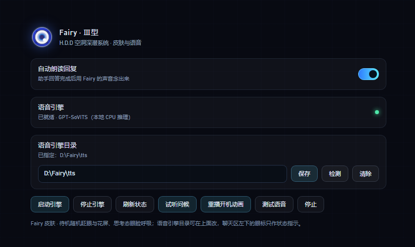
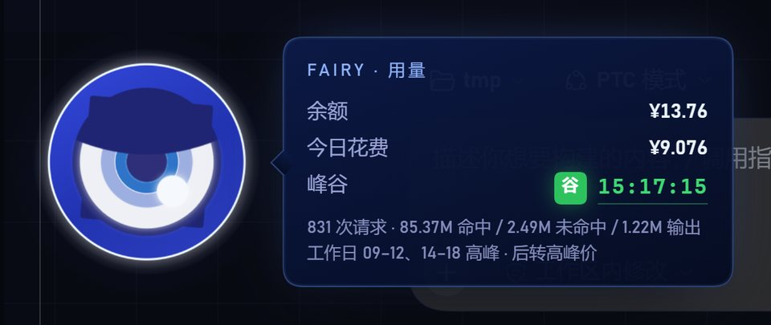
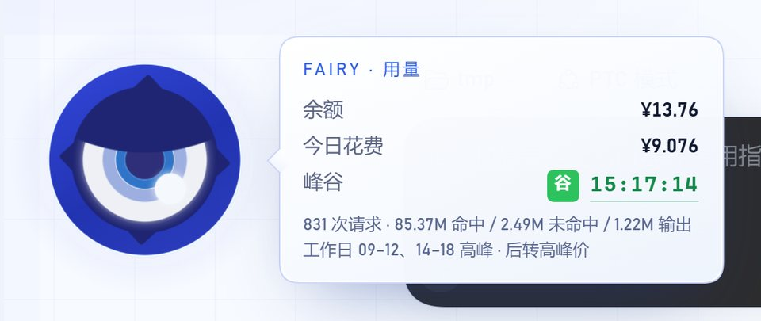
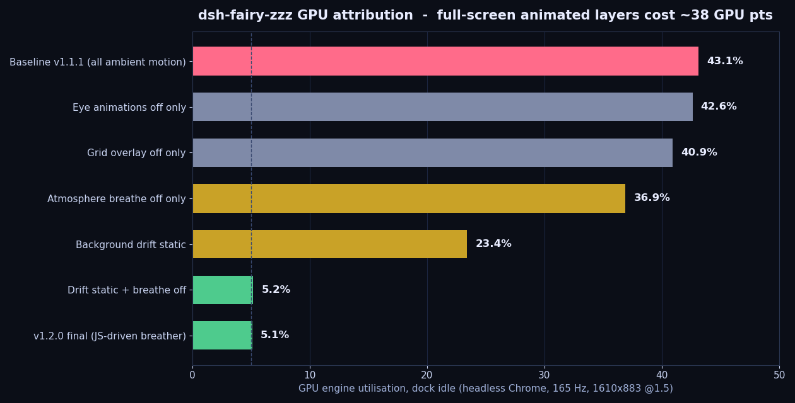
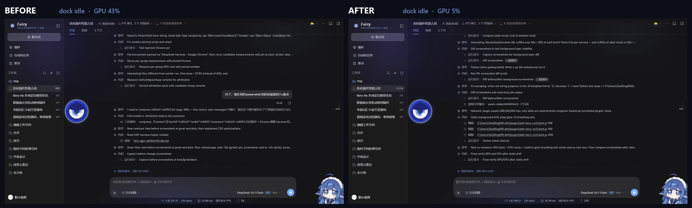

<div align="center">

**⚠️ 第三方修改版（非官方）· 本仓库基于他人作品修改**

</div>

> 本仓库**不是原创项目**，而是在下面这些开源作品的基础上修改而来；除特别声明外，修改部分由 [SkyWingDN](https://github.com/SkyWingDN) 完成。

| 来源项目 / 作者 | 许可 | 本仓库的使用方式 |
| --- | --- | --- |
| [AssassinVIX/fairy-zzz-plugin](https://github.com/AssassinVIX/fairy-zzz-plugin) · AssassinVIX（B 站「黑塔小蛋糕」，[BV1d4HK6eE3g](https://www.bilibili.com/video/BV1d4HK6eE3g/)） | MIT | **原始插件**：代码基础、H.D.D 皮肤概念、开机视频与问候语资源 |
| [Chengzhibense/Fairy-DSH](https://github.com/Chengzhibense/Fairy-DSH) · Chengzhibense（B 站「橙汁本色」，[BV1SD4C63EZz](https://www.bilibili.com/video/BV1SD4C63EZz/)） | Apache-2.0 | 眼标 SVG，以及眼睑 / 呼吸 / 故障动效的几何与时长 |
| 素材：开机视频、Fairy 角色形象 | 版权归 miHoYo / HoYoverse | 仅用于个人桌面改造，**请勿商用或二次分发素材** |

> **本修改版新增的内容**：性能优化（常驻 rAF 归零、全屏动画静态化、资源压缩约 −68%）、v1.3.0 的「电费余额 / 今日电费 / 五倍·十倍电费」气泡、眼徽拖拽与显隐、外观三档、欢迎页文案改写、宿主 `GET /fairy-zzz/usage` 路由，以及一批稳定性 bug 修复；1.3.1 再把拖拽改为 transform-only + 四边吸附、用量改预取（点开即显）、气泡支持点外 / Esc 关闭；1.3.2 把拖拽与吸附范围收进会话内容区；1.3.3 把气泡文案统一成「电费」口径（谷时「五倍电费」、峰时「十倍电费」）。完整署名与许可条款见文末「致谢与许可」、`NOTICE-fairy-dsh.md` 与 `licenses/`。

---

# Fairy Ⅲ · 绝区零 H.D.D 皮肤（性能优化修改版）

**中文** · [English](#english) · **v1.3.3**

> **第三方修改版，非官方。** 本仓库由 [SkyWingDN](https://github.com/SkyWingDN) 基于 [AssassinVIX/fairy-zzz-plugin](https://github.com/AssassinVIX/fairy-zzz-plugin)（MIT）修改：主要工作是**性能优化与资源压缩**（待机主线程开销约 -94%，首屏资源约 -68%，待机 GPU 占用约 -88%），并附带少量必要的行为调整（思考态眼睑由动态呼吸改为静态半闭）。原作者与素材来源见文末「致谢与许可」，性能细节见 [docs/PERFORMANCE.md](docs/PERFORMANCE.md)。本仓库**不包含** GPT-SoVITS 模型或推理引擎。

把 DeepSeek Harness 的 Web 界面换成《绝区零》Fairy 的 H.D.D 终端：满屏开机动画 → 居中问好 → 收成会话区左侧的常驻眼徽，并可用本地 GPT-SoVITS 的 Fairy 音色把回复念出来。1.3.0 起眼徽还是交互入口：点一下看电费余额 / 今日电费与电费倍率倒计时，按住可拖动，设置里可隐藏，外观支持跟随 / 深色 / 浅色。1.3.1 把拖拽改成只写元素自身 `transform`（165 Hz 下不再掉帧）；1.3.2 再把拖拽与吸附限制在会话内容区内（左不越过侧栏、上不越过标题栏），松手吸附到该区域四边（角落两轴同时吸），点气泡外任意位置或按 Esc 即可关闭；1.3.3 把气泡文案统一成「电费」口径。


| 眼徽状态 | 设置面板 |
| --- | --- |
|  |  |

## 特性

- **开机动画**：整屏播放 H.D.D 启动片（**带片源自带的 H.D.D 启动音效**；桌面壳通常直接出声，浏览器若拦截带声音的自动播放，会先静音播放并提示点击一次开启声音），视频按 `object-fit: contain` 完整显示，多余区域由同帧的模糊铺底填充，任何窗口比例都不会出现硬黑边。
- **居中问好**：动画结束后淡入 H.D.D 眼徽（深蓝环 / 白盘 / 蓝瞳 / 高光点），背后是蓝光晕图，`HOLLOW DEEP DIVE SYSTEM` 标题带镜面倒影，下方按当前时段（凌晨/上午/中午/下午/傍晚/深夜）播一句问候并同步播放预录音频。
- **收成眼徽**：问候结束约 1.9s 后眼徽飞到会话区左缘的中线（侧栏右侧的蓝色圈内）常驻，光晕图淡出；眼徽本身是状态指示，点击会弹出电费气泡（见下），按住可拖动。
- **状态动效**（纯 CSS 时间线驱动，无常驻 JS 主循环；几何与时长移植自 Fairy-DSH）：
  - `idle` 四层眼球呼吸（1440ms 主时钟，层间 45/90/180ms 相位差，`cubic-bezier(.72,0,.28,1)`）+ 睫毛 15s 匀速旋转（与参考文档 / Fairy-DSH 实现一致；官方实拍更快，如需可改 `FZ3_LASH_PERIOD_S` 与 CSS 的 `animation-duration`）+ 5 圈睫毛脉冲光环（4s 一轮）+ **静态外圈光晕**（参考实现里光晕不参与呼吸，避免重绘）；
  - 随机「眼闪」：待机每 1.75–3.6s 轻轻亮一下，单次 155–255ms；
  - 任意表情状态下都可能随机出现「信号故障」，参数按参考文档：每 2.3–4.6s 一次，`threads`（feTurbulence 水平拉丝，4 拍、拍间 30–42ms、收尾 34–76ms、位移 17–29px）与 `blocks`（5 条横切片，2 或 4 拍、拍间 56–104ms、收尾 48–96ms、切片位移 1.4–3px）交替，视觉变量 x ±0.9px / skew ±0.24° / brightness 1.02–1.14 / contrast 1.02–1.16；表情切换时播放两段式强转场（2 拍 threads → 28ms → 6 拍，其中前 2 拍 blocks，40ms/拍，最后 28ms 清理，位移/亮度按转场增强档）；故障切片只克隆眼体（不再复制外圈光晕，避免错位重影），切块故障锁定的睫毛角度在故障结束后按当前角度连续接回、不会跳帧；视觉总时长硬上限 900ms 兜底；
  - `thinking/working` 期间**保持半闭**：用 clipPath 裁切整只眼球，眼睑形状固定在原呼吸的「张开」相位（静态半闭，不再随 1440ms 相位开合——这是本次唯一有意简化的动效，原因见 [docs/PERFORMANCE.md](docs/PERFORMANCE.md)）；只有非运行状态才完全睁眼；表情切换瞬间播放两段故障转场；
  - 外圈辉光 / 氛围光 / 眼闪改为**静态多层渐变**（不再使用实时 `drop-shadow` / `blur()` 逐帧重栅格化），大眼阶段稳定接近 60fps；
  - 页面隐藏时自动暂停故障与装饰动画；**系统「减少动态效果」（含 Windows 关闭动画效果）不再降级**——插件固定保持完整动效。
  - **性能**：待机 / 思考时主线程约 1–2.5%（原版约 31–41%），常驻 rAF 归零；页面隐藏时暂停轮询与动画；首屏资源约 2.9 MB（原约 9.0 MB）；GPU 待机约 5%（原版约 43%，同机 165 Hz headless 实测）——真正的开销是两处全屏动画层，已把背景漂移静态化、氛围光呼吸改为 500ms 环境时钟。v1.2.1 清理死代码 / 死样式后 `client.js` 从 109 KB 降到 94 KB（约 −14%，无行为变化）。详见 [docs/PERFORMANCE.md](docs/PERFORMANCE.md)。v1.3.0 的气泡 / 拖拽 / 主题三档都是按需、静态或交互期路径，没有新增常驻动画或定时器；v1.3.1 把拖拽从「每帧改 `:root` 变量」改成「只写元素自身 `transform` + rAF 合并」（24 次 pointermove 合计 146–201ms、零长任务），并给气泡加了用量预取缓存。代码体积 `client.js` 151,180 B / 3,119 行、`index.js` 47,855 B / 1,391 行（零构建、运行期零依赖）。
- **品牌位替换**：隐藏官方 SVG 字标，在原位置叠上 Fairy 眼徽 + 斜体 `Fairy` 字标，位置由量测官方元素得到，随窗口自适应。
- **欢迎页品牌位（1.1.1 新增）**：接管 `conversation.hero.brand.mark` 槽位，把新会话欢迎页「探索未至之境」标题左侧的 DeepSeek 鲸鱼 logo 换成同一个 Fairy 眼标；复用静态 SVG，不增加动画开销，悬停时跟随官方 `fish` 类一起轻微摆动。见 [docs/TECHNICAL.md](docs/TECHNICAL.md)。
- **主题**：深蓝玻璃 + 青蓝霓虹 token、网格与扫描线壁纸、H.D.D 风滚动条与焦点光。
- **语音**：开场问候是预录 mp3（不依赖引擎）；后续回复可自动朗读或点按钮朗读，走本地 GPT-SoVITS（CPU 推理）。**本仓库不含模型与引擎**，需按下方说明自行部署。
- **设置面板**：DSH 的「设置 → Fairy」里集中管理朗读开关、引擎状态、引擎目录、试听/重播/测试、眼徽拖动 / 显隐 / 复位与外观三档。
- **电费气泡（1.3.0 新增，1.3.3 改文案）**：点一下眼徽弹出「电费余额 / 今日电费 / 电费倍率倒计时」气泡（谷时显示「五倍电费」、峰时显示「十倍电费」，每轮回答结束还会自动弹一次本轮结算，18s 自动关）；数据由宿主 `/fairy-zzz/usage` 增量解析会话日志得到；dock 后 700ms 空闲预取，点开即显（实测 65–166ms）；点气泡外任意位置或按 Esc 关闭。
- **拖拽与外观（1.3.0 新增，1.3.1 重写）**：按住眼徽可拖到任意位置（重启后保持），**松手时距会话内容区边缘 64px 内会吸附到四边（角落两轴同时吸）**；拖拽与停靠都被限制在会话内容区里（左边界 = 侧栏右缘、上边界 = 标题栏底缘，右 / 下 = 窗口边缘），不会盖住侧栏或标题栏；拖动只写眼徽自身的 `transform`、用 `requestAnimationFrame` 合并，165 Hz 下无长任务（旧实现每个 `pointermove` 都改 `:root` 变量，整页样式重算）；落点若被 `z-index` 更高的悬浮组件（如 dsh-whale-widget 鲸鱼挂件）盖住，会自动沿吸附边让位；设置里能关闭拖动、隐藏眼徽或复位；外观支持「跟随宿主 / 强制深色 / 强制浅色」三档；欢迎页标题与「预览版」徽章文案也已改写。

| 电费气泡 | 浅色外观 |
| --- | --- |
|  |  |

## 性能（本修改版重点）

原版插件用常驻 `requestAnimationFrame` 主循环逐帧驱动机体动效；本版改为纯 CSS 时间线，并把思考态眼睑的逐帧 SVG 裁切改为静态形状。同机 headless Chrome 10 秒稳态实测：

| 场景 | 原版主线程 | 本版主线程 |
| --- | --- | --- |
| 侧栏待机 | 31.2% | **1.8%** |
| 模型思考中 | 30.9% | **1.6%** |
| 问候页待机 | 41.1% | **2.5%** |

首屏运行时下载从约 9.0 MB 降到约 2.9 MB；静态资源改为 ETag/304 协商缓存，刷新不再重传多 MB。测量方法、取舍与复测思路见 [docs/PERFORMANCE.md](docs/PERFORMANCE.md)。

### GPU 占用（v1.2.0）

用户实测：核显下开着插件 GPU 平均 80–90%，关掉插件约 10%。测量条件：headless Chrome 156 真实加载插件页面，165 Hz 显示器，视口 1610×883 @ dpr 1.5，20 秒采样窗口（丢弃前 2 个样本），同一轮内做相对比较。

| 场景 | 修改前 v1.1.1 | 本版 v1.2.0 |
| --- | --- | --- |
| dock 待机 GPU 引擎平均占用 | 43.1% | **5.1%**（约 −88%） |
| boot 开机阶段 | — | 9.9%（主要是视频解码） |

结论：真正的开销是两处**全屏动画层**（背景 40s 漂移、氛围光 14s 呼吸），不是眼徽本身；小面积动画（128px 眼徽、384px 脉冲环）几乎免费。165 Hz 高刷屏上，任何全屏层只要每帧变化，整个屏幕就要重新合成，代价随刷新率翻倍。




图注：上图为 dock 待机时逐项关闭各层的 GPU 归因；下图为整页截图的前后对比。完整数据、失败方案与复测方法见 [docs/PERFORMANCE.md](docs/PERFORMANCE.md) 第 9 节。

## 安装

需要 DeepSeek Harness（插件只在运行时调用宿主提供的槽位与 webServer，不直接 import `@deepseek-ai/*`）。

> 本仓库是**性能优化修改版**；原始插件与素材来自 [AssassinVIX/fairy-zzz-plugin](https://github.com/AssassinVIX/fairy-zzz-plugin)，只想用原生版本请去上游。

**方式一：让 agent 装（推荐）**

```text
git clone https://github.com/SkyWingDN/dsh-fairy-zzz.git
```

然后在 DSH 会话里：

```text
plugin_manager install_bundle  target=<克隆下来的目录>
```

**方式二：手动合并 patch**

把本仓库根目录 `cordis.patch.yml` 里的 `insert` 段合并进你的 profile patch（Windows 一般是 `%USERPROFILE%\.dsh\profiles\<profile>\cordis.patch.yml`）：

```yaml
- insert:
    - id: fairy-zzz-skin
      name: 'dsh-fairy-zzz'
```

装好后整页刷新一次。皮肤只做「插入一行 + 宿主注册若干本地 HTTP 路由」，不修改宿主的任何文件。

**方式三：Windows 一键脚本**

```powershell
powershell -ExecutionPolicy Bypass -File .\install-windows.ps1            # 装
powershell -ExecutionPolicy Bypass -File .\install-windows.ps1 -Uninstall  # 卸
```

脚本会自己找 profile、把插件放进 `node_modules\dsh-fairy-zzz`、补 patch、把浅色主题改成深色。不放心脚本改文件的话用方式一/二。

> **从旧版升级**：1.0.0 起包名从 `@local/dsh-fairy-zzz` 改成 `dsh-fairy-zzz`（为了能被收录与 npm 安装）。
> 老安装请把 profile patch 里的 `name: '@local/dsh-fairy-zzz'` 改成 `name: 'dsh-fairy-zzz'`，
> 并把插件目录从 `node_modules\@local\dsh-fairy-zzz` 换到 `node_modules\dsh-fairy-zzz`。

> **从 1.1.0 起**本仓库为性能优化修改版（仓库地址改为 SkyWingDN/dsh-fairy-zzz），包名与路由不变；升级时直接覆盖 `client.js`、`index.js`、`assets/` 后重启 DSH 即可。
>
> **1.1.1** 只改 `client.js`（新增欢迎页品牌位，无新资源），从 1.1.0 升级只需覆盖这一个文件并重启 DSH。
> 
> **1.2.0** 只改 `client.js`（GPU：背景漂移静态化 + 氛围光呼吸改为 JS 环境时钟；无新资源）——覆盖 `client.js` 后整页刷新即可。
> 
> **1.2.1** 只改 `client.js` 与 `index.js`（删除死代码与死样式，**无行为变化**；无新资源）——覆盖这两个文件后整页刷新即可；`client.js` 从 109 KB 降到 94 KB（约 −14%）。
> 
> **1.3.0** 改 `client.js`、`index.js` 与 `package.json`（新增用量 / 花费气泡、眼徽拖拽与显隐、外观三档、欢迎页文案，宿主新增 `/usage` 路由；`package.json` 版本号 1.3.0；无新资源，新增两张文档图见 `docs/img/usage-bubble.jpg`、`theme-light.jpg`）——覆盖后**重启 DSH**（host 路由变了）并整页刷新。
> 
> **1.3.1** 只改 `client.js` 与 `package.json`（拖拽重写为 transform-only + 四边吸附 + 遮挡让位、用量预取缓存、气泡点外 / Esc 关闭、设置页删掉「（本地 CPU 推理）」后缀；无新资源）——覆盖 `client.js` 后整页刷新即可。
> 
> **1.3.2** 只改 `client.js` 与 `package.json`（拖拽 / 吸附范围限制在会话内容区，边界在指针按下时实时测量，打开会话导致标题栏变高也会自动适配；无新资源）——覆盖 `client.js` 后整页刷新即可。
> 
> **1.3.3** 改 `client.js`、`index.js` 与 `package.json`（气泡文案统一为「电费」口径：用量→电费、余额→电费余额、今日花费→今日电费、峰谷→五倍电费 / 十倍电费；无新资源）——覆盖后**重启 DSH**（host 的 `peak` 文案变了）并整页刷新；只覆盖 `client.js` 也能看到新文案（客户端会兜底改写旧宿主的「高峰 / 空闲」字样）。


> `presets/fairy-mode.patch.yml` 是**可选**的「Fairy 模式」agent 预设（毒舌 AI 腔、称你为「主人」）。
> 它依赖较多 `@deepseek-ai/dsh-*` 插件，不同 DSH 版本的工具集不一样，所以默认不在 patch 里启用；
> 想用就按文件开头的说明把它追加到 profile patch，并确认列出的插件在你的版本里都存在。

## 设置（设置 → Fairy）

| 控件 | 说明 |
| --- | --- |
| 自动朗读回复 | 助手回答完成后自动念出来；关掉也可以单独点消息旁的朗读按钮 |
| 语音引擎 | 引擎状态灯：绿=就绪，黄=启动中，灰=未运行 |
| 语音引擎目录 | 输入引擎目录 → `保存`（写入 `<插件目录>/voice-home.txt`）、`检测`（只校验不保存）、`清除`（回到自动探测） |
| 启动引擎 / 停止引擎 | 由宿主进程托管引擎的启停 |
| 刷新状态 | 立即重新探测一次 |
| 试听问候 / 重播开机动画 | 重放最新问候音频 / 重新走一遍开机 → 问好 → 收成眼徽 |
| 测试语音 / 停止 | 合成一句测试语音 / 停止当前播放 |
| 拖动眼徽 | 开：按住眼徽可拖到任意位置；关：固定不动 |
| 显示眼徽 | 关掉后隐藏眼徽与气泡（可在此重新打开） |
| 复位位置 | 把眼徽恢复为默认（会话区左缘中线） |
| 外观 | 跟随宿主 / 强制深色 / 强制浅色 |

## 语音引擎（可选）

皮肤、开机动画、预录问候都不需要引擎；只有「把回复念出来」需要。

引擎目录里需要有：

```text
<引擎目录>/
  fairy_server.py        # 引擎入口（--port 指定端口）
  GPT-SoVITS/            # 引擎本体
  models/                # Fairy 的 .pth / .ckpt 与参考音频
  py311/                 # 可选：便携 Python
```

目录的查找顺序（用户指定的永远优先）：

1. `<插件目录>/voice-home.txt` —— 在设置面板里保存的那个目录；
2. `FAIRY_VOICE_HOME` 环境变量；
3. 插件同级 `voice/`（免安装便携包）；
4. 旧版 `FAIRY_TTS_DIR` 环境变量（兼容）。

都没找到时皮肤照常工作，设置面板会提示去指定目录。

> **本仓库不含 GPT-SoVITS 模型、参考音频与推理引擎**——请自行部署；插件只自带预录问候 mp3。

其它环境变量：

| 变量 | 默认 | 说明 |
| --- | --- | --- |
| `FAIRY_TTS_PORT` | `9800` | 引擎监听端口 |
| `FAIRY_CACHE_DIR` | `<插件目录>/cache` | 合成语音与磁盘缓存位置 |

引擎日志写在引擎目录下的 `server.log`。CPU 加载约 20s，加载完成前设置面板显示「启动中」。

## 路由

宿主半边只注册这些只读/本地路由（前缀 `/fairy-zzz`）：

| 方法 | 路径 | 说明 |
| --- | --- | --- |
| GET | `/fairy-zzz/assets/<file>` | `boot-opt.mp4` / `poster.jpg` / `hero.webp` / `icon-180.png` / `voice/greet-*.mp3`（支持 ETag/304、HEAD、Range/If-Range） |
| GET | `/fairy-zzz/audio/<hash>.wav` | 合成语音缓存（支持 Range） |
| POST | `/fairy-zzz/tts` | `{ text }` → `{ url, cached, seconds }`，清 markdown/代码块后截 500 字 |
| GET | `/fairy-zzz/health` | `{ ok, engine, voice, speed, home }` |
| GET | `/fairy-zzz/mood` | `idle` / `thinking` / `working` / `done`（以宿主 `agents` 注册表的权威快照驱动眼徽；加 `?diag=1` 返回诊断） |
| GET | `/fairy-zzz/voice-home` | 当前引擎目录与来源 |
| POST | `/fairy-zzz/voice-home` | 保存 / 校验引擎目录 |
| GET | `/fairy-zzz/engine` | 引擎进程状态 |
| POST | `/fairy-zzz/engine` | `{ action: "start" \| "stop" }` |
| GET | `/fairy-zzz/usage` | `{ ok, now, peak, today, turn }`：电费余额 / 今日电费（北京时区，含五倍·十倍电费计价）/ 电费倍率倒计时；增量解析会话日志，3s 记忆化（`?diag=1` 附诊断） |

静态资源带强 ETag / Last-Modified 与 304 协商缓存，`cache/` 下的合成音频为一年 immutable；`/mood`、`/engine`、`/voice-home`、`/usage` 有 300–3000ms 记忆化（`?diag=1` 绕过）。

## 截图是怎么来的

`screenshots/` 里的图不是外链：开机帧取自 `assets/boot-opt.mp4`，其余是离线渲染（把 `client.js` 里的 CSS 与眼徽 SVG 抽出来，用同一套样式渲染）。仓库里没有运行期依赖，也没有构建产物。

## 已知限制

- 官方字标是内联 SVG，没有可替换的文本节点；`sidebar.brand.mark/name` 又是 `single` 槽位、宿主先注册者常驻，所以皮肤用「隐藏官方字标 + 在同一位置叠自己的字标」来实现，不是真正的槽位替换。官方的 DOM 结构一改就可能要跟着调选择器。
- 桌面壳的窗口标题、菜单、侧栏条目文案属于应用本身，插件改不了。
- 与其它抢占左下/右下角落的插件（鲸鱼挂件、桌宠）同时开时，v1.3.1 起会自动沿吸附边让位到不被遮挡的位置；若对方覆盖面积过大仍可能找不到空位。
- 语音引擎是可选外部依赖，本仓库**不含**模型 / 引擎 / 参考音频，需自行部署（不提供模型下载）。
- 强制浅色会覆盖插件与宿主大部分外壳，但宿主少数内部组件（如输入框）仍沿用自身深色样式。

## 排错

| 现象 | 处理 |
| --- | --- |
| 设置里引擎一直「未运行」 | 检查引擎目录是否含 `fairy_server.py`、`GPT-SoVITS/`、`models/`；看 `<引擎目录>/server.log` |
| 保存目录后仍显示旧路径 | 旧的宿主进程没有 `voice-home` 路由，重启一次 DSH |
| 回复不朗读但问候能播 | 问候是预录 mp3，不走引擎；引擎没起来时只有朗读会静默失败 |
| 眼徽/字标没出现 | 确认 profile patch 里有 `fairy-zzz-skin` 这一行，并整页刷新 |
| 空闲时眼徽一直半闭眼（thinking） | 1.0.18 起以宿主 Agent 注册表为准，没有运行中的 Agent 就是 `idle`；若仍出现，完全重启 DSH 并查看 `<插件目录>/cache/mood.log` |
| 气泡里电费余额 / 电费倍率一直显示「—」 | 宿主还在跑旧版 `index.js`（没有 `/usage` 路由）；完全重启 DSH 后刷新页面。首次冷启动解析会话日志约 0.5–0.6s 属正常。 |

## 目录结构

```text
cordis.patch.yml     # 一行 insert（皮肤本体）
client.js            # 客户端：主题、开机/问好/眼徽、设置面板、语音动作（纯 CSS 动效）
index.js             # 宿主：静态资源（ETag/304/Range）、TTS 队列与缓存、心情、引擎托管
assets/              # boot-opt.mp4 / poster.jpg / hero.webp / icon-180.png / voice/*.mp3
presets/             # 可选的「Fairy 模式」agent 预设
screenshots/         # 列表用截图
docs/                # 原理说明（TECHNICAL.md）、性能报告（PERFORMANCE.md，含第 9 节 GPU 归因与前后对比）
docs/img/            # 文档配图：before-after-dock-eye.png、hero-brand-mark.png、gpu-attribution.png、gpu-before-after-dock.jpg、theme-light.jpg、usage-bubble.jpg
licenses/            # 第三方许可全文（Apache-2.0 / Fairy-DSH NOTICE）
install-windows.ps1  # Windows 安装/卸载脚本
```

## 致谢与许可

- 本仓库（SkyWingDN 的修改部分）以 **MIT** 发布，见 [LICENSE](LICENSE)；原始插件版权归 dsh-fairy-zzz contributors / AssassinVIX（MIT），其署名与素材版权见 [NOTICE-fairy-dsh.md](NOTICE-fairy-dsh.md)。
- 眼徽 SVG、动画几何与时长、眼闪 / 故障参数参考了 [Chengzhibense/Fairy-DSH](https://github.com/Chengzhibense/Fairy-DSH)（Apache-2.0，Copyright 2026 Chengzhibense，commit `d639887a386b0de6fef2e61c97dc268631854591`；见 [NOTICE-fairy-dsh.md](NOTICE-fairy-dsh.md)，Apache-2.0 全文在 [licenses/Apache-2.0.txt](licenses/Apache-2.0.txt)）；对照视频为 BV1SD4C63EZz「可能是全网最还原的Fairy」。
- UI 皮肤创意与原始插件来自 B 站 BV1d4HK6eE3g「我把Fairy接入了DeepseekHarness？」作者 黑塔小蛋糕，及其开源仓库 [AssassinVIX/fairy-zzz-plugin](https://github.com/AssassinVIX/fairy-zzz-plugin)；感谢 @_天才小宇 的教程、橙汁本色与梁子的 Fairy 动画项目。
- 开机视频素材与角色形象版权归 miHoYo / HoYoverse 所有；Fairy 与《绝区零》为米哈游商标。这里只做个人桌面的视觉改造，请勿用于商业用途。
- **语音**：本仓库不含 GPT-SoVITS 模型权重、参考音频或推理引擎，需自行部署（见上文「语音引擎」）。

---

> **Unofficial modified edition.** This repository is maintained by [SkyWingDN](https://github.com/SkyWingDN) and based on [AssassinVIX/fairy-zzz-plugin](https://github.com/AssassinVIX/fairy-zzz-plugin) (MIT). The main work here is **performance optimization and asset compression** (idle main-thread cost about -94%, initial payload about -68%, idle GPU usage about -88%), plus one deliberate motion simplification (the thinking eyelid is a static half-closed shape instead of a per-frame SVG clip animation). See [docs/PERFORMANCE.md](docs/PERFORMANCE.md) for numbers and attribution. **This repository contains no GPT-SoVITS model or inference engine.**

# English

<div align="center">

**⚠️ Third-party modification (unofficial) · this repository is built on other people's work**

</div>

> **This is not an original project.** It is a modified edition of the open-source works below; unless stated otherwise, the modifications were made by [SkyWingDN](https://github.com/SkyWingDN).

| Upstream project / author | License | How this repository uses it |
| --- | --- | --- |
| [AssassinVIX/fairy-zzz-plugin](https://github.com/AssassinVIX/fairy-zzz-plugin) · AssassinVIX (Bilibili: 黑塔小蛋糕, [BV1d4HK6eE3g](https://www.bilibili.com/video/BV1d4HK6eE3g/)) | MIT | **Original plugin**: code base, H.D.D skin concept, boot video and greeting assets |
| [Chengzhibense/Fairy-DSH](https://github.com/Chengzhibense/Fairy-DSH) · Chengzhibense (Bilibili: 橙汁本色, [BV1SD4C63EZz](https://www.bilibili.com/video/BV1SD4C63EZz/)) | Apache-2.0 | Eye-badge SVG and the geometry/timings of the eyelid, breathing and glitch animations |
| Assets: boot video, Fairy character | Copyright miHoYo / HoYoverse | Personal desktop use only — **do not redistribute the assets or use them commercially** |

> **What this edition adds**: performance work (no resident rAF, static full-screen layers, ~68% smaller first-load assets), the 1.3.0 fee bubble (fee balance / today's fee / 5×·10× fee countdown), draggable and hideable eye badge, three appearance modes, rewritten welcome-page copy, the host-side `GET /fairy-zzz/usage` route, and a batch of stability fixes; 1.3.1 then rewrites dragging as transform-only with four-edge snapping, prefetches the usage data (instant bubble), and closes the bubble on any outside click / Esc; 1.3.2 then confines dragging and snapping to the conversation content area (never over the sidebar or header); 1.3.3 relabels the bubble in "utility fee" terms (fee balance / today's fee / 5× off-peak · 10× peak countdown). Full attribution and license terms: "Credits & license" at the end, `NOTICE-fairy-dsh.md` and `licenses/`.


[中文](README.md) · **English** · **v1.3.3**

An **unofficial, performance-optimized edition** of the **Fairy Ⅲ · Zenless Zone Zero H.D.D skin** for DeepSeek Harness.

It turns the DSH web interface into Fairy's H.D.D terminal: a full-screen boot animation, then a centered greeting, then the emblem tucks itself into a permanent eye badge at the left edge of the conversation area — and replies can be read aloud in a local GPT-SoVITS Fairy voice. Since 1.3.0 the badge is also an interaction point: click it for the fee balance / today's fee / fee-multiplier countdown, hold and drag it anywhere, hide it in Settings, and pick follow-host / dark / light appearance. Since 1.3.1 dragging only writes the badge's own `transform` (no dropped frames on a 165 Hz panel), and on release the badge snaps to an edge; since 1.3.2 both dragging and snapping stay inside the conversation content area (never over the sidebar or the header), and the region is re-measured on every pointer-down so a taller header in an open conversation adapts automatically. Click anywhere outside the bubble or press Esc to close it. Since 1.3.3 the bubble is worded as a utility-fee meter: 5× fee off-peak, 10× fee during peak hours.


| Eye badge states | Settings panel |
| --- | --- |
|  |  |

## Features

- **Boot animation** — the H.D.D startup clip fills the screen **with its built-in H.D.D boot sound** (the desktop shell normally plays it right away; if a browser blocks unmuted autoplay it starts muted, shows a short hint, and enables sound on the first click). The video uses `object-fit: contain`, and the leftover area is filled with a blurred copy of the same frame, so no hard black bars appear at any window ratio.
- **Centered greeting** — when the clip ends, the H.D.D eye badge (deep-blue ring / white disc / blue iris / highlight dot) fades in over a blue glow, with a mirrored `HOLLOW DEEP DIVE SYSTEM` title and a time-of-day greeting (small hours / morning / noon / afternoon / evening / late night) played together with a matching pre-recorded audio clip.
- **Badge hand-off** — about 1.9 s after the greeting the badge flies to the middle of the left edge of the conversation area (inside the blue ring next to the sidebar) and stays there while the glow fades out. The badge is a status indicator, but it is also an interaction point: clicking opens the fee bubble (below) and holding + dragging moves it.
- **State animations** (driven by CSS keyframes only — no resident JS loop; geometry and timings ported from Fairy-DSH):
  - `idle` — four-layer eyeball breathing (1440 ms master clock, 45/90/180 ms layer offsets, `cubic-bezier(.72,0,.28,1)`), 15 s lash rotation (matching the reference doc / Fairy-DSH implementation; the official cutscene is faster — adjust `FZ3_LASH_PERIOD_S` and the CSS `animation-duration` together if you prefer), five concentric lash-pulse rings (4 s cycle), and a **static outer halo** (the reference halo does not breathe, which also avoids repaints);
  - random eye flicker every 1.75–3.6 s, 155–255 ms each;
  - **Performance**: ~1–2.5% of one CPU core at idle / thinking (upstream: ~31–41%), zero resident rAF requests; polling and animations pause on hidden pages; initial payload ~2.9 MB (upstream ~9.0 MB); idle GPU ~5% (v1.1.1: ~43% on the same 165 Hz display, headless measurement) — the real cost was two full-screen animated layers, so the background drift is now static and the atmosphere breath runs on a 500 ms JS ambient clock. After the v1.2.1 dead-code cleanup `client.js` is 94 KB instead of 109 KB (about −14%, no behaviour change). Since 1.3.0 the bubble / drag / theme additions are on-demand, static or interaction-time paths with no resident animation or timer; v1.3.1 moved dragging from "rewrite `:root` variables every frame" to "write the badge's own `transform`, coalesced with requestAnimationFrame" (24 pointermove events: 146–201 ms total, zero long tasks) and added a usage prefetch cache for the bubble; `client.js` is now 151,180 B / 3,119 lines and `index.js` 47,855 B / 1,391 lines (zero build, zero runtime dependencies). Details in [docs/PERFORMANCE.md](docs/PERFORMANCE.md).
  - random signal glitches may appear in **any expression state**, using the reference-documented parameters: one every 2.3–4.6 s, alternating `threads` (feTurbulence horizontal tearing, 4 pulses, 30–42 ms gaps, 34–76 ms fade, 17–29 px displacement) and `blocks` (five horizontal slices, 2 or 4 pulses, 56–104 ms gaps, 48–96 ms fade, 1.4–3 px slice offsets); visual vars are x ±0.9 px, skew ±0.24°, brightness 1.02–1.14, contrast 1.02–1.16. Expression changes play a two-burst strong transition glitch (2 threads pulses → 28 ms → 6 pulses, first 2 blocks, 40 ms per pulse, 28 ms cleanup, with the raised transition strength ranges); fault slices clone the eye body only (the outer halo is no longer duplicated, so no offset ghosting), and the lash angle locked during a blocks fault is re-anchored continuously when the fault ends; fault visuals are force-cleared after a 900 ms hard cap;
  - `thinking` / `working` — the eye **stays half-closed** while the agent runs: the reference clip mechanism clips the whole eye group, but the eyelid shape is now static (frozen at the open phase of the old breath animation) instead of breathing on the 1440 ms phase; it opens fully when nothing is running; expression changes play a two-burst glitch transition. This is the only deliberate motion simplification (see [docs/PERFORMANCE.md](docs/PERFORMANCE.md));
  - the outer halo, atmosphere glow and flash are **static layered gradients** instead of live `drop-shadow` / `blur()` (no per-frame re-rasterisation), so the big 330 px stage stays at ~60 fps;
  - faults and decorative motion pause on hidden pages; the plugin deliberately ignores the system "reduce motion" setting (including Windows' animation-effects switch) and always keeps the full motion.
- **Brand slot replacement** — the official SVG wordmark is hidden and the Fairy eye badge plus an italic `Fairy` wordmark are overlaid in the same spot, positioned from measurements of the official element so it stays responsive.
- **Welcome-hero brand mark (new in 1.1.1)** — the plugin takes over the `conversation.hero.brand.mark` slot, so the DeepSeek whale logo left of the “探索未至之境” headline on the new-session welcome page becomes the same Fairy eye badge. It reuses the static SVG (no extra animation cost) and inherits the official `fish` hover wiggle. See [docs/TECHNICAL.md](docs/TECHNICAL.md).
- **Fee bubble (new in 1.3.0, relabelled in 1.3.3)** — click the badge to open a bubble with the fee balance, today's fee (Beijing-time day, 5× off-peak / 10× peak pricing) and a fee-multiplier countdown; after every finished turn the plugin also pops a one-shot "this turn" summary (auto-closes after 18 s). Data comes from the host's `GET /fairy-zzz/usage`, which parses session logs incrementally; it is prefetched 700 ms after docking, so opening the bubble takes 65–166 ms; click anywhere outside the bubble or press Esc to close it.
- **Dragging & appearance (new in 1.3.0, rewritten in 1.3.1)** — hold and drag the badge anywhere (its position persists across restarts); **on release it snaps to the edge of the conversation content area when within 64 px (both axes in a corner)**; the drag area and the snap edges are limited to that region (left = right edge of the sidebar, top = bottom edge of the header, right/bottom = window edges) and re-measured on pointer-down; dragging writes only the badge's own `transform` and coalesces with `requestAnimationFrame` (no long tasks on a 165 Hz panel — the old code rewrote `:root` variables on every `pointermove`, forcing a full-page style recalculation); if the landing spot is covered by a higher-`z-index` floating widget (e.g. the dsh-whale-widget mascot), it slides inward along the snapped edge until visible; Settings can disable dragging, hide the badge or reset its position; appearance supports follow-host / force-dark / force-light; the welcome-page headline and "preview" badge copy were rewritten.

| Fee bubble | Light appearance |
| --- | --- |
|  |  |

## Performance (this edition)

The upstream plugin runs all eye motion from a resident `requestAnimationFrame` loop; this edition replaces it with CSS keyframes and turns the thinking eyelid into a static clipped shape. Headless Chrome, 10 s steady-state window, same machine:

| Scenario | Upstream main thread | This edition |
| --- | --- | --- |
| Sidebar idle | 31.2% | **1.8%** |
| Agent thinking | 30.9% | **1.6%** |
| Greeting screen idle | 41.1% | **2.5%** |

Initial download dropped from ~9.0 MB to ~2.9 MB, and static assets now use ETag/304 revalidation so refreshes no longer re-transfer megabytes. Method, trade-offs and how to re-measure: [docs/PERFORMANCE.md](docs/PERFORMANCE.md).

- **Theme** — deep-blue glass with cyan neon tokens, grid and scanline wallpaper, an H.D.D-style scrollbar and focus glow.
- **Voice** — the opening greeting is a pre-recorded MP3 and needs no engine; later replies can be read aloud automatically or with a per-message button through a local GPT-SoVITS (CPU inference). **This repository ships neither model nor engine**; deploy your own as described below.
- **Settings panel** — DSH's *Settings → Fairy* manages the read-aloud switch, engine status, engine directory, sampling, replay and tests, plus badge drag / visibility / reset and the appearance mode.

### GPU usage (v1.2.0)

On the user's machine: with the plugin on, integrated graphics average 80–90% GPU; with it off, about 10%. Measurement setup: headless Chrome 156 loading the real plugin, 165 Hz display, 1610×883 viewport at dpr 1.5, 20 s sampling window (first 2 samples dropped), relative comparison within the same run.

| Scenario | Before (v1.1.1) | This edition v1.2.0 |
| --- | --- | --- |
| Dock idle, GPU engine average | 43.1% | **5.1%** (about −88%) |
| Boot stage | — | 9.9% (mostly video decoding) |

Takeaway: the real cost was two **full-screen animated layers** — the 40 s background drift and the 14 s atmosphere-glow breath — not the eye badge itself; small animations (the 128 px eye and the 384 px pulse rings) are almost free. On a 165 Hz panel, any full-screen layer that changes every frame forces the whole screen to be re-composited, and the cost scales with the refresh rate.


Caption: the first image attributes GPU cost by switching each layer off while docked; the second is the full-page before/after comparison. Full data, failed approaches and how to re-measure: [docs/PERFORMANCE.md](docs/PERFORMANCE.md), section 9.

### Interaction performance (v1.3.1)

Same machine, headless Chrome, 1602×944 at dpr 1.5, 165 Hz:

| Metric | v1.3.0 | v1.3.1 |
| --- | --- | --- |
| 24 `pointermove` events while dragging | every event rewrote `:root` variables → whole-page style recalculation | **146–201 ms** (rAF-coalesced, no long tasks) |
| Click badge → bubble data | fetched `/usage` + balance on every open (~0.5 s+) | **65–166 ms** (prefetched 700 ms after docking) |
| Release → final position | — | snapped within 60 ms (`transform` tween 170 ms, no 1.35 s glide) |

> This is the **performance-optimized modified edition**. The original plugin and artwork come from [AssassinVIX/fairy-zzz-plugin](https://github.com/AssassinVIX/fairy-zzz-plugin); use the upstream repository if you want the unmodified version.

## Install

Requires DeepSeek Harness. The plugin only uses the host slots and `webServer` passed at runtime; it never imports `@deepseek-ai/*`.

**Option 1 — let an agent install it (recommended)**

```text
git clone https://github.com/SkyWingDN/dsh-fairy-zzz.git
```

then, in a DSH session:

```text
plugin_manager install_bundle  target=<path to the cloned folder>
```

**Option 2 — merge the patch by hand**

Merge the `insert` block from `cordis.patch.yml` into your profile patch (on Windows usually `%USERPROFILE%\.dsh\profiles\<profile>\cordis.patch.yml`):

```yaml
- insert:
    - id: fairy-zzz-skin
      name: 'dsh-fairy-zzz'
```

Reload the whole page once installed. The skin only inserts one line and registers a handful of local HTTP routes on the host; it does not modify any file that ships with DSH.

**Option 3 — Windows one-click script**

```powershell
powershell -ExecutionPolicy Bypass -File .\install-windows.ps1            # install
powershell -ExecutionPolicy Bypass -File .\install-windows.ps1 -Uninstall  # uninstall
```

> **Since 1.1.0** this repository is the performance-optimized edition (now at SkyWingDN/dsh-fairy-zzz). The package name and routes are unchanged; to upgrade, overwrite `client.js`, `index.js` and `assets/`, then restart DSH.
>
> **1.1.1** only touches `client.js` (new welcome-hero brand mark, no new assets), so upgrading from 1.1.0 means replacing that single file and restarting DSH.  
> 
> **1.2.0** only touches `client.js` (GPU: static background drift + JS-driven atmosphere breather; no new assets) — replace `client.js` and reload the page.
> 
> **1.2.1** only touches `client.js` and `index.js` (dead code and dead CSS removed, **no behaviour change**; no new assets) — replace those two files and reload the page. `client.js` drops from 109 KB to 94 KB (about −14%).
> 
> **1.3.0** touches `client.js`, `index.js` and `package.json` (usage / cost bubble, draggable & hideable eye badge, three appearance modes, rewritten welcome copy, new host `/usage` route; version bumped to 1.3.0; no new assets — the two new doc images are `docs/img/usage-bubble.jpg` and `docs/img/theme-light.jpg`) — replace them, **restart DSH** (the host routes changed) and reload the page.
> 
> **1.3.1** only touches `client.js` and `package.json` (dragging rewritten as transform-only with four-edge snapping and occlusion avoidance, usage prefetch cache, outside-click / Esc to close the bubble, the "（本地 CPU 推理）" suffix removed from Settings; no new assets) — replace `client.js` and reload the page.
> 
> **1.3.2** only touches `client.js` and `package.json` (dragging and snapping confined to the conversation content area, with the region re-measured on pointer-down so a taller header in an open conversation adapts; no new assets) — replace `client.js` and reload the page.
> 
> **1.3.3** touches `client.js`, `index.js` and `package.json` (bubble wording unified under "utility fee": usage → fee, balance → fee balance, today's cost → today's fee, peak / off-peak → 5× / 10× fee; no new assets) — replace them, **restart DSH** (the host `peak` strings changed) and reload the page; replacing `client.js` alone already shows the new wording because it remaps the host's old "peak / idle" text.

The script finds your profile, copies the plugin into `node_modules\dsh-fairy-zzz`, adds the patch and switches a light theme to dark. If you would rather not let a script edit files, use option 1 or 2.

> **Upgrading from older versions**: from 1.0.0 the package name changed from `@local/dsh-fairy-zzz` to `dsh-fairy-zzz` (so it can be listed and installed from npm). Change `name: '@local/dsh-fairy-zzz'` to `name: 'dsh-fairy-zzz'` in your profile patch, and move the plugin directory from `node_modules\@local\dsh-fairy-zzz` to `node_modules\dsh-fairy-zzz`.

> `presets/fairy-mode.patch.yml` is an **optional** "Fairy mode" agent preset (snarky AI tone, addresses you as "Master"). It depends on a lot of `@deepseek-ai/dsh-*` plugins whose tool sets differ between DSH versions, so it is not enabled by default; to use it, append it to your profile patch as described at the top of the file and make sure every plugin it lists exists in your version.

## Settings (Settings → Fairy)

| Control | What it does |
| --- | --- |
| Read replies aloud | Speaks each assistant answer when it finishes; with it off you can still use the speaker button next to a message |
| Voice engine | Engine status light: green = ready, yellow = starting, grey = not running |
| Engine directory | Type a directory → `Save` (writes `<plugin dir>/voice-home.txt`), `Detect` (validate without saving), `Clear` (back to auto-detection) |
| Start / Stop engine | Host-managed engine start and stop |
| Refresh status | Re-probe immediately |
| Play greeting / Replay boot | Replay the latest greeting audio / run the boot → greeting → badge sequence again |
| Test voice / Stop | Synthesize a test line / stop current playback |
| Drag badge | On: hold and drag the badge anywhere; Off: it stays fixed |
| Show badge | Hiding removes the badge and its bubble (turn it back on here) |
| Reset position | Restore the badge to the default spot (middle of the conversation's left edge) |
| Appearance | Follow host / Force dark / Force light |

## Voice engine (optional)

The skin, the boot animation and the pre-recorded greeting need no engine — only "read replies aloud" does.

The engine directory must contain:

```text
<engine dir>/
  fairy_server.py        # entry point (--port)
  GPT-SoVITS/            # the engine itself
  models/                # Fairy's .pth / .ckpt and reference audio
  py311/                 # optional: portable Python
```

Lookup order (a user-specified directory always wins):

1. `<plugin dir>/voice-home.txt` — the directory saved in the settings panel;
2. the `FAIRY_VOICE_HOME` environment variable;
3. `voice/` next to the plugin (portable bundle);
4. the legacy `FAIRY_TTS_DIR` environment variable (compatibility).

> **This repository contains no GPT-SoVITS model, reference audio or inference engine** — deploy your own; the only audio shipped is the pre-recorded greeting MP3s.

If none of them is found the skin still works, and the settings panel points you to the directory field.

Other environment variables:

| Variable | Default | Description |
| --- | --- | --- |
| `FAIRY_TTS_PORT` | `9800` | Port the engine listens on |
| `FAIRY_CACHE_DIR` | `<plugin dir>/cache` | Where synthesized audio and the disk cache go |

Engine logs are written to `server.log` in the engine directory. Loading on CPU takes about 20 s; until it finishes the settings panel shows "starting".

## HTTP routes

The host side only registers these read-only/local routes (prefix `/fairy-zzz`):

| Method | Path | Description |
| --- | --- | --- |
| GET | `/fairy-zzz/assets/<file>` | `boot-opt.mp4` / `poster.jpg` / `hero.webp` / `icon-180.png` / `voice/greet-*.mp3` (strong ETag/304, HEAD, Range/If-Range) |
| GET | `/fairy-zzz/audio/<hash>.wav` | Synthesized-audio cache (Range supported) |
| POST | `/fairy-zzz/tts` | `{ text }` → `{ url, cached, seconds }`; strips markdown/code blocks and truncates to 500 characters |
| GET | `/fairy-zzz/health` | `{ ok, engine, voice, speed, home }` |
| GET | `/fairy-zzz/mood` | `idle` / `thinking` / `working` / `done` (drives the badge; reads the host `agents` registry as the authoritative snapshot, add `?diag=1` for diagnostics) |
| GET | `/fairy-zzz/voice-home` | Current engine directory and where it came from |
| POST | `/fairy-zzz/voice-home` | Save / validate the engine directory |
| GET | `/fairy-zzz/engine` | Engine process state |
| POST | `/fairy-zzz/engine` | `{ action: "start" \| "stop" }` |
| GET | `/fairy-zzz/usage` | `{ ok, now, peak, today, turn }`: balance / today's cost (Beijing-time day, peak / off-peak pricing) / peak-hour countdown; incremental session-log parsing, 3 s memo (`?diag=1` for diagnostics) |

Static assets are served with strong ETag / Last-Modified and 304 revalidation; synthesized audio under `cache/` is immutable for one year; `/mood`, `/engine`, `/voice-home` and `/usage` are briefly memoised (300–3000 ms, `?diag=1` bypasses).

## How the screenshots were made

The images in `screenshots/` are not remote links: the boot frame is taken from `assets/boot-opt.mp4`, and the rest are rendered offline by extracting the CSS and the eye-badge SVG from `client.js` and rendering them with the same styles. The repository has no runtime dependencies and no build output.

## Known limitations

- The official wordmark is inline SVG with no replaceable text node, and `sidebar.brand.mark/name` are `single` slots that the first registrant keeps, so the skin hides the official wordmark and overlays its own at the same position instead of doing a real slot replacement. If the official DOM changes, the selectors may need updating.
- The desktop shell's window title, menus and sidebar labels belong to the app itself; a plugin cannot change them.
- Other plugins that claim the bottom-left/right corners (whale widget, desktop pet) may look cluttered when enabled together.
- The voice engine is an optional external dependency; this repository ships **no** weights, engine or reference audio — deploy your own.
- Forced light mode restyles the plugin and most of the host shell, but a few host-internal components (e.g. the composer) keep their own dark styling.

## Troubleshooting

| Symptom | Fix |
| --- | --- |
| The engine stays "not running" in Settings | Check that the engine directory has `fairy_server.py`, `GPT-SoVITS/` and `models/`; read `<engine dir>/server.log` |
| The old path is still shown after saving | The old host process has no `voice-home` route; restart DSH once |
| Replies are not spoken but the greeting plays | The greeting is a pre-recorded MP3 and does not use the engine; with no engine running only read-aloud fails silently |
| No badge or wordmark appears | Check that `fairy-zzz-skin` is in your profile patch and reload the whole page |
| The badge stays half-closed (thinking) while idle | Since 1.0.18 the mood follows the host agent registry, so no running agent means `idle`; if it persists, fully restart DSH and read `<plugin dir>/cache/mood.log` |
| Fee balance / fee multiplier in the bubble stay at "—" | The host is still running the old `index.js` (no `/usage` route); fully restart DSH and reload the page. The first cold parse of the session logs takes ~0.5–0.6 s, which is normal. |

## Repository layout

```text
cordis.patch.yml     # one insert line (the skin itself)
client.js            # client: theme, boot/greeting/badge, settings panel, voice actions (CSS-only motion)
index.js             # host: static assets (ETag/304/Range), TTS queue and cache, mood, engine supervision
assets/              # boot-opt.mp4 / poster.jpg / hero.webp / icon-180.png / voice/*.mp3
presets/             # optional Fairy mode agent preset
screenshots/         # screenshots used above
docs/                # technical guide (TECHNICAL.md), performance report (PERFORMANCE.md, incl. the v1.2.0 GPU section)
docs/img/            # doc images: before-after-dock-eye.png, hero-brand-mark.png, gpu-attribution.png, gpu-before-after-dock.jpg, theme-light.jpg, usage-bubble.jpg
licenses/            # third-party license texts (Apache-2.0 / Fairy-DSH NOTICE)
install-windows.ps1  # Windows install/uninstall script
```

## Credits & license

- The modifications in this repository are released under the **MIT** license (see [LICENSE](LICENSE)); the original plugin copyright belongs to dsh-fairy-zzz contributors / AssassinVIX (MIT), with attribution and asset credits in [NOTICE-fairy-dsh.md](NOTICE-fairy-dsh.md).
- The eye-badge SVG, the animation geometry and timings, the flicker/glitch parameters reference [Chengzhibense/Fairy-DSH](https://github.com/Chengzhibense/Fairy-DSH) (Apache-2.0, Copyright 2026 Chengzhibense, commit `d639887a386b0de6fef2e61c97dc268631854591`; see [NOTICE-fairy-dsh.md](NOTICE-fairy-dsh.md) and [licenses/Apache-2.0.txt](licenses/Apache-2.0.txt)); the comparison video is BV1SD4C63EZz by 橙汁本色.
- The UI concept and the original plugin come from Bilibili video BV1d4HK6eE3g by 黑塔小蛋糕 and the [AssassinVIX/fairy-zzz-plugin](https://github.com/AssassinVIX/fairy-zzz-plugin) repository; thanks to @_天才小宇 for the tutorial and to 橙汁本色 / 梁子 for the Fairy animation project.
- The boot video assets and the character likeness belong to miHoYo / HoYoverse; Fairy and Zenless Zone Zero are miHoYo trademarks. This is a personal desktop visual reskin only — do not use it commercially.
- **Voice**: this repository does not contain GPT-SoVITS weights, reference audio or the inference engine — deploy your own.

---

[↑ 返回中文 / Back to Chinese](README.md)
