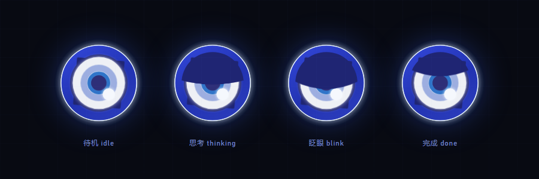

# Fairy Ⅲ · 绝区零 H.D.D 皮肤（性能优化修改版）

**中文** · [English](#english)

> **第三方修改版，非官方。** 本仓库由 [SkyWingDN](https://github.com/SkyWingDN) 基于 [AssassinVIX/fairy-zzz-plugin](https://github.com/AssassinVIX/fairy-zzz-plugin)（MIT）修改：主要工作是**性能优化与资源压缩**（待机主线程开销约 -94%，首屏资源约 -68%），并附带少量必要的行为调整（思考态眼睑由动态呼吸改为静态半闭）。原作者与素材来源见文末「致谢与许可」，性能细节见 [docs/PERFORMANCE.md](docs/PERFORMANCE.md)。本仓库**不包含** GPT-SoVITS 模型或推理引擎。

把 DeepSeek Harness 的 Web 界面换成《绝区零》Fairy 的 H.D.D 终端：满屏开机动画 → 居中问好 → 收成会话区左侧的常驻眼徽，并可用本地 GPT-SoVITS 的 Fairy 音色把回复念出来。


| 眼徽状态 | 设置面板 |
| --- | --- |
|  |  |

## 特性

- **开机动画**：整屏播放 H.D.D 启动片（**带片源自带的 H.D.D 启动音效**；桌面壳通常直接出声，浏览器若拦截带声音的自动播放，会先静音播放并提示点击一次开启声音），视频按 `object-fit: contain` 完整显示，多余区域由同帧的模糊铺底填充，任何窗口比例都不会出现硬黑边。
- **居中问好**：动画结束后淡入 H.D.D 眼徽（深蓝环 / 白盘 / 蓝瞳 / 高光点），背后是蓝光晕图，`HOLLOW DEEP DIVE SYSTEM` 标题带镜面倒影，下方按当前时段（凌晨/上午/中午/下午/傍晚/深夜）播一句问候并同步播放预录音频。
- **收成眼徽**：问候结束约 1.9s 后眼徽飞到会话区左缘的中线（侧栏右侧的蓝色圈内）常驻，光晕图淡出；眼徽本身只是状态指示，点击不再弹面板。
- **状态动效**（纯 CSS 时间线驱动，无常驻 JS 主循环；几何与时长移植自 Fairy-DSH）：
  - `idle` 四层眼球呼吸（1440ms 主时钟，层间 45/90/180ms 相位差，`cubic-bezier(.72,0,.28,1)`）+ 睫毛 15s 匀速旋转（与参考文档 / Fairy-DSH 实现一致；官方实拍更快，如需可改 `FZ3_LASH_PERIOD_S` 与 CSS 的 `animation-duration`）+ 5 圈睫毛脉冲光环（4s 一轮）+ **静态外圈光晕**（参考实现里光晕不参与呼吸，避免重绘）；
  - 随机「眼闪」：待机每 1.75–3.6s 轻轻亮一下，单次 155–255ms；
  - 任意表情状态下都可能随机出现「信号故障」，参数按参考文档：每 2.3–4.6s 一次，`threads`（feTurbulence 水平拉丝，4 拍、拍间 30–42ms、收尾 34–76ms、位移 17–29px）与 `blocks`（5 条横切片，2 或 4 拍、拍间 56–104ms、收尾 48–96ms、切片位移 1.4–3px）交替，视觉变量 x ±0.9px / skew ±0.24° / brightness 1.02–1.14 / contrast 1.02–1.16；表情切换时播放两段式强转场（2 拍 threads → 28ms → 6 拍，其中前 2 拍 blocks，40ms/拍，最后 28ms 清理，位移/亮度按转场增强档）；故障切片只克隆眼体（不再复制外圈光晕，避免错位重影），切块故障锁定的睫毛角度在故障结束后按当前角度连续接回、不会跳帧；视觉总时长硬上限 900ms 兜底；
  - `thinking/working` 期间**保持半闭**：用 clipPath 裁切整只眼球，眼睑形状固定在原呼吸的「张开」相位（静态半闭，不再随 1440ms 相位开合——这是本次唯一有意简化的动效，原因见 [docs/PERFORMANCE.md](docs/PERFORMANCE.md)）；只有非运行状态才完全睁眼；表情切换瞬间播放两段故障转场；
  - 外圈辉光 / 氛围光 / 眼闪改为**静态多层渐变**（不再使用实时 `drop-shadow` / `blur()` 逐帧重栅格化），大眼阶段稳定接近 60fps；
  - 页面隐藏时自动暂停故障与装饰动画；**系统「减少动态效果」（含 Windows 关闭动画效果）不再降级**——插件固定保持完整动效。
  - **性能**：待机 / 思考时主线程约 1–2.5%（原版约 31–41%），常驻 rAF 归零；页面隐藏时暂停轮询与动画；首屏资源约 2.9 MB（原约 9.0 MB）。详见 [docs/PERFORMANCE.md](docs/PERFORMANCE.md)。
- **品牌位替换**：隐藏官方 SVG 字标，在原位置叠上 Fairy 眼徽 + 斜体 `Fairy` 字标，位置由量测官方元素得到，随窗口自适应。
- **欢迎页品牌位（1.1.1 新增）**：接管 `conversation.hero.brand.mark` 槽位，把新会话欢迎页「探索未至之境」标题左侧的 DeepSeek 鲸鱼 logo 换成同一个 Fairy 眼标；复用静态 SVG，不增加动画开销，悬停时跟随官方 `fish` 类一起轻微摆动。见 [docs/TECHNICAL.md](docs/TECHNICAL.md)。
- **主题**：深蓝玻璃 + 青蓝霓虹 token、网格与扫描线壁纸、H.D.D 风滚动条与焦点光。
- **语音**：开场问候是预录 mp3（不依赖引擎）；后续回复可自动朗读或点按钮朗读，走本地 GPT-SoVITS（CPU 推理）。**本仓库不含模型与引擎**，需按下方说明自行部署。
- **设置面板**：DSH 的「设置 → Fairy」里集中管理朗读开关、引擎状态、引擎目录、试听/重播/测试。

## 性能（本修改版重点）

原版插件用常驻 `requestAnimationFrame` 主循环逐帧驱动机体动效；本版改为纯 CSS 时间线，并把思考态眼睑的逐帧 SVG 裁切改为静态形状。同机 headless Chrome 10 秒稳态实测：

| 场景 | 原版主线程 | 本版主线程 |
| --- | --- | --- |
| 侧栏待机 | 31.2% | **1.8%** |
| 模型思考中 | 30.9% | **1.6%** |
| 问候页待机 | 41.1% | **2.5%** |

首屏运行时下载从约 9.0 MB 降到约 2.9 MB；静态资源改为 ETag/304 协商缓存，刷新不再重传多 MB。测量方法、取舍与复测思路见 [docs/PERFORMANCE.md](docs/PERFORMANCE.md)。

## 安装

需要 DeepSeek Harness（插件只在运行时调用宿主提供的槽位与 webServer，不直接 import `@deepseek-ai/*`）。

> 本仓库是**性能优化修改版**；原始插件与素材来自 [AssassinVIX/fairy-zzz-plugin](https://github.com/AssassinVIX/fairy-zzz-plugin)，只想用原生版本请去上游。

**方式一：让 agent 装（推荐）**

```text
git clone https://github.com/SkyWingDN/dsh-fairy-zzz.git
```

然后在 DSH 会话里：

```text
plugin_manager install_bundle  target=<克隆下来的目录>
```

**方式二：手动合并 patch**

把本仓库根目录 `cordis.patch.yml` 里的 `insert` 段合并进你的 profile patch（Windows 一般是 `%USERPROFILE%\.dsh\profiles\<profile>\cordis.patch.yml`）：

```yaml
- insert:
    - id: fairy-zzz-skin
      name: 'dsh-fairy-zzz'
```

装好后整页刷新一次。皮肤只做「插入一行 + 宿主注册两条 HTTP 路由」，不修改宿主的任何文件。

**方式三：Windows 一键脚本**

```powershell
powershell -ExecutionPolicy Bypass -File .\install-windows.ps1            # 装
powershell -ExecutionPolicy Bypass -File .\install-windows.ps1 -Uninstall  # 卸
```

脚本会自己找 profile、把插件放进 `node_modules\dsh-fairy-zzz`、补 patch、把浅色主题改成深色。不放心脚本改文件的话用方式一/二。

> **从旧版升级**：1.0.0 起包名从 `@local/dsh-fairy-zzz` 改成 `dsh-fairy-zzz`（为了能被收录与 npm 安装）。
> 老安装请把 profile patch 里的 `name: '@local/dsh-fairy-zzz'` 改成 `name: 'dsh-fairy-zzz'`，
> 并把插件目录从 `node_modules\@local\dsh-fairy-zzz` 换到 `node_modules\dsh-fairy-zzz`。

> **从 1.1.0 起**本仓库为性能优化修改版（仓库地址改为 SkyWingDN/dsh-fairy-zzz），包名与路由不变；升级时直接覆盖 `client.js`、`index.js`、`assets/` 后重启 DSH 即可。
>
> **1.1.1** 只改 `client.js`（新增欢迎页品牌位，无新资源），从 1.1.0 升级只需覆盖这一个文件并重启 DSH。


> `presets/fairy-mode.patch.yml` 是**可选**的「Fairy 模式」agent 预设（毒舌 AI 腔、称你为「主人」）。
> 它依赖较多 `@deepseek-ai/dsh-*` 插件，不同 DSH 版本的工具集不一样，所以默认不在 patch 里启用；
> 想用就按文件开头的说明把它追加到 profile patch，并确认列出的插件在你的版本里都存在。

## 设置（设置 → Fairy）

| 控件 | 说明 |
| --- | --- |
| 自动朗读回复 | 助手回答完成后自动念出来；关掉也可以单独点消息旁的朗读按钮 |
| 语音引擎 | 引擎状态灯：绿=就绪，黄=启动中，灰=未运行 |
| 语音引擎目录 | 输入引擎目录 → `保存`（写入 `<插件目录>/voice-home.txt`）、`检测`（只校验不保存）、`清除`（回到自动探测） |
| 启动引擎 / 停止引擎 | 由宿主进程托管引擎的启停 |
| 刷新状态 | 立即重新探测一次 |
| 试听问候 / 重播开机动画 | 重放最新问候音频 / 重新走一遍开机 → 问好 → 收成眼徽 |
| 测试语音 / 停止 | 合成一句测试语音 / 停止当前播放 |

## 语音引擎（可选）

皮肤、开机动画、预录问候都不需要引擎；只有「把回复念出来」需要。

引擎目录里需要有：

```text
<引擎目录>/
  fairy_server.py        # 引擎入口（--port 指定端口）
  GPT-SoVITS/            # 引擎本体
  models/                # Fairy 的 .pth / .ckpt 与参考音频
  py311/                 # 可选：便携 Python
```

目录的查找顺序（用户指定的永远优先）：

1. `<插件目录>/voice-home.txt` —— 在设置面板里保存的那个目录；
2. `FAIRY_VOICE_HOME` 环境变量；
3. 插件同级 `voice/`（免安装便携包）；
4. 旧版 `FAIRY_TTS_DIR` 环境变量（兼容）。

都没找到时皮肤照常工作，设置面板会提示去指定目录。

> **本仓库不含 GPT-SoVITS 模型、参考音频与推理引擎**——请自行部署；插件只自带预录问候 mp3。

其它环境变量：

| 变量 | 默认 | 说明 |
| --- | --- | --- |
| `FAIRY_TTS_PORT` | `9800` | 引擎监听端口 |
| `FAIRY_CACHE_DIR` | `<插件目录>/cache` | 合成语音与磁盘缓存位置 |

引擎日志写在引擎目录下的 `server.log`。CPU 加载约 20s，加载完成前设置面板显示「启动中」。

## 路由

宿主半边只注册这些只读/本地路由（前缀 `/fairy-zzz`）：

| 方法 | 路径 | 说明 |
| --- | --- | --- |
| GET | `/fairy-zzz/assets/<file>` | `boot-opt.mp4` / `poster.jpg` / `hero.webp` / `icon-180.png` / `voice/greet-*.mp3`（支持 ETag/304、HEAD、Range/If-Range） |
| GET | `/fairy-zzz/audio/<hash>.wav` | 合成语音缓存（支持 Range） |
| POST | `/fairy-zzz/tts` | `{ text }` → `{ url, cached, seconds }`，清 markdown/代码块后截 500 字 |
| GET | `/fairy-zzz/health` | `{ ok, engine, voice, speed, home }` |
| GET | `/fairy-zzz/mood` | `idle` / `thinking` / `working` / `done`（以宿主 `agents` 注册表的权威快照驱动眼徽；加 `?diag=1` 返回诊断） |
| GET | `/fairy-zzz/voice-home` | 当前引擎目录与来源 |
| POST | `/fairy-zzz/voice-home` | 保存 / 校验引擎目录 |
| GET | `/fairy-zzz/engine` | 引擎进程状态 |
| POST | `/fairy-zzz/engine` | `{ action: "start" \| "stop" }` |

静态资源带强 ETag / Last-Modified 与 304 协商缓存，`cache/` 下的合成音频为一年 immutable；`/mood`、`/engine`、`/voice-home` 有 300–3000ms 记忆化（`?diag=1` 绕过）。

## 截图是怎么来的

`screenshots/` 里的图不是外链：开机帧取自 `assets/boot-opt.mp4`，其余是离线渲染（把 `client.js` 里的 CSS 与眼徽 SVG 抽出来，用同一套样式渲染）。仓库里没有运行期依赖，也没有构建产物。

## 已知限制

- 官方字标是内联 SVG，没有可替换的文本节点；`sidebar.brand.mark/name` 又是 `single` 槽位、宿主先注册者常驻，所以皮肤用「隐藏官方字标 + 在同一位置叠自己的字标」来实现，不是真正的槽位替换。官方的 DOM 结构一改就可能要跟着调选择器。
- 桌面壳的窗口标题、菜单、侧栏条目文案属于应用本身，插件改不了。
- 与其它抢占左下/右下角落的插件（鲸鱼挂件、桌宠）同时开时观感会打架。
- 语音引擎是可选外部依赖，本仓库**不含**模型 / 引擎 / 参考音频，需自行部署（不提供模型下载）。

## 排错

| 现象 | 处理 |
| --- | --- |
| 设置里引擎一直「未运行」 | 检查引擎目录是否含 `fairy_server.py`、`GPT-SoVITS/`、`models/`；看 `<引擎目录>/server.log` |
| 保存目录后仍显示旧路径 | 旧的宿主进程没有 `voice-home` 路由，重启一次 DSH |
| 回复不朗读但问候能播 | 问候是预录 mp3，不走引擎；引擎没起来时只有朗读会静默失败 |
| 眼徽/字标没出现 | 确认 profile patch 里有 `fairy-zzz-skin` 这一行，并整页刷新 |
| 空闲时眼徽一直半闭眼（thinking） | 1.0.18 起以宿主 Agent 注册表为准，没有运行中的 Agent 就是 `idle`；若仍出现，完全重启 DSH 并查看 `<插件目录>/cache/mood.log` |

## 目录结构

```text
cordis.patch.yml     # 一行 insert（皮肤本体）
client.js            # 客户端：主题、开机/问好/眼徽、设置面板、语音动作（纯 CSS 动效）
index.js             # 宿主：静态资源（ETag/304/Range）、TTS 队列与缓存、心情、引擎托管
assets/              # boot-opt.mp4 / poster.jpg / hero.webp / icon-180.png / voice/*.mp3
presets/             # 可选的「Fairy 模式」agent 预设
screenshots/         # 列表用截图
docs/                # 原理说明（TECHNICAL.md）、性能报告与对比图（PERFORMANCE.md）
licenses/            # 第三方许可全文（Apache-2.0 / Fairy-DSH NOTICE）
install-windows.ps1  # Windows 安装/卸载脚本
```

## 致谢与许可

- 本仓库（SkyWingDN 的修改部分）以 **MIT** 发布，见 [LICENSE](LICENSE)；原始插件版权归 dsh-fairy-zzz contributors / AssassinVIX（MIT），其署名与素材版权见 [NOTICE-fairy-dsh.md](NOTICE-fairy-dsh.md)。
- 眼徽 SVG、动画几何与时长、眼闪 / 故障参数参考了 [Chengzhibense/Fairy-DSH](https://github.com/Chengzhibense/Fairy-DSH)（Apache-2.0，Copyright 2026 Chengzhibense，commit `d639887a386b0de6fef2e61c97dc268631854591`；见 [NOTICE-fairy-dsh.md](NOTICE-fairy-dsh.md)，Apache-2.0 全文在 [licenses/Apache-2.0.txt](licenses/Apache-2.0.txt)）；对照视频为 BV1SD4C63EZz「可能是全网最还原的Fairy」。
- UI 皮肤创意与原始插件来自 B 站 BV1d4HK6eE3g「我把Fairy接入了DeepseekHarness？」作者 黑塔小蛋糕，及其开源仓库 [AssassinVIX/fairy-zzz-plugin](https://github.com/AssassinVIX/fairy-zzz-plugin)；感谢 @_天才小宇 的教程、橙汁本色与梁子的 Fairy 动画项目。
- 开机视频素材与角色形象版权归 miHoYo / HoYoverse 所有；Fairy 与《绝区零》为米哈游商标。这里只做个人桌面的视觉改造，请勿用于商业用途。
- **语音**：本仓库不含 GPT-SoVITS 模型权重、参考音频或推理引擎，需自行部署（见上文「语音引擎」）。

---

> **Unofficial modified edition.** This repository is maintained by [SkyWingDN](https://github.com/SkyWingDN) and based on [AssassinVIX/fairy-zzz-plugin](https://github.com/AssassinVIX/fairy-zzz-plugin) (MIT). The main work here is **performance optimization and asset compression** (idle main-thread cost about -94%, initial payload about -68%), plus one deliberate motion simplification (the thinking eyelid is a static half-closed shape instead of a per-frame SVG clip animation). See [docs/PERFORMANCE.md](docs/PERFORMANCE.md) for numbers and attribution. **This repository contains no GPT-SoVITS model or inference engine.**

# English

[中文](README.md) · **English**

An **unofficial, performance-optimized edition** of the **Fairy Ⅲ · Zenless Zone Zero H.D.D skin** for DeepSeek Harness.

It turns the DSH web interface into Fairy's H.D.D terminal: a full-screen boot animation, then a centered greeting, then the emblem tucks itself into a permanent eye badge at the left edge of the conversation area — and replies can be read aloud in a local GPT-SoVITS Fairy voice.


| Eye badge states | Settings panel |
| --- | --- |
|  |  |

## Features

- **Boot animation** — the H.D.D startup clip fills the screen **with its built-in H.D.D boot sound** (the desktop shell normally plays it right away; if a browser blocks unmuted autoplay it starts muted, shows a short hint, and enables sound on the first click). The video uses `object-fit: contain`, and the leftover area is filled with a blurred copy of the same frame, so no hard black bars appear at any window ratio.
- **Centered greeting** — when the clip ends, the H.D.D eye badge (deep-blue ring / white disc / blue iris / highlight dot) fades in over a blue glow, with a mirrored `HOLLOW DEEP DIVE SYSTEM` title and a time-of-day greeting (small hours / morning / noon / afternoon / evening / late night) played together with a matching pre-recorded audio clip.
- **Badge hand-off** — about 1.9 s after the greeting the badge flies to the middle of the left edge of the conversation area (inside the blue ring next to the sidebar) and stays there while the glow fades out. The badge is a status indicator only; clicking it no longer opens a panel.
- **State animations** (driven by CSS keyframes only — no resident JS loop; geometry and timings ported from Fairy-DSH):
  - `idle` — four-layer eyeball breathing (1440 ms master clock, 45/90/180 ms layer offsets, `cubic-bezier(.72,0,.28,1)`), 15 s lash rotation (matching the reference doc / Fairy-DSH implementation; the official cutscene is faster — adjust `FZ3_LASH_PERIOD_S` and the CSS `animation-duration` together if you prefer), five concentric lash-pulse rings (4 s cycle), and a **static outer halo** (the reference halo does not breathe, which also avoids repaints);
  - random eye flicker every 1.75–3.6 s, 155–255 ms each;
  - **Performance**: ~1–2.5% of one CPU core at idle / thinking (upstream: ~31–41%), zero resident rAF requests; polling and animations pause on hidden pages; initial payload ~2.9 MB (upstream ~9.0 MB). Details in [docs/PERFORMANCE.md](docs/PERFORMANCE.md).
  - random signal glitches may appear in **any expression state**, using the reference-documented parameters: one every 2.3–4.6 s, alternating `threads` (feTurbulence horizontal tearing, 4 pulses, 30–42 ms gaps, 34–76 ms fade, 17–29 px displacement) and `blocks` (five horizontal slices, 2 or 4 pulses, 56–104 ms gaps, 48–96 ms fade, 1.4–3 px slice offsets); visual vars are x ±0.9 px, skew ±0.24°, brightness 1.02–1.14, contrast 1.02–1.16. Expression changes play a two-burst strong transition glitch (2 threads pulses → 28 ms → 6 pulses, first 2 blocks, 40 ms per pulse, 28 ms cleanup, with the raised transition strength ranges); fault slices clone the eye body only (the outer halo is no longer duplicated, so no offset ghosting), and the lash angle locked during a blocks fault is re-anchored continuously when the fault ends; fault visuals are force-cleared after a 900 ms hard cap;
  - `thinking` / `working` — the eye **stays half-closed** while the agent runs: the reference clip mechanism clips the whole eye group, but the eyelid shape is now static (frozen at the open phase of the old breath animation) instead of breathing on the 1440 ms phase; it opens fully when nothing is running; expression changes play a two-burst glitch transition. This is the only deliberate motion simplification (see [docs/PERFORMANCE.md](docs/PERFORMANCE.md));
  - the outer halo, atmosphere glow and flash are **static layered gradients** instead of live `drop-shadow` / `blur()` (no per-frame re-rasterisation), so the big 330 px stage stays at ~60 fps;
  - faults and decorative motion pause on hidden pages; the plugin deliberately ignores the system "reduce motion" setting (including Windows' animation-effects switch) and always keeps the full motion.
- **Brand slot replacement** — the official SVG wordmark is hidden and the Fairy eye badge plus an italic `Fairy` wordmark are overlaid in the same spot, positioned from measurements of the official element so it stays responsive.
- **Welcome-hero brand mark (new in 1.1.1)** — the plugin takes over the `conversation.hero.brand.mark` slot, so the DeepSeek whale logo left of the “探索未至之境” headline on the new-session welcome page becomes the same Fairy eye badge. It reuses the static SVG (no extra animation cost) and inherits the official `fish` hover wiggle. See [docs/TECHNICAL.md](docs/TECHNICAL.md).

## Performance (this edition)

The upstream plugin runs all eye motion from a resident `requestAnimationFrame` loop; this edition replaces it with CSS keyframes and turns the thinking eyelid into a static clipped shape. Headless Chrome, 10 s steady-state window, same machine:

| Scenario | Upstream main thread | This edition |
| --- | --- | --- |
| Sidebar idle | 31.2% | **1.8%** |
| Agent thinking | 30.9% | **1.6%** |
| Greeting screen idle | 41.1% | **2.5%** |

Initial download dropped from ~9.0 MB to ~2.9 MB, and static assets now use ETag/304 revalidation so refreshes no longer re-transfer megabytes. Method, trade-offs and how to re-measure: [docs/PERFORMANCE.md](docs/PERFORMANCE.md).

- **Theme** — deep-blue glass with cyan neon tokens, grid and scanline wallpaper, an H.D.D-style scrollbar and focus glow.
- **Voice** — the opening greeting is a pre-recorded MP3 and needs no engine; later replies can be read aloud automatically or with a per-message button through a local GPT-SoVITS (CPU inference). **This repository ships neither model nor engine**; deploy your own as described below.
- **Settings panel** — DSH's *Settings → Fairy* manages the read-aloud switch, engine status, engine directory, sampling, replay and tests.

> This is the **performance-optimized modified edition**. The original plugin and artwork come from [AssassinVIX/fairy-zzz-plugin](https://github.com/AssassinVIX/fairy-zzz-plugin); use the upstream repository if you want the unmodified version.

## Install

Requires DeepSeek Harness. The plugin only uses the host slots and `webServer` passed at runtime; it never imports `@deepseek-ai/*`.

**Option 1 — let an agent install it (recommended)**

```text
git clone https://github.com/SkyWingDN/dsh-fairy-zzz.git
```

then, in a DSH session:

```text
plugin_manager install_bundle  target=<path to the cloned folder>
```

**Option 2 — merge the patch by hand**

Merge the `insert` block from `cordis.patch.yml` into your profile patch (on Windows usually `%USERPROFILE%\.dsh\profiles\<profile>\cordis.patch.yml`):

```yaml
- insert:
    - id: fairy-zzz-skin
      name: 'dsh-fairy-zzz'
```

Reload the whole page once installed. The skin only inserts one line and registers two HTTP routes on the host; it does not modify any file that ships with DSH.

**Option 3 — Windows one-click script**

```powershell
powershell -ExecutionPolicy Bypass -File .\install-windows.ps1            # install
powershell -ExecutionPolicy Bypass -File .\install-windows.ps1 -Uninstall  # uninstall
```

> **Since 1.1.0** this repository is the performance-optimized edition (now at SkyWingDN/dsh-fairy-zzz). The package name and routes are unchanged; to upgrade, overwrite `client.js`, `index.js` and `assets/`, then restart DSH.
>
> **1.1.1** only touches `client.js` (new welcome-hero brand mark, no new assets), so upgrading from 1.1.0 means replacing that single file and restarting DSH.

The script finds your profile, copies the plugin into `node_modules\dsh-fairy-zzz`, adds the patch and switches a light theme to dark. If you would rather not let a script edit files, use option 1 or 2.

> **Upgrading from older versions**: from 1.0.0 the package name changed from `@local/dsh-fairy-zzz` to `dsh-fairy-zzz` (so it can be listed and installed from npm). Change `name: '@local/dsh-fairy-zzz'` to `name: 'dsh-fairy-zzz'` in your profile patch, and move the plugin directory from `node_modules\@local\dsh-fairy-zzz` to `node_modules\dsh-fairy-zzz`.

> `presets/fairy-mode.patch.yml` is an **optional** "Fairy mode" agent preset (snarky AI tone, addresses you as "Master"). It depends on a lot of `@deepseek-ai/dsh-*` plugins whose tool sets differ between DSH versions, so it is not enabled by default; to use it, append it to your profile patch as described at the top of the file and make sure every plugin it lists exists in your version.

## Settings (Settings → Fairy)

| Control | What it does |
| --- | --- |
| Read replies aloud | Speaks each assistant answer when it finishes; with it off you can still use the speaker button next to a message |
| Voice engine | Engine status light: green = ready, yellow = starting, grey = not running |
| Engine directory | Type a directory → `Save` (writes `<plugin dir>/voice-home.txt`), `Detect` (validate without saving), `Clear` (back to auto-detection) |
| Start / Stop engine | Host-managed engine start and stop |
| Refresh status | Re-probe immediately |
| Play greeting / Replay boot | Replay the latest greeting audio / run the boot → greeting → badge sequence again |
| Test voice / Stop | Synthesize a test line / stop current playback |

## Voice engine (optional)

The skin, the boot animation and the pre-recorded greeting need no engine — only "read replies aloud" does.

The engine directory must contain:

```text
<engine dir>/
  fairy_server.py        # entry point (--port)
  GPT-SoVITS/            # the engine itself
  models/                # Fairy's .pth / .ckpt and reference audio
  py311/                 # optional: portable Python
```

Lookup order (a user-specified directory always wins):

1. `<plugin dir>/voice-home.txt` — the directory saved in the settings panel;
2. the `FAIRY_VOICE_HOME` environment variable;
3. `voice/` next to the plugin (portable bundle);
4. the legacy `FAIRY_TTS_DIR` environment variable (compatibility).

> **This repository contains no GPT-SoVITS model, reference audio or inference engine** — deploy your own; the only audio shipped is the pre-recorded greeting MP3s.

If none of them is found the skin still works, and the settings panel points you to the directory field.

Other environment variables:

| Variable | Default | Description |
| --- | --- | --- |
| `FAIRY_TTS_PORT` | `9800` | Port the engine listens on |
| `FAIRY_CACHE_DIR` | `<plugin dir>/cache` | Where synthesized audio and the disk cache go |

Engine logs are written to `server.log` in the engine directory. Loading on CPU takes about 20 s; until it finishes the settings panel shows "starting".

## HTTP routes

The host side only registers these read-only/local routes (prefix `/fairy-zzz`):

| Method | Path | Description |
| --- | --- | --- |
| GET | `/fairy-zzz/assets/<file>` | `boot-opt.mp4` / `poster.jpg` / `hero.webp` / `icon-180.png` / `voice/greet-*.mp3` (strong ETag/304, HEAD, Range/If-Range) |
| GET | `/fairy-zzz/audio/<hash>.wav` | Synthesized-audio cache (Range supported) |
| POST | `/fairy-zzz/tts` | `{ text }` → `{ url, cached, seconds }`; strips markdown/code blocks and truncates to 500 characters |
| GET | `/fairy-zzz/health` | `{ ok, engine, voice, speed, home }` |
| GET | `/fairy-zzz/mood` | `idle` / `thinking` / `working` / `done` (drives the badge; reads the host `agents` registry as the authoritative snapshot, add `?diag=1` for diagnostics) |
| GET | `/fairy-zzz/voice-home` | Current engine directory and where it came from |
| POST | `/fairy-zzz/voice-home` | Save / validate the engine directory |
| GET | `/fairy-zzz/engine` | Engine process state |
| POST | `/fairy-zzz/engine` | `{ action: "start" \| "stop" }` |

Static assets are served with strong ETag / Last-Modified and 304 revalidation; synthesized audio under `cache/` is immutable for one year; `/mood`, `/engine` and `/voice-home` are briefly memoised (300–3000 ms, `?diag=1` bypasses).

## How the screenshots were made

The images in `screenshots/` are not remote links: the boot frame is taken from `assets/boot-opt.mp4`, and the rest are rendered offline by extracting the CSS and the eye-badge SVG from `client.js` and rendering them with the same styles. The repository has no runtime dependencies and no build output.

## Known limitations

- The official wordmark is inline SVG with no replaceable text node, and `sidebar.brand.mark/name` are `single` slots that the first registrant keeps, so the skin hides the official wordmark and overlays its own at the same position instead of doing a real slot replacement. If the official DOM changes, the selectors may need updating.
- The desktop shell's window title, menus and sidebar labels belong to the app itself; a plugin cannot change them.
- Other plugins that claim the bottom-left/right corners (whale widget, desktop pet) may look cluttered when enabled together.
- The voice engine is an optional external dependency; this repository ships **no** weights, engine or reference audio — deploy your own.

## Troubleshooting

| Symptom | Fix |
| --- | --- |
| The engine stays "not running" in Settings | Check that the engine directory has `fairy_server.py`, `GPT-SoVITS/` and `models/`; read `<engine dir>/server.log` |
| The old path is still shown after saving | The old host process has no `voice-home` route; restart DSH once |
| Replies are not spoken but the greeting plays | The greeting is a pre-recorded MP3 and does not use the engine; with no engine running only read-aloud fails silently |
| No badge or wordmark appears | Check that `fairy-zzz-skin` is in your profile patch and reload the whole page |
| The badge stays half-closed (thinking) while idle | Since 1.0.18 the mood follows the host agent registry, so no running agent means `idle`; if it persists, fully restart DSH and read `<plugin dir>/cache/mood.log` |

## Repository layout

```text
cordis.patch.yml     # one insert line (the skin itself)
client.js            # client: theme, boot/greeting/badge, settings panel, voice actions (CSS-only motion)
index.js             # host: static assets (ETag/304/Range), TTS queue and cache, mood, engine supervision
assets/              # boot-opt.mp4 / poster.jpg / hero.webp / icon-180.png / voice/*.mp3
presets/             # optional Fairy mode agent preset
screenshots/         # screenshots used above
docs/                # technical guide (TECHNICAL.md), performance report and comparison image
licenses/            # third-party license texts (Apache-2.0 / Fairy-DSH NOTICE)
install-windows.ps1  # Windows install/uninstall script
```

## Credits & license

- The modifications in this repository are released under the **MIT** license (see [LICENSE](LICENSE)); the original plugin copyright belongs to dsh-fairy-zzz contributors / AssassinVIX (MIT), with attribution and asset credits in [NOTICE-fairy-dsh.md](NOTICE-fairy-dsh.md).
- The eye-badge SVG, the animation geometry and timings, the flicker/glitch parameters reference [Chengzhibense/Fairy-DSH](https://github.com/Chengzhibense/Fairy-DSH) (Apache-2.0, Copyright 2026 Chengzhibense, commit `d639887a386b0de6fef2e61c97dc268631854591`; see [NOTICE-fairy-dsh.md](NOTICE-fairy-dsh.md) and [licenses/Apache-2.0.txt](licenses/Apache-2.0.txt)); the comparison video is BV1SD4C63EZz by 橙汁本色.
- The UI concept and the original plugin come from Bilibili video BV1d4HK6eE3g by 黑塔小蛋糕 and the [AssassinVIX/fairy-zzz-plugin](https://github.com/AssassinVIX/fairy-zzz-plugin) repository; thanks to @_天才小宇 for the tutorial and to 橙汁本色 / 梁子 for the Fairy animation project.
- The boot video assets and the character likeness belong to miHoYo / HoYoverse; Fairy and Zenless Zone Zero are miHoYo trademarks. This is a personal desktop visual reskin only — do not use it commercially.
- **Voice**: this repository does not contain GPT-SoVITS weights, reference audio or the inference engine — deploy your own.

---

[↑ 返回中文 / Back to Chinese](README.md)
