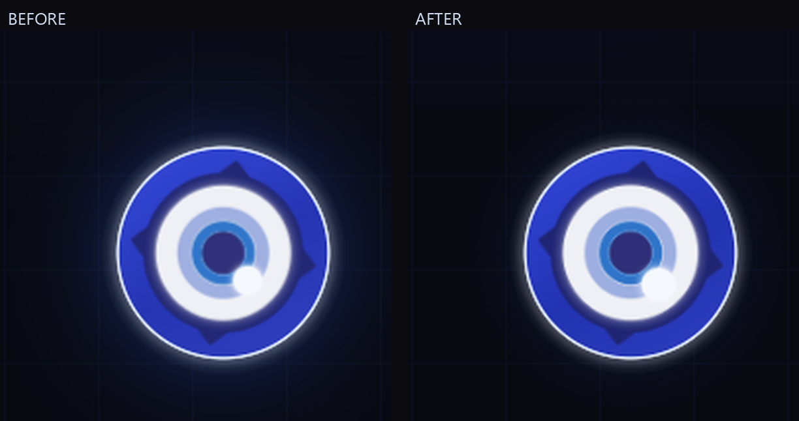

# 性能优化报告 / Performance notes

This page records why and how the **performance-optimized edition** of
dsh-fairy-zzz differs from the upstream plugin, plus the measurements used to
validate the result. 中文在前，English summary at the end.

## 1. 背景与目标

上游 `fairy-zzz-plugin` 的眼徽动效由一个**常驻 `requestAnimationFrame` 主循环**逐帧驱动：
四层眼球呼吸、睫毛旋转、脉冲环、SVG 裁切眼睑、故障克隆同步等全部在 JS 里每帧计算，
并逐帧写 `style.transform` / SVG `clipPath`。由此带来：

- 待机与思考时主线程持续忙碌（约 31–41% 的一个 CPU 核），风扇与耗电明显；
- 启动页同时解码两路 `boot.mp4` 并铺全屏 `blur(46px)`；
- 常驻 `blur(34px)` / `blur(20px)` / `drop-shadow` 每帧重栅格化；
- 多 MB 资源以 `no-cache` 下发，每次刷新重传。

目标：**在不牺牲 Fairy 观感的前提下把资源占用压到接近空闲**，并保留全部动效语义。

## 2. 测量方法

测量条件：headless Chrome 156，视口 1600×1000、dpr 1，**10 秒稳态窗口**，
同一台机器、同一套静态 harness（harness 直接从 `client.js` 抽取 CSS / SVG / 运行时，
页面结构与 `FairySkin` 一致），改动前后使用完全相同的参数。

「主线程 %core」= 浏览器主线程任务占一个 CPU 核的百分比。headless 以约 160fps 出帧，
真实 60fps 下绝对数字更低，但**前后比例**可信。

harness 与测量脚本属于一次性验证工具，**未随仓库发布**；复测方法见第 8 节。

## 3. 前后对比

| 场景 | 优化前 主线程 | 优化后 主线程 | 降幅 |
| --- | --- | --- | --- |
| 侧栏待机（dock idle） | 31.2% | **1.8%**（复测 1.0%） | -94% |
| 模型思考中（thinking） | 30.9% | **1.6%** | -95% |
| 问候页待机（greet） | 41.1% | **2.5%** | -94% |
| 启动动画（boot） | 0.4% | 0.4% | 持平（本来就很低） |

同一窗口的其它指标（dock idle）：

| 指标 | 优化前 | 优化后 | 说明 |
| --- | --- | --- | --- |
| Script（JS 执行） | 2.0% core | 0.1% core | 常驻 rAF 循环已删除（rAF 请求 158 次/秒 → **0 次/秒**） |
| Recalc Style | 8.9% core | 0.6% core | 不再每帧改 SVG 裁切 / transform |
| Layout | 1.3% core | 0.1% core | dock 定位不再周期性全量测量 |
| Chrome 进程树 CPU | 201.6% | 86.9% | 含合成器 / GPU，噪声较大，趋势可信 |
| 长任务（>50ms） | 0 | 0 | 两者都没有卡顿 |
| DOM 元素数 | 496 | 496 | 无增加 |
| 首屏下载资源 | ≈9.0 MB | **≈2.9 MB** | -68% |
| 静态资源缓存 | 每次 no-cache 重下 | **ETag / 304 协商缓存**，音频 immutable | 刷新不再重传几 MB |

## 4. 关键发现：真正的元凶是「SVG 裁切形状动画」

优化过程中一度出现「JS 全删了、rAF 归零了，但主线程仍占 23%」：脚本时间 0.1%，
样式重算却有 6%。逐项关动画做二分定位后发现：

- 眼睑（半闭眼）的「呼吸」动画作用在 `<clipPath>` 里的形状上；
- 形状每帧变化 → Chrome 每帧都要重新解析 SVG 裁切、重绘整棵眼睛子树
  （**只能走主线程，上不了合成器**）；
- 待机时该裁切根本不可见，动画却在空转，于是每秒 60 次白算；
- 降帧无效（`steps(8/12/24)` 实测 34.6% / 29.7% / 30.9%，与连续动画 31.8% 同一量级），
  只有 `animation: none` 才降到 1.3%；
- 最终方案：**删掉这条动画，把眼睑形状固定在原呼吸的「张开」相位**。眼球四层自身的
  缩放呼吸、睫毛旋转、脉冲环、眼闪全部保留（它们跑在合成器上，经探针验证零主线程成本），
  所以眼睛依然「活」着，只是思考时不再持续做半闭眼开合的动作。

## 5. 改动清单

### client.js（前端动效与组件）

1. 删除常驻 `requestAnimationFrame` 主循环：四层眼球呼吸、睫毛 15s 旋转、4s 脉冲环、
   眼闪改为纯 CSS `@keyframes` 驱动；花屏 / 故障 / 表情切换仍由离散定时器触发，
   事件之间主线程完全静默。
2. 删除每帧 SVG 写 transform、12 步二分缓动、5 份眼睛克隆的逐帧同步
   （克隆只在花屏时 `display:block`）。
3. 眼睑半闭眼形状改为静态（详见第 4 节）。
4. 启动动画：两路 `boot.mp4` 同时解码改为单路 `boot-opt.mp4`；去掉全屏 `blur(46px)` 铺底；
   进度条直接写 DOM（不再每帧 `setState` 触发 React 重渲染）。
5. 去掉多道常驻模糊 / 滤镜：氛围光 `blur(34px)`、闪光 `blur(20px)`、眼周光晕 `blur(20px)`、
   眼睛 `drop-shadow` 全部改成静态多层渐变（不再每帧重栅格化）。
6. 轮询感知页面可见性：mood 900ms、health 5s 轮询在页面隐藏时暂停、可见时恢复，
   并做 in-flight 去重（避免请求堆叠）。
7. dock（侧栏）定位：缓存容器、合并 resize 定时器，不再每 600ms 遍历全部
   `div/main/section` 做 `getBoundingClientRect`（强制布局）。
8. `React.memo` 包裹眼睛 / 氛围层，减少父组件重渲染波及；淡出结束后的图层加
   `visibility:hidden`，彻底停止绘制。
9. 清理重复的 `body::after` 死规则等。

### index.js（host 路由）

1. 静态资源：强 ETag（size-mtime）、`Last-Modified`、`If-None-Match` / `If-Modified-Since`
   → 304 空 body；HEAD；Range / 206 + If-Range（视频拖动 / 音频 seek 正常）；
   `cache/` 下 sha1 命名的音频改为一年 immutable。
2. 高频接口记忆化：`/mood` 300ms、`/engine` 1500ms、`/voice-home` 3000ms，带 in-flight 去重；
   `?diag=1` 绕过缓存；start / stop / TTS 成功后主动清缓存。
3. 路由集合与行为不变（30/30 端点断言全部通过）。

### 媒体资产

| 文件 | 前 | 后 | 降幅 |
| --- | --- | --- | --- |
| boot.mp4 → boot-opt.mp4 | 4,814,589 B | 2,394,692 B | -50.3%（1280×720 crf27，PSNR 38/36/34 dB） |
| hero.png → hero.webp | 1,943,569 B | 23,014 B | -98.8%（1600×1017 q82，PSNR 42.4 dB） |
| greet 问候语音 wav → mp3 | 1,653,980 B | 420,129 B | -74.6%（时长不变） |
| **运行时实际下载合计** | **≈9.0 MB** | **≈2.9 MB** | **-68%** |

旧文件（boot.mp4 / hero.png / voice/*.wav）在本仓库中已删除，如需回滚请从上游
`AssassinVIX/fairy-zzz-plugin` 取。

## 6. 观感验证

用「冻结动画相位」的方式对改动前后截图做逐像素对比（同页面、同视口、同参数）：

- 启动画面：**逐像素完全一致**（mean / max 差异均为 0）；
- 待机 / 问候：整图平均差异 0.23–1.49 / 255，差异超过 16 灰阶的像素不到 1%，
  文字 / 布局 / 形状未变；
- 眼睛区域是唯一的可见差异区（mean 8–11 / 255，面积约 128×128 px）：约 1/3 来自
  外圈辉光由实时 `drop-shadow` 换成静态多层渐变的正常差异（外圈 15.4→11.0，
  眼球内部差异仅 2.1，基本不可见），约 2/3 是冻结相位 / 光栅化造成的边缘细环伪影
  （无整体缩放或位移）。

结论：**观感保持**。呼吸、睫毛旋转、脉冲环、眼闪、花屏故障、思考半闭眼等动效全部保留；
唯一变化是思考态半闭眼不再持续开合（见第 7 节取舍）。

## 7. 如何生效 / 注意事项

1. **完全退出并重启 DeepSeek Harness 桌面应用**（host 端 `index.js` 的路由改动只有重启
   才生效）。
2. 重启后**整页刷新一次**（Ctrl+Shift+R）加载新的 `client.js`。
3. 验证：DevTools → Network 里 `hero.webp` / `boot-opt.mp4` 应出现 304 或 from cache；
   任务管理器里该插件的 CPU 占用应明显下降。
4. 回滚：用上游原版 `client.js`、`index.js` 覆盖回插件目录即可（本仓库不含旧资产）。

注意：

- 上面的百分比是 headless（约 160fps 出帧）口径，会放大主线程占比；真实 60fps 下
  绝对值更低，但逐帧工作量的比例差异方向可靠。
- GPU / 合成器相关指标（进程树 CPU）噪声较大，同配置重复测量可差 ±10 个百分点；
  `Task%` / `Script%` / `Recalc%` 更稳定。
- **代价 / 取舍**：思考态的半闭眼不再做持续开合呼吸（静态半闭眼）。这是本次唯一
  有意做的动效简化，也是拿掉约 27% 一个核的必要条件；想恢复的话，成本约为每秒 60 次
  整棵眼睛子树的裁切重算。

## 8. 复现方法

本次的对比 harness 与测量脚本是一次性验证工具，未随仓库发布。复测思路：

1. 从任意版本的 `client.js` 中用标记 `/* FZ3_RUNTIME_BEGIN */ … /* FZ3_RUNTIME_END */`
   抽取运行时，并连同页面里的 CSS / SVG 拼成一个静态 HTML harness；
2. 用 headless Chrome + DevTools Protocol 的 `Performance.getMetrics` 记录 10 秒稳态窗口，
   分别统计 `TaskDuration`、`ScriptDuration`、`RecalcStyleDuration`、`LayoutDuration`；
3. 用同样的参数跑两份 `client.js`（上游 / 本版），对比绝对值和比例即可。

---

## English summary

The upstream plugin drives all eye motion from a resident `requestAnimationFrame`
loop: every frame it recomputes transforms, SVG `clipPath` geometry and glitch
clones. On the measured machine that kept the main thread at ~31–41% of one CPU
core while merely idling or thinking, decoded two boot videos at once, kept several
`blur()` / `drop-shadow` filters live, and served multi-MB assets with `no-cache`.

This edition:

- replaces the JS animation loop with CSS keyframes (0 rAF requests per second at
  idle; main thread ~1.0–2.5%, a ~94–95% reduction);
- drops the per-frame `clipPath` eyelid breathing — the single largest main-thread
  cost — and keeps the eyelid as a static half-closed shape while an agent runs
  (the eye itself still breathes, the lashes still rotate, the pulse rings and
  flicker are intact);
- replaces live `blur()` / `drop-shadow` with static layered gradients;
- makes the boot stage a single `boot-opt.mp4` without a full-screen blur backfill
  and writes progress straight to the DOM;
- adds strong ETag / `Last-Modified` / 304 revalidation, `Range` / `If-Range`, and
  immutable caching for synthesized audio; memoises `/mood`, `/engine` and
  `/voice-home` briefly; pauses polling while the page is hidden;
- shrinks the runtime payload from ~9.0 MB to ~2.9 MB (`boot-opt.mp4` 2.3 MB,
  `hero.webp` 23 KB, greeting clips as MP3).

Pixel-level comparison of frozen animation frames shows the boot screen is
pixel-identical and idle / greeting screens differ only by 0.23–1.49 / 255 on
average (the eye halo is the only visible region, from switching from a live
drop-shadow to static gradients).

Attribution and the full list of adapted code are in [../NOTICE-fairy-dsh.md](../NOTICE-fairy-dsh.md);
the eye art and motion timings are ported from Chengzhibense/Fairy-DSH (Apache-2.0),
the original plugin is AssassinVIX/fairy-zzz-plugin (MIT).
