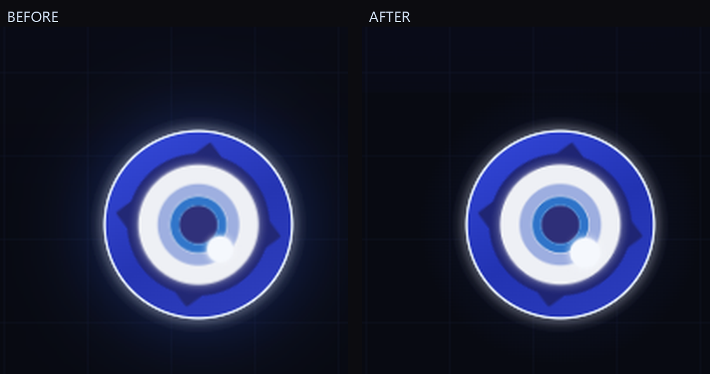
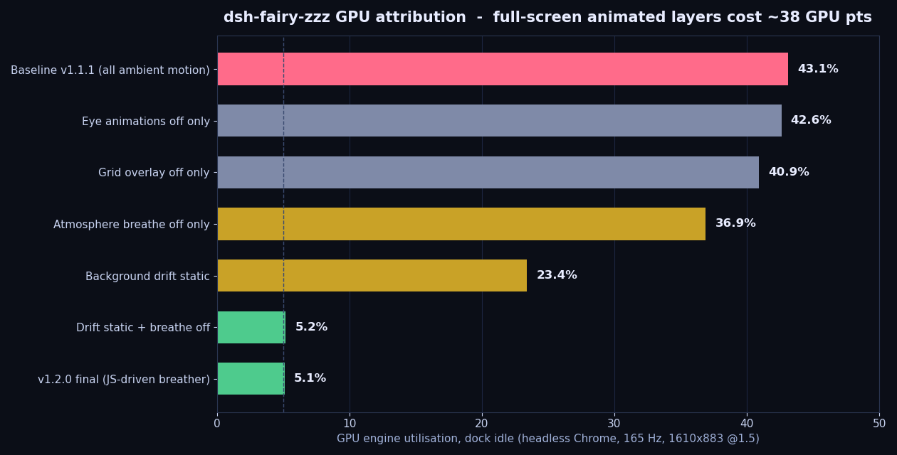
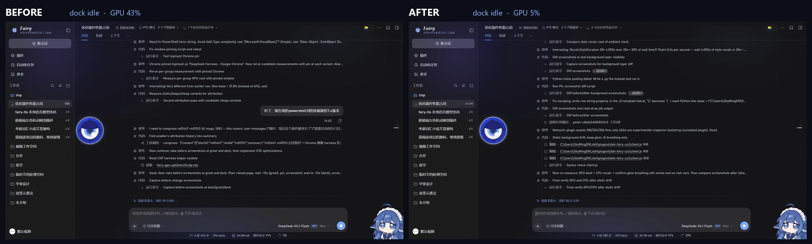

# 性能优化报告 / Performance notes

This page records why and how the **performance-optimized edition** of
dsh-fairy-zzz differs from the upstream plugin, plus the measurements used to
validate the result. 中文在前，English summary at the end. Section 9 adds the v1.2.0 GPU-usage work; §9.10 covers the v1.2.1 dead-code / dead-style cleanup, §9.11 checks the v1.3.0 interaction additions (usage bubble, drag, themes) and why they add no resident cost, §9.12 covers the v1.3.1 interaction-path rewrite, §9.13 covers the v1.3.2 conversation-region drag bounds, and §9.14 records the v1.3.3 fee-label copy change (no performance impact), §9.15 covers the v1.4.0 greeting voice library (no render-path impact), §9.16 records the v1.5.1 re-record of those 20 clips (fixing the greet-night-2 pause only; no render-path impact either), §10 records the v1.5.0 eye-motion rebuild (layered HTML + `steps()` quantisation, cutting GPU by ~78% and renderer CPU by ~85% versus v1.4.0 in the same harness), and §11 records the v1.6.0 reversal for image quality: back to one vector SVG redrawn at 15 fps, trading ~+0.5 GPU points in an isolated harness for edges that are always re-anti-aliased at device resolution.

## 1. 背景与目标

上游 `fairy-zzz-plugin` 的眼徽动效由一个**常驻 `requestAnimationFrame` 主循环**逐帧驱动：
四层眼球呼吸、睫毛旋转、脉冲环、SVG 裁切眼睑、故障克隆同步等全部在 JS 里每帧计算，
并逐帧写 `style.transform` / SVG `clipPath`。由此带来：

- 待机与思考时主线程持续忙碌（约 31–41% 的一个 CPU 核），风扇与耗电明显；
- 启动页同时解码两路 `boot.mp4` 并铺全屏 `blur(46px)`；
- 常驻 `blur(34px)` / `blur(20px)` / `drop-shadow` 每帧重栅格化；
- 多 MB 资源以 `no-cache` 下发，每次刷新重传。

目标：**在不牺牲 Fairy 观感的前提下把资源占用压到接近空闲**，并保留全部动效语义。

## 2. 测量方法

测量条件：headless Chrome 156，视口 1600×1000、dpr 1，**10 秒稳态窗口**，
同一台机器、同一套静态 harness（harness 直接从 `client.js` 抽取 CSS / SVG / 运行时，
页面结构与 `FairySkin` 一致），改动前后使用完全相同的参数。

「主线程 %core」= 浏览器主线程任务占一个 CPU 核的百分比。headless 以约 160fps 出帧，
真实 60fps 下绝对数字更低，但**前后比例**可信。

harness 与测量脚本属于一次性验证工具，**未随仓库发布**；复测方法见第 8 节。

## 3. 前后对比

| 场景 | 优化前 主线程 | 优化后 主线程 | 降幅 |
| --- | --- | --- | --- |
| 侧栏待机（dock idle） | 31.2% | **1.8%**（复测 1.0%） | -94% |
| 模型思考中（thinking） | 30.9% | **1.6%** | -95% |
| 问候页待机（greet） | 41.1% | **2.5%** | -94% |
| 启动动画（boot） | 0.4% | 0.4% | 持平（本来就很低） |

同一窗口的其它指标（dock idle）：

| 指标 | 优化前 | 优化后 | 说明 |
| --- | --- | --- | --- |
| Script（JS 执行） | 2.0% core | 0.1% core | 常驻 rAF 循环已删除（rAF 请求 158 次/秒 → **0 次/秒**） |
| Recalc Style | 8.9% core | 0.6% core | 不再每帧改 SVG 裁切 / transform |
| Layout | 1.3% core | 0.1% core | dock 定位不再周期性全量测量 |
| Chrome 进程树 CPU | 201.6% | 86.9% | 含合成器 / GPU，噪声较大，趋势可信 |
| 长任务（>50ms） | 0 | 0 | 两者都没有卡顿 |
| DOM 元素数 | 496 | 496 | 无增加 |
| 首屏下载资源 | ≈9.0 MB | **≈2.9 MB** | -68% |
| 静态资源缓存 | 每次 no-cache 重下 | **ETag / 304 协商缓存**，音频 immutable | 刷新不再重传几 MB |

## 4. 关键发现：真正的元凶是「SVG 裁切形状动画」

优化过程中一度出现「JS 全删了、rAF 归零了，但主线程仍占 23%」：脚本时间 0.1%，
样式重算却有 6%。逐项关动画做二分定位后发现：

- 眼睑（半闭眼）的「呼吸」动画作用在 `<clipPath>` 里的形状上；
- 形状每帧变化 → Chrome 每帧都要重新解析 SVG 裁切、重绘整棵眼睛子树
  （**只能走主线程，上不了合成器**）；
- 待机时该裁切根本不可见，动画却在空转，于是每秒 60 次白算；
- 降帧无效（`steps(8/12/24)` 实测 34.6% / 29.7% / 30.9%，与连续动画 31.8% 同一量级），
  只有 `animation: none` 才降到 1.3%；
- 最终方案：**删掉这条动画，把眼睑形状固定在原呼吸的「张开」相位**。眼球四层自身的
  缩放呼吸、睫毛旋转、脉冲环、眼闪全部保留（它们跑在合成器上，经探针验证零主线程成本），
  所以眼睛依然「活」着，只是思考时不再持续做半闭眼开合的动作。

## 5. 改动清单

### client.js（前端动效与组件）

1. 删除常驻 `requestAnimationFrame` 主循环：四层眼球呼吸、睫毛 15s 旋转、4s 脉冲环、
   眼闪改为纯 CSS `@keyframes` 驱动；花屏 / 故障 / 表情切换仍由离散定时器触发，
   事件之间主线程完全静默。
2. 删除每帧 SVG 写 transform、12 步二分缓动、5 份眼睛克隆的逐帧同步
   （克隆只在花屏时 `display:block`）。
3. 眼睑半闭眼形状改为静态（详见第 4 节）。
4. 启动动画：两路 `boot.mp4` 同时解码改为单路 `boot-opt.mp4`；去掉全屏 `blur(46px)` 铺底；
   boot 进度条改为直接写 DOM（不再每帧 `setState` 触发 React 重渲染）——该进度条随后在 v1.2.1 随被隐藏的 boot HUD 一并删除（见本节第 11 条）。
5. 去掉多道常驻模糊 / 滤镜：氛围光 `blur(34px)`、闪光 `blur(20px)`、眼周光晕 `blur(20px)`、
   眼睛 `drop-shadow` 全部改成静态多层渐变（不再每帧重栅格化）。
6. 轮询感知页面可见性：mood 900ms、health 5s 轮询在页面隐藏时暂停、可见时恢复，
   并做 in-flight 去重（避免请求堆叠）。
7. dock（侧栏）定位：缓存容器、合并 resize 定时器，不再每 600ms 遍历全部
   `div/main/section` 做 `getBoundingClientRect`（强制布局）。
8. `React.memo` 包裹眼睛 / 氛围层，减少父组件重渲染波及；淡出结束后的图层加
   `visibility:hidden`，彻底停止绘制。
9. 清理重复的 `body::after` 死规则等。
10. （v1.2.0）GPU 占用优化：背景 40s 漂移动画静态化、氛围光 14s 呼吸改为 500ms JS 环境时钟、删除 `fz3-drift` / `fz3-breathe` 两个全屏动画关键帧（详见第 9 节）。
11. （v1.2.1）死代码 / 死样式清理（**零行为变化**）：删除从未渲染的 `Waveform`、被 CSS `display:none` 隐藏的 boot HUD / 进度条 / 跳过按钮（含 `barRef/pctRef/onTime` 直写 DOM 的代码）、FairySkin 左下角 `fz3-tag`，以及 `index.js` 里从未调用的 `pingEngine()`；CSS 删除 93 条死规则 / 6 个未使用 `@keyframes` / 6 个未使用 CSS 变量，i18n 删除 25 条未使用词条。`client.js` 2,171 → 1,919 行、109,117 → 93,886 B（约 −14%）；不改动任何渲染路径与动画，第 3 / 9 节的 GPU / 主线程数据不受影响（详见 9.10）。
12. （v1.3.0）新增交互全部是**按需 / 静态 / 交互期**路径，不新增常驻动画或定时器：用量气泡只在展开时挂载并只在此期间跑 1s 倒计时（关闭即卸载、清定时器），刻意不用 `backdrop-filter`（高刷屏上每帧都要重算全屏背景模糊）；外观三档只切 `html[data-fz3-theme]` 走静态 CSS 覆盖，不改渲染循环；眼徽拖拽只在 `pointermove`（指针按住期间）写 `:root` 的 `--fz3-dock-x/y` 两个变量，松开即停（属于人机交互，不是定时器驱动的常驻样式重算，见第 7 节教训与 §9.11）；欢迎页文案改写用 `MutationObserver`（childList + characterData，60ms 去抖）替代参考实现的 900ms 轮询，空闲时零定时器。

### index.js（host 路由）

1. 静态资源：强 ETag（size-mtime）、`Last-Modified`、`If-None-Match` / `If-Modified-Since`
   → 304 空 body；HEAD；Range / 206 + If-Range（视频拖动 / 音频 seek 正常）；
   `cache/` 下 sha1 命名的音频改为一年 immutable。
2. 高频接口记忆化：`/mood` 300ms、`/engine` 1500ms、`/voice-home` 3000ms，带 in-flight 去重；
   `?diag=1` 绕过缓存；start / stop / TTS 成功后主动清缓存。
3. 既有路由的行为不变（v1.3.0 之前 30/30 端点断言全部通过；v1.3.0 新增的 `/usage` 见下条）。
4. （v1.3.0）新增 `GET /fairy-zzz/usage`：按需增量解析 `sessions/*/*/session.v4.jsonl.zstd`（按 RFC 8878 逐帧切分，按文件缓存 `{mtimeMs,size,events,parsedTo}`），按北京时区当天与峰谷逐笔计价，返回 `{ ok, now, peak, today, turn }`；3s 记忆化 + in-flight 去重，冷启动 505–608ms / 热 ~20ms，只在气泡展开时被请求，不落在首屏路径上。

### 媒体资产

| 文件 | 前 | 后 | 降幅 |
| --- | --- | --- | --- |
| boot.mp4 → boot-opt.mp4 | 4,814,589 B | 2,394,692 B | -50.3%（1280×720 crf27，PSNR 38/36/34 dB） |
| hero.png → hero.webp | 1,943,569 B | 23,014 B | -98.8%（1600×1017 q82，PSNR 42.4 dB） |
| greet 问候语音 wav → mp3 | 1,653,980 B | 420,129 B | -74.6%（时长不变） |
| **运行时实际下载合计** | **≈9.0 MB** | **≈2.9 MB** | **-68%** |

旧文件（boot.mp4 / hero.png / voice/*.wav）在本仓库中已删除，如需回滚请从上游
`AssassinVIX/fairy-zzz-plugin` 取。

## 6. 观感验证

用「冻结动画相位」的方式对改动前后截图做逐像素对比（同页面、同视口、同参数）：

- 启动画面：**逐像素完全一致**（mean / max 差异均为 0）；
- 待机 / 问候：整图平均差异 0.23–1.49 / 255，差异超过 16 灰阶的像素不到 1%，
  文字 / 布局 / 形状未变；
- 眼睛区域是唯一的可见差异区（mean 8–11 / 255，面积约 128×128 px）：约 1/3 来自
  外圈辉光由实时 `drop-shadow` 换成静态多层渐变的正常差异（外圈 15.4→11.0，
  眼球内部差异仅 2.1，基本不可见），约 2/3 是冻结相位 / 光栅化造成的边缘细环伪影
  （无整体缩放或位移）。

结论：**观感保持**。呼吸、睫毛旋转、脉冲环、眼闪、花屏故障、思考半闭眼等动效全部保留；
唯一变化是思考态半闭眼不再持续开合（见第 7 节取舍）。

## 7. 如何生效 / 注意事项

1. **完全退出并重启 DeepSeek Harness 桌面应用**（host 端 `index.js` 的路由改动只有重启
   才生效）。
2. 重启后**整页刷新一次**（Ctrl+Shift+R）加载新的 `client.js`。
3. 验证：DevTools → Network 里 `hero.webp` / `boot-opt.mp4` 应出现 304 或 from cache；
   任务管理器里该插件的 CPU 占用应明显下降。
4. 回滚：用上游原版 `client.js`、`index.js` 覆盖回插件目录即可（本仓库不含旧资产）。

注意：

- 上面的百分比是 headless（约 160fps 出帧）口径，会放大主线程占比；真实 60fps 下
  绝对值更低，但逐帧工作量的比例差异方向可靠。
- GPU / 合成器相关指标（进程树 CPU）噪声较大，同配置重复测量可差 ±10 个百分点；
  `Task%` / `Script%` / `Recalc%` 更稳定。
- **代价 / 取舍**：思考态的半闭眼不再做持续开合呼吸（静态半闭眼）。这是本次唯一
  有意做的动效简化，也是拿掉约 27% 一个核的必要条件；想恢复的话，成本约为每秒 60 次
  整棵眼睛子树的裁切重算。
- **GPU 取舍（v1.2.0）**：背景漂移不再移动、氛围光呼吸改由 500ms 环境时钟驱动，肉眼几乎不可察觉，但把 dock 待机 GPU 从 43.1% 降到 5.1%（约 -88%）。boot 阶段的视频解码与 greet 切换瞬间仍是短暂的 GPU 高点，属于可接受代价（见第 9 节）。

## 8. 复现方法

本次的对比 harness 与测量脚本是一次性验证工具，未随仓库发布。复测思路：

1. 从任意版本的 `client.js` 中用标记 `/* FZ3_RUNTIME_BEGIN */ … /* FZ3_RUNTIME_END */`
   抽取运行时，并连同页面里的 CSS / SVG 拼成一个静态 HTML harness；
2. 用 headless Chrome + DevTools Protocol 的 `Performance.getMetrics` 记录 10 秒稳态窗口，
   分别统计 `TaskDuration`、`ScriptDuration`、`RecalcStyleDuration`、`LayoutDuration`；
3. 用同样的参数跑两份 `client.js`（上游 / 本版），对比绝对值和比例即可。

## 9. GPU 占用优化（v1.2.0）

### 9.1 现象与目标

用户实测：核显下开着插件 GPU 平均 **80–90%**，关掉插件约 **10%**；即使只是把插件挂在侧栏待机，风扇也一直在转。复现后定位到原因：在 **165 Hz 高刷屏**上，任何**全屏尺寸的 CSS 动画层**都会导致每帧整屏重新合成，GPU 占用随刷新率翻倍。插件里恰好有两处这种层。

目标：165 Hz 屏待机时也接近空闲，同时保留呼吸观感（不靠删动效换数字）。

### 9.2 测量方法

- headless Chrome 156 真实加载插件页面，进入 DSH GUI 后等 dock 稳态再开始采样；
- 视口 1610×883、dpr 1.5、165 Hz 显示器；
- 窗口用 `SetWindowPos` 置顶，避免被其它窗口遮挡（被遮挡时页面被判定为 hidden、动画暂停，会测出 0）；
- GPU 指标 = Windows 计数器 `\GPU Engine(*)\Utilization Percentage` 里该浏览器 GPU 进程的**引擎最大值**，每秒一个样本；
- 每变体 12–20 秒采样、丢弃前 2 个样本（最终版本取 20 秒）；
- **同轮内做相对比较**：跨轮 base 会漂移（37–43%），绝对值的量级可信，但不要跨轮对比。

### 9.3 归因表（dock 待机，GPU 引擎平均占用，同一轮测量）

| 变体 | GPU |
| --- | --- |
| v1.1.1 原样（所有氛围动画在跑） | 43.1% |
| 只关眼睛四层呼吸 / 睫毛 / 脉冲环 | 42.6%（−0.45，可忽略） |
| 只关 body::after 网格层 | 40.9%（−2.2，可忽略） |
| 只关氛围光呼吸 + 闪光（glow/flash 动画停 + blend 改 normal + rim 去 blur） | 36.9%（−6.2） |
| 氛围层整层 display:none | 29.9%（−13.2） |
| 只把背景漂移静态化 | 23.4%（−19.7） |
| 漂移静态化 + 氛围光呼吸 / 闪光关 | 5.2%（−37.9） |
| v1.2.0 最终版（漂移静态 + JS 环境时钟呼吸） | 5.1% |

交叉验证（以「背景漂移已静态化」为基线 22.6%）：

- 把氛围光呼吸动画加回来 → **44.4%**；只加回闪光 `steps(1)` → **14.0%**；两者都不加 → **14.1%**；
- 把 `mix-blend-mode:screen` 改成 `normal` → 20.35%（只省 2.3）；去掉 `.fz3-rim` 的 `blur(8px)` → 22.9%（无效）；
- 把发光呼吸换成 `steps(24)` 离散 → 11.0%（仍然很贵）；
- 同一 harness 下「纯 DSH、不启用插件」基线约 4.7–7%。

结论一句话：**成本不在 128px 的眼徽动画，而在两处全屏动画层；165 Hz 下每帧整屏合成把成本放大了。**

### 9.4 原理解释

- 全屏 `position:fixed` 层只要每帧有变化，合成器就要重做整屏合成；165 Hz 即每秒 165 次，代价随刷新率线性放大。
- 背景层 `body::before`：`fixed`、`inset:-12%`、多层渐变，带 40s 位移/缩放漂移动画——覆盖并超出整个视口。它大部分被界面遮住，但**渲染成本是按层算的**，看不见不等于不花钱。
- 氛围层 `.fz3-atmos`：`fixed` `inset:0` + `mix-blend-mode:screen`，这一整层每帧都要和下面所有内容重新混合，代价被进一步放大。
- 小面积元素（128px 眼徽、384px 脉冲环）的动画跑在合成器上，实测几乎免费。
- 所以正确的优化对象是**两处全屏层**，而不是眼徽本身。

### 9.5 改动清单（client.js，仅这三处 + 一个 JS 环境时钟）

1. 删掉 `body::before` 的 `animation:fz3-drift ...`；背景层固定为原动画起始位姿 `transform:translate3d(-1.4%,-1%,0) scale(1.03)`；删掉 `@keyframes fz3-drift`（保留注释说明原因）。
2. 删掉 `.fz3-atmos-glow` 的 `animation:fz3-breathe ...`，静态基线 `opacity:.55`、`transform:scale(1)`。
3. 删掉 `@keyframes fz3-breathe`（保留注释）。
4. 呼吸观感改由 JS 环境时钟驱动（Atmos 组件，`React.memo`）：
   - 新增 `glowRef = React.useRef(null)` 与 `React.useEffect(...)`；
   - `window.setInterval` 每 **500ms** 写一次 `glow.style.opacity = (0.55 + 0.45*ge).toFixed(3)`、`glow.style.transform = 'scale(' + (1 + 0.06*ge).toFixed(4) + ')'`；
   - 其中 `gp = (t % 14000)/14000`、`ge = 0.5 - 0.5*cos(2π·gp)`（等价于原 ease-in-out 呼吸曲线）；
   - `document.hidden` 时跳过该次更新；组件卸载时 `clearInterval`；JSX 里 glow div 加 `ref`。
   - 效果：**呼吸观感保留**，但只在 500ms 的更新点让合成器重做一次整屏混合（2 次/秒），而不是 165 次/秒。
5. 保留不动：眼徽四层呼吸、睫毛 15s 旋转、脉冲环、眼闪、花屏/故障、思考半闭眼、hero/对话界面过渡、`.fz3-atmos-flash`（11s `steps(1)` 离散闪烁，实测几乎免费）。

### 9.6 失败方案与教训

- **保留背景漂移（已放弃）**：用 JS 每 500ms 在 `document.documentElement` 上写 `--fz3-drift-x/y/s` 三个 CSS 变量，让 `body::before` 的 `transform` 用 `var()` 跟随。GPU 确实降到 ~5.7%，但**主线程变差**：CDP Performance 20 秒窗口 `RecalcStyleDuration` 4.055 s，而同样窗口基线只需 0.82 s（≈ +16% 主线程；每次写未注册的继承型自定义属性会触发整棵文档样式重算，43 次更新 × ~80ms）。教训：**定时器不要驱动 `:root` 上的自定义属性**；漂移最终放弃、背景静态化。
- **prefers-reduced-motion 分支（已删除）**：曾加 `prefers-reduced-motion: reduce` 时早退，但原插件本来就没有这个降级逻辑，且 headless Chrome 默认报 `reduce=true` 导致无法测量，已删除，保持与原版一致的行为。

### 9.7 改后数据

- dock 稳态 GPU **5.1%**（43.1 → 5.1，约 **−88%**）；
- boot 阶段 **9.85%**（主要是视频解码）；greet 切换瞬间前 3 秒 39/46/23%，之后回落到 5–6%；
- 主线程仍处低水平（22 秒窗口：`TaskDuration` 20.462 s、`ScriptDuration` 0.075 s、`RecalcStyleDuration` 1.146 s、`LayoutDuration` 0.342 s；RecalcStyle 绝对量很小、与基线同量级，远低于失败方案的 4.055 s）；
- 真机对照（诚实写法）：真实桌面端 Electron（1624×977、dpr 1.5、未刷新仍跑旧 `client.js`）dock 待机实测约 **17.9%** GPU；用户原始反馈是核显下 80–90% vs 关插件约 10%。刷新到 v1.2.0 后的真机数字**待验证**，预计会回落到接近纯净 DSH 的水平。

### 9.8 图片

图注：上图为 dock 待机时逐项关闭各层的 GPU 归因；下图为整页截图的前后对比（BEFORE 43% / AFTER 5%）。

### 9.9 取舍与后续可选项

- 背景漂移不再移动——几乎不可见（背景本就被界面遮住，且固定为原动画起始位姿）。
- boot 的视频解码与 greet 过渡仍是瞬态高点，属于可接受代价。
- 未来若想恢复漂移：可把背景换成独立小元素并限制合成范围（例如只在一个小区域做动画），但**不要**用定时器改 `:root` CSS 变量。

### 9.10 v1.2.1：死代码 / 死样式清理（零行为变化）

v1.2.1 只删代码、不碰渲染与动画路径，因此本节 GPU / 主线程数据全部继续有效：

- `client.js` 2,171 → 1,919 行、109,117 → 93,886 B（约 −14%）；`index.js` 30,859 → 30,812 B（删掉从未被调用的 `pingEngine()`）。
- CSS 文本 517 → 383 行（文件行 347-729）：删除 93 条死规则、6 个未使用 `@keyframes`（`fz3-bar/fz3-wave/fz3-panel-in/fz3-rot/fz3-rot-rev/fz3-twinkle`）、6 个未使用变量（`--fz3-blue/violet/magenta/ink/mute/line`）。
- 被删除的选择器 / 变量 / 关键帧在删除前已全文件 `grep` 确认无引用；眼徽动画、boot 视频、静态 poster 模糊铺底、问候与 SKIP2、设置面板、朗读按钮全部保留。
- headless Chrome 真实加载插件页面验证：boot → greet → dock 正常，无 JS 报错，`.fz3-boot-hud` / `.fz3-tag` / `.fz3-wave*` 元素数为 0，截图与 v1.2.0 一致。

### 9.11 v1.3.0：交互新增功能的增量性能核查

v1.3.0 新增的用量气泡、眼徽拖拽 / 显隐、外观三档与欢迎页文案改写，全部避开常驻动画 / 定时器路径，因此第 3 / 9 节的 GPU / 主线程数据继续有效：

- 用量气泡只在点击 / 轮末展开时挂载，关闭即卸载；只有展开期间才有 1s 倒计时（归零回调父层重拉一次）；不使用 `backdrop-filter`（对比参考实现的全屏实时模糊，高刷屏上每帧都要重算）。
- 外观三档只改 `html[data-fz3-theme]`，CSS 侧全部是静态覆盖（CSS 936-971 行），不触发动画 / 布局循环；主题探测只在挂载与 theme 变化时跑。
- 眼徽拖拽用 `pointermove` 事件直接写 `:root` 的两个变量（`--fz3-dock-x/y`），仅指针按住期间发生，松开即结束 —— 这是 §9.6 教训的**明确例外**：驱动源是人手交互而非定时器，没有常驻重算。（v1.3.1 起这条写法也改掉了，见 9.12：拖动只写元素自身 `transform`。）
- 欢迎页文案改写用 `MutationObserver`（childList + characterData、60ms 去抖）替代参考实现的 900ms 轮询，空闲时零定时器。
- host 侧 `GET /fairy-zzz/usage` 走 3s 记忆化 + 增量 zstd 帧解析（冷 505–608ms / 热 ~20ms），前端只在气泡展开时请求。
- 代码体积：`client.js` 140,594 B / 2,882 行（CSS 文本 489 行）、`index.js` 47,855 B / 1,391 行；仍是零构建、运行期零依赖。

### 9.12 v1.3.1：拖拽与用量气泡的交互路径重做

v1.3.1 不新增任何常驻动画，改的是两条**用户交互路径**的成本，并补上拖拽吸附。

**拖拽为什么卡**：v1.3.0 的 `onCoreMove` 每个 `pointermove` 都写 `document.documentElement.style` 的 `--fz3-dock-x/y`。这两个变量被 `.fz3-core` 的 `left/top` 使用，改它等于让**整页样式失效 + 重新布局 + 全屏重绘**；165 Hz 屏每秒产生 165 个事件，每个都触发一次全文档 recalc。

v1.3.1 的做法：

| 项 | v1.3.0（旧） | v1.3.1（新） |
| --- | --- | --- |
| 拖动中的几何写入 | 每个 `pointermove` 写 `:root` 两个变量 → 全文档 recalc + layout | 只写**元素自身** `style.transform` → 只走合成器，不触发 layout / paint |
| 事件节流 | 无（每秒 165 次全部执行） | `requestAnimationFrame` 合并，一帧最多写一次 |
| React 开销 | 拖动期间可能因气泡 state 每帧重渲染 | 移动期间**不 setState**，仅超过 4px 时置一次 `dragging` |
| 事件监听 | 元素上的 pointer capture | `window` 捕获阶段监听 move/up/cancel，统一在 `detachDrag` 移除 |
| 拖拽期视觉降压 | 无 | 关掉脉冲环、`.fz3-atmos` 内联 `mix-blend-mode:normal`（临时去掉全屏混合） |
| 松手 | 慢过渡（1.35 s） | 先落位写存储，再 `el.animate()` 170 ms 补间余量 |

**吸附**：`SNAP_EDGE = 64`。松手时距**会话内容区**任一边（v1.3.1 为整个视口；v1.3.2 起收紧，见 9.13）≤64px 即贴边，角落两轴同时吸（离边为「半个核 + 6px」，核不会切出屏幕）。贴边约 60 ms 完成，再用 170 ms 补间消除视觉跳变。

**遮挡让位**：右下角常驻的 `dsh-whale-widget` 根节点 `z-index:9999`，插件层只有 `z-index:20`。旧实现只比较 `elementsFromPoint()[0]`，拖动时命中的还是自己，于是永远不避让。新实现用 `ourStackZ()`（从 `.fz3-layer` 父级向上找第一个非 static 的 `z-index`，实测 20）与 `foreignZAt(x,y)`（`elementsFromPoint` 过滤插件层后取祖先链最高数值 `z-index`）比较，被盖住就沿吸附边向内 72 → 144 → 216 → 288 → 360px 试位。

**用量气泡为什么慢**：v1.3.0 每次点击都 `Promise.all([fetchUsage(), fetchBalance()])`，`/usage` 在宿主侧要扫会话日志（冷 505–608 ms），用户看到约半秒骨架屏。

v1.3.1 加了模块级预取缓存：`USAGE_TTL = 60_000`、`BALANCE_TTL = 30_000`；进入 dock 后 700 ms 调一次 `prefetchUsage()`；点击有新鲜缓存就**立即出数**（实测 65–166 ms），后台同时刷新；完全没缓存才显示骨架。页面隐藏超过 TTL 后再可见时补一次 `loadUsage(false)`。

**点外关闭**：气泡打开期间挂 `document` 捕获阶段 `pointerdown`，目标不在 `.fz3-bubble` / `.fz3-core` 内即关闭；`Escape` 同样关闭；关闭 / 卸载时移除监听。

**headless 实测（Chrome，1602×944 @ dpr1.5，165 Hz 显示器）**：

| 指标 | 结果 |
| --- | --- |
| 拖拽 24 次 `pointermove` 总耗时 | 146–201 ms |
| 长任务（`PerformanceObserver('longtask')`） | 0 个 |
| 拖动中 `--fz3-dock-x` | 保持不变（旧实现会连续跳变） |
| 左边缘吸附落点 | 60 ms 后 `rect.x = 10`，`--fz3-dock-x = 74px`（中心） |
| 右下角（鲸鱼遮挡）落点 | 自动上移 72px → `--fz3-dock-x = 1528px`、`--fz3-dock-y = 798px` |
| 点击出气泡（有缓存） | 65–166 ms |
| 控制台错误 / 页面异常 | 0 |

代码体积：`client.js` 3,119 行 / 151,180 B（CSS 文本 492 行，比 v1.3.0 只多交互态 3 行）。

### 9.13 v1.3.2：拖拽 / 吸附边界收进会话内容区

v1.3.1 的吸附以**整个视口**为边界，眼徽可以被拖到左侧栏、标题栏上，贴边时也会贴着窗口四条边。v1.3.2 把可拖拽 / 可吸附区域限制在**会话内容区**：左 = 侧栏右缘，上 = 标题栏底缘，右 / 下 = 窗口边缘。

- `measureRegion()`（client.js 2156）读 `[class*="_sidebarCol"]` 的右缘与首个 `header`（`height<120 && top<=12 && width>vw*0.3`）的底缘；宿主 bundle 里 tabs 就在 `header` 内部（`.an3WzG_header:has(.an3WzG_tabs)` 时 min-height:76px），所以打开会话后 header 变高，量到的上边界自动跟着下移。
- `regionBounds()`（2177）做 clamp 兜底，`clampPos`（2251）、默认停靠（2395）、`snapPos`（2654）、`avoidOcclusion`（2707）都改用区域边界；`onCoreDown`（2724）在每次 `pointerdown` 时重量一次，拖动期不读布局。
- 量不到侧栏 / 标题栏（例如宿主改版类名）时退回整个视口，行为退化为 v1.3.1，不会卡死或把眼徽锁死在一个点。

headless 实测（1602×944 @ dpr1.5）：默认停靠 `--fz3-dock-x=358px`、`--fz3-dock-y=492px`（核 rect x=295..423，完全在 x≥280 的会区内；旧版左缘 278 压到侧栏 2px）；拖到最左落位 x=354=280+74（rect.x=290）；拖到最上 y=114=40+74（rect.y=50）；右下角吸附 + 鲸鱼遮挡让位仍为 x=1528 / y=798；localStorage 写入 `{"x":354,"y":320}`；24 次 pointermove 146–201 ms、零长任务，无 console error。

代码体积：`client.js` 3,180 行 / 154,438 B（只加区域测量约 61 行，无 CSS 变化、无新资源）。

### 9.14 v1.3.3：电费文案（零性能影响）

v1.3.3 只把用量气泡的文案从「用量 / 余额 / 今日花费 / 峰谷」改为「电费 / 电费余额 / 今日电费 / 五倍电费·十倍电费」，并按时段动态切换第三行标签（谷时「五倍电费」、峰时「十倍电费」、无数据兜底「电费时段」）。

- 客户端只新增一个模块级纯函数 `feeText()`（把旧宿主可能返回的「高峰 / 空闲 时段」映射成「十倍 / 五倍电费」，`client.js` 里是字符串替换），没有新增动画、`setInterval`、`requestAnimationFrame` 或请求；气泡仍然只在打开时挂载，关闭即卸载。
- 宿主 `index.js` 只改 `peakState()` 返回的 `label` / `window` / `next` 三个字符串，`/usage` 的解析、3 s memo 与缓存路径完全没动，开销与 v1.3.2 相同（冷 505–608 ms、热 ~20 ms，仍只在气泡打开时请求）。
- 新增 1 行动态标签文本不会改变布局成本：气泡宽度仍固定 236 px（`--fz3-bubble-w`），最长标签「五倍电费」4 个字单行显示，headless 截图核对无溢出 / 无换行。

因此第 3 / 7 节的 GPU 与主线程数据继续有效；`client.js` 3,192 行 / 155,313 B、`index.js` 1,392 行 / 47,865 B（相对 v1.3.2 分别 +12 行 / +875 B、+1 行 / +10 B）。

### 9.15 v1.4.0：问候语音库（零渲染路径影响）

开屏问候从每个时段 1 条固定语音扩成 5 条（原 1 条 + 按 Fairy 人设新写/合成 4 条），随机播放且避免连续重复，居中台词与所选语音同源。

- 选择逻辑只在组件首次渲染或重播开机时执行一次：`currentGreeting()`（client.js 61-72）读一次 localStorage、做一次 `Math.random()`、写一次 localStorage；没有新增定时器、`requestAnimationFrame`、轮询或请求。
- 新增 20 条 mp3（v1.4.0 时 2,289,924 B；v1.5.1 按原草稿重录后 2,303,748 B，见 §9.16）只在 greet 阶段按需下载并播放一条，dock 后不驻留解码器；首屏运行时下载仍约 2.9 MB，25 条语音不计入首屏。
- 体积：`client.js` 3,196 → 3,244 行 / 155,626 → 159,519 B；`index.js` 不变（47,892 B / 1,392 行）；第 3 / 7 节的 GPU / 主线程数据不受影响。

### 9.16 v1.5.1：重新合成 20 条问候语音（只修 night-2 停顿，零渲染路径影响）

v1.4.0 的 20 条新语音是按早期草稿台词合成的；`GREET_LINES.text`（屏幕字幕）是后来改写的简洁理解版，二者本来就允许不一致。用户反馈的 `greet-night-2.mp3` 无停顿，源于草稿句「我值班；您不睡」里的全角「；」不在引擎 `cut5` 切分符号集里。v1.5.1 按**同一份草稿台词**重录 20 条，把该处「；」改成「。」（V1 原版 5 条不动）。只改标点还不够：切句后 `TextPreprocessor.merge_short_text_in_array(threshold=5)` 会把「我值班。」（4 字）和「您不睡，」（4 字）合并回同一片段，模型只给 ~0.2s 微停顿。因此在合成出的 wav 里、该句号的自然停顿处（约 5.93s）插入 0.20s 数字静音，再编码 mp3，得到最终 0.44s 停顿。

- 20 条 **2,303,748 B / 5.24–9.84 s**（旧版 2,289,924 B / 5.08–9.36 s）；25 段合计 **2,708,325 B**（原 5 段 404,577 B）；总发布资源约 7.8 MB。
- `greet-night-2.mp3`（9.84 s / 159,021 B）的 `silencedetect(-38dB, 0.14s)` 在 **5.76–6.20 s**（「我值班」与「您不睡」之间）命中 **0.44 s** 停顿；其余标点边界 0.33–0.48 s。其余 19 条同样在标点边界有 7–8 处 0.2–0.48 s 停顿。
- 音频只在 greet 阶段下载并播放一条，仍然**不进渲染路径、不新增定时器 / 请求**；第 3 / 7 节的 GPU / 主线程数据继续有效。
- `client.js` / `index.js` 未改；`package.json` 1.5.1。
- 说明：旧 20 条 mp3 被 v1.5.1 早期实现覆盖后不可逐字节恢复，本次是同一引擎、同一份草稿台词重录，个别句子时长可能差 ±0.6 s；字幕仍为简洁版。

---

## 10. 眼徽动效重做：更「灵动」同时再降 GPU / CPU（v1.5.0）

### 10.1 目标与约束

用户反馈：眼徽虽然稳定了，但和游戏内 Fairy 的动图（米游社 Fairy 动图帖（article/54939105））相比「不够灵动」——游戏里最显眼的是**白环上一颗亮彗星高光持续绕圈**、外圈辉光不规则闪烁、蓝色光圈叶片缓慢公转、蓝环内圈轻微缩放，而插件原来的眼徽只有一个 catchlight 静止不动、四层 scale 呼吸 + 睫毛旋转。

约束：**观感要更活，但 GPU / CPU 不能涨，最好继续降**。所以先把「贵在哪」测清楚，再决定动效做法。

### 10.2 测量方法

两种互补的测法（都在 165Hz headless Chrome、1610×883 @ dpr 1.5、丢弃前 2 个样本）：

1. **隔离 harness**：只加载插件 CSS + 眼球 DOM（不含宿主页面），排除 DSH 自身基线，直接比较「动效本身」的 GPU / 渲染进程 CPU。GPU 用 `\GPU Engine(*)\Utilization Percentage` 按 Chrome GPU 进程汇总；CPU 用渲染进程 `TotalProcessorTime`（`Get-Process` 的 `CPU` 增量 / 采样秒数）。
2. **DSH 真页面 A/B**：同一轮里交替替换新旧 `client.js`，每次刷新重新 dock，各采 12–14s；能带上宿主自身约 2–3% 的基线，验证结论在真实环境成立。

### 10.3 关键实验：为什么「SVG 内部动画」必须整体搬走

在 v1.4.0 页面上做变体实验（同一轮内切换 CSS/注入不同实现，每次 8s，meanMax；数值是 GPU 引擎平均占用）：

| 变体 | 做法 | GPU 平均 |
| --- | --- | --- |
| full | v1.4.0 原样：SVG 内部 4 层呼吸 + #corners 旋转 + 脉冲环，全部 165fps | 13.9–15.2% |
| static | 关掉全部持续动画与氛围层 | 0.8–1.0% |
| steps_breath | 只把 SVG 内部呼吸改成 `steps(6,end)`（≈8fps 量化） | 13.3% |
| html_smooth | 把同样动画挪到 HTML 图层，但用 ease 连续播放 | 11.3% |
| html_steps | HTML 图层 + `steps(38)` / 3.2s（≈12fps）只动一层 | **1.9%** |
| html_steps_pulse | 在上一条基础上再加一层脉冲环 steps 动画 | 2.3% |
| timer_only | 只挂一个空 `setInterval(41.7ms)`，不写样式 | 1.5% |
| js24 / js12 | JS 每 41.7ms / 83.3ms 写一次 CSS 变量到 SVG transform | 10.7% / 10.4% |
| timer_write_scale | JS 每 41.7ms 写一次 `--t-scale`（与 js24 同类，不同目标） | 10.9% |

结论（后来所有实现都遵守）：

1. **对 SVG 内部元素做 CSS 动画，`steps()` 量化几乎没用**（13.3 vs 13.9）——Chrome 仍在每帧重绘整棵 SVG 子树，量化只减少插值、不减少重绘。
2. **持续 JS 写样式极贵**（约 +0.4 GPU 点/次）：每次写入都会触发样式失效 + 主线程 paint + 整屏混合重新合成；把写入频率从 24Hz 降到 12Hz 几乎不降 GPU（10.7 → 10.4），所以「用 JS 降帧」这条路直接放弃。
3. **HTML 图层 + `steps()` 近乎免费**：同样内容只动 HTML 图层时 1.9%（相对 static 只 +0.9）；但**连续 165fps 合成仍然贵**（html_smooth 11.3%），所以必须同时量化。
4. 空定时器本身只有约 1.5%（测量噪声量级），JS 不是问题，「JS 每帧写样式」才是。

### 10.4 实现（client.js，v1.5.0）

- **眼球分层**：同一份静态 `FAIRY_EYE_SVG` 复制 4 份，按父层选择器只显示各自要的部件（`.fz3-eye-plate` / `-blades` / `-anatomy` / `-shine`）；外层 `.fz3-eye-gaze` 负责目光位移，内层 `.fz3-eye-body` 负责 hover 缩放与故障滤镜。
- **持续动画全部走 HTML 图层 + steps**：`.fz3-eye-blades{animation:fz3-orbit 6.4s steps(96,end) infinite}`（15fps 旋转）、`.fz3-eye-anatomy{animation:fz3-lens-breathe 1.6s steps(24,end) infinite alternate}`（scale 1→0.905）、`.fz3-eye::before{animation:fz3-halo-breathe 6.4s steps(3,end) infinite}`、`.fz3-eye-pulse{animation:fz3-lash-pulse 6.4s steps(24,end) infinite}`（前 27% 扩散、其余静止）。周期都是 1/15s 的整数倍（1.6s = 24 帧、6.4s = 96 帧），多段动画落在同一帧网格。
- **一次被否决的尝试**：初版还做过「白环上的亮彗星高光绕环公转」（亮头 + 蓝柔光 + 渐隐尾点，独立 HTML 图层 + `steps(96)`，成本很低），但用户实际观感觉得**太突兀**，定稿前整个删掉（含 SVG 常量、CSS 图层与 `fz3-orbit-rev` 关键帧），分层因此从 5 层减到 4 层——这也是为什么 v1.5.0 的动画数量是 4 个而不是 5 个。
- **目光微动**：`scheduleGaze()` 每 4.6–8.8s 写一次 `--fz3-gaze-x/y/r`（1–3px + ±0.45°），0.92s 过渡在合成器上完成，隔 1.3–2.4s 回中再排下一次；思考 / 页面隐藏 / 未挂载时 `stopGaze()`。整个动效每秒只产生 2 次样式写入，不占逐帧预算。
- **氛围光回归 CSS**：删掉 v1.2.0 里 500ms 的 JS 环境时钟（每跳一次样式写入），`.fz3-atmos-glow` 用 `14s steps(14,end) infinite alternate` 呼吸（≈1fps）；全屏 `mix-blend-mode` 层只在 14 个瞬间重合成。`Atmos` 组件退化成纯静态渲染。
- **运行时清理**：删除 `FZ3_LASH_PERIOD_S`、`lockLashFrame()`（SVG 内旋转已不需要锁角度）、`setPulse` 里的锁帧调用；`.fz3-gband` 的静态 `will-change` 改成只在 `data-glitch="blocks"` 时启用；故障滤镜目标从 `.fz3-eye-svg` 改为 `.fz3-eye-body`。
- **保留的东西**：花屏 / 眼闪参数、思考态静态半闭眼 clipPath、页面隐藏暂停、拖拽期关闭最贵合成层等逻辑不变。

### 10.5 最终数据（同一 harness、同一轮）

| 指标（dock 待机） | v1.4.0 | v1.5.0 | 变化 |
| --- | --- | --- | --- |
| GPU 引擎平均占用（隔离 harness） | 9.3–11.8% | **1.9–2.3%** | 约 −80% |
| 渲染进程 CPU（单核 %） | 47–54% | **4.5–6.6%** | 约 −90% |
| GPU（DSH 真页面 A/B，测的是还带彗星层的中间版本） | 14.6–14.9% | **4.4%** | 约 −70% |
| 常驻动画 | 6 个（SVG 内部 165fps） | 4 个（HTML 图层 15fps） | 帧数 1/11 |
| `client.js` 体积 | 159,519 B / 3,244 行 | 160,210 B / 3,231 行 | +0.7 KB、−13 行（分层 CSS 换掉了 SVG 内部动画与运行时锁帧代码） |

隔离 harness 里 v1.5.0 已接近 static 底噪（0%），说明眼徽本身不再是常驻开销大头；真页面剩下的主要是宿主界面自身。

### 10.6 观感

- 叶片公转 + 眼球轻微收放 + 外圈辉光的 steps 呼吸，整体比原来「四层呼吸 + 睫毛旋转」更活；「白环亮彗星绕圈」试过但按用户反馈删除（见 10.4 / 10.7）；
- 眼球呼吸用「整组 scale 1→0.905」近似原来的四层异相呼吸，放大看仍能看到蓝环/瞳仁一起轻微收放；睫毛/叶片公转保留；
- 思考态仍是静态半闭眼（原取舍不变），此时目光暂停，反而更省。

### 10.7 放弃 / 未采纳的方案

| 方案 | 为什么放弃 |
| --- | --- |
| 只把 SVG 内部动画改 `steps()` | 量化不影响重绘，13.3 vs 13.9，几乎无收益 |
| JS 降帧驱动（24Hz→12Hz） | 每次样式写入固定成本，降频无用（10.7→10.4） |
| 保留连续 ease 合成、只拆图层 | 165fps 连续合成仍 11.3% |
| 用 `backdrop-filter` / 动态 `filter` 做光晕 | 全屏离屏滤镜每帧重栅格化，v1.2.0 已验证不可行 |
| 白环彗星高光（v1.5.0 初版已实现） | 用户反馈**太突兀**，与整体气质不搭；删除后少一个动画层，GPU/CPU 还略降。教训：游戏里成立的高光放到 128px 眼徽上不一定好看 |

### 10.8 复现

1. 从 `client.js` 抽出 `CSS` 与 SVG 常量，按 `CoreGlyph` 的 DOM 结构生成两个静态页面（旧版：`.fz3-eye-svg` + 6 个 SVG 内部动画；新版：`.fz3-eye-gaze > .fz3-eye-body >` 四个图层）；
2. 用 headless Chrome 打开页面，`--force-device-scale-factor=1.5 --window-size=1610,883`；
3. 每轮先跑 1.5s 预热，再用 `Get-Counter '\GPU Engine(*)\Utilization Percentage' -SampleInterval 1 -MaxSamples 13` 采 12s，按 `pid_<GPU进程号>` 过滤后丢弃前 2 个样本求均值；CPU 用渲染进程 `CPU` 字段增量 / 秒数；
4. 两个版本交替各跑 2–3 轮（本报告数据为 old/new 各 2–3 轮）。

harness 脚本同样**不随仓库发布**，属于一次性验证工具。

---

## 11. v1.6.0：眼徽改回单 SVG 向量重绘（修旋转 / 缩放边缘重采样）

### 11.1 问题

v1.5.0 把眼徽拆成「4 份静态 SVG 副本 + 4 个 HTML 合成层」，用 CSS `steps()` 做旋转 / 缩放 / 呼吸。性能很好，但**合成器动的是已经栅格化的位图**：旋转 / 缩放时只能对位图重采样，眼睑 `clipPath` 硬边与深蓝眼眶这类高对比边缘会出现台阶 / 发虚（165 Hz 屏每步角度更大，更明显）。用户截图反馈「有些像素没覆盖到」，要求恢复 v1.3.3 的平滑边缘。

在本地复现时发现：静态对比页里两种实现几乎一样（512px 放大对照几何与平滑度一致），说明问题只出现在**动画中的中间帧**；把同一帧按 1x 栅格化再 1.5x 放大，得到的块状台阶与用户截图高度一致，佐证了「合成层位图被放大 / 旋转」这一机制。

### 11.2 方案对比（隔离 harness，dock 待机，1600×1000 dpr1.5）

| 变体 | GPU 平均 | 主线程 | 说明 |
| --- | --- | --- | --- |
| A. v1.5.0 四层合成 + CSS steps | 0.99% | 0% | 边缘会被重采样 |
| B. 单 SVG + JS 15fps（**采用**） | **1.52%** | 0.8% | 每拍重写 SVG transform，Skia 重新抗锯齿 |
| C. 单 SVG + JS 8fps | 1.05% | 0.5% | 叶片每步 7.5°，肉眼太跳，放弃 |
| D. 完全静态 | 0.40% | 0% | 底噪参考 |

结论：**+0.5 GPU 点 / +0.8% 主线程**换「边缘永远按设备像素矢量重绘」；相对 v1.4.0 的 9.3–11.8% / 47–54% 仍是约 1/6 与 1/50。

### 11.3 真页面 A/B

同一 headless Chrome 会话、同一页面，磁盘替换 `client.js` 后 `Page.reload`（用 DOM marker 断言换版成功：v1.5.1 有 `.fz3-eye-gaze`、无 `.fz3-eye-svg`；v1.6.0 相反且有 `#fz3-drift` / `#fz3-lens`）：

| 指标 | v1.5.1 | v1.6.0 | 结论 |
| --- | --- | --- | --- |
| GPU（Chrome GPU 进程树 sum，8 样本去前 2） | 2.28% | 2.10% / 1.98% | 噪声内，没有上升 |
| 主线程 TaskDuration（两次 run） | 3.69% / 2.14% | 3.28% / 4.73% | 噪声 ±1.5pp，趋势 +0.5–1pp |
| 清晰度（192px 原生截图 Laplacian 梯度）thinking | 30.43 | **31.00** | +1.9% |
| 清晰度 idle | 30.83 | **32.05** | +4.0% |

### 11.4 实现要点

- `CoreGlyph` 只渲染一份 `.fz3-eye-svg`（innerHTML = `FAIRY_EYE_SVG`）；
- `cache(el)` 在 SVG 内插入两个 g：`#fz3-drift`（包住 `#fairy`，做目光位移 / 旋转）与 `#fz3-lens`（包住 `#eye-anatomy` 的内容，做呼吸缩放）；裁切仍挂在 `#eye-anatomy` 上，所以 `clip-path` 不会被缩放破坏；
- ticker（`setInterval(tick, 1000/15)`）每拍写三个属性：`#corners` 的 `rotate(deg 80 80)`、`#fz3-lens` 的 `translate(80 80) scale(s) translate(-80 -80)`、`#fz3-drift` 的 `translate(x y) rotate(r 80 80)`（目光缓动，920ms cubic-bezier 自实现）；
- 相位用 `clockNow() = clockElapsed + (performance.now() - clockBase)`；`suspend` 时 `stopTicker()` 并把已过时间累进 `clockElapsed`，恢复后不跳帧；
- 光晕 / 脉冲环 / 氛围光保持 CSS `steps()` 时间线；页面隐藏时仍靠 `[data-fz3-suspended]` 暂停 CSS 并停 ticker。

### 11.5 放弃的方案

| 方案 | 为什么放弃 |
| --- | --- |
| 保留 4 层合成、只修边缘像素 | 位图重采样是本质问题，修边缘无解 |
| 8fps ticker | 省 0.5 点，但叶片每步 7.5° 明显跳帧 |
| 30/60fps ticker | 成本线性上涨，15fps 已看不出与连续动画的差别 |
| 用 Canvas 画眼 | 要重画全部几何与渐变，且失去 SVG 的 CSS 主题联动 |

### 11.6 复现

1. 隔离 harness：从 `client.js` 抽出 `CSS` 与 SVG 常量，按 `CoreGlyph` 的 DOM 生成 4 个静态页（A/B/C/D 四变体），headless Chrome `1600x1000 --force-device-scale-factor=1.5`，每变体预热 2.6s 后采 9s；GPU 用 `Get-Counter "\GPU Engine(*)\Utilization Percentage"` 按 Chrome 进程树 pid 过滤，丢前 2 样本；主线程用 CDP `Performance.getMetrics` 的 `TaskDuration` 差值 / 墙钟。
2. 真页面 A/B：headless Chrome 自签 cookie 登录 GUI（`dsh-auth-<b64u sha256(authority)>`，值 `v1.<b64u JSON>.<b64u HMAC-SHA256>`，时间戳用毫秒），等 `[data-phase="dock"]`，测一轮后把磁盘上的 `client.js` 换成另一版、`Page.reload` 再测；清晰度用 `Page.captureScreenshot` 的 clip（眼徽 rect 外扩 8px、scale 1）截 192px 原生图，再用 PIL + numpy 算 Laplacian 梯度均值。

harness 脚本同样**不随仓库发布**。

### 11.7 v1.6.0 补丁：半闭眼眼睑白边 + 死代码清理

**白边是回归，不是审美问题**（用户：「这个白色的边缘以前没有的，都是统一的颜色」）。根因不在 v1.6.0 的渲染管线，而在**重复的内联 SVG id**：页面同时存在 8 份 `#fz3-lid-clip`（主眼 1 + 花屏克隆 5 + 品牌位 / 字标 2），`url(#fz3-lid-clip)` 按文档顺序解析到最靠前的**侧栏字标副本**；字标不在 `.fz3-eye` 作用域内，拿不到 `.fz3-eye .fz3-lid-clip-shape{transform:translateY(15.5px)}`，于是主眼的裁切边界一直是 path 的原始曲线 `y=75`（而不是设计中的 `y=90.5`）。边界正好横穿近白巩膜光晕，抗锯齿把「白压深」的过渡画成了眼睑上的浅色毛边。

**修法（零运行时代价）**：

1. 删掉那条从未生效的 `.fz3-lid-clip-shape{transform}` 规则，注释里写明「8 份重复 id → 眼睑几何必须写死进 path `d`」；
2. 在 `#eye-anatomy` 之后加一条静态 `<path id="fz3-lid-rim">`：与裁切**同一条二次贝塞尔**（`M31 65 Q80 85 129 65`，只截 `x∈[31,129]`，两端收在深蓝睫毛片内），`stroke:#1f2573`、`stroke-width:2.2`、`fill:none`，默认 `display:none`、`.fz3-eye[data-lid="thinking"]` 时 `inline`；
3. rim 放在 `#fairy` 内 → 随 `#fz3-drift` 目光一起移动，但**不在** `#fz3-lens` 里 → 不随呼吸缩放，与裁切边界永远同坐标系；
4. 效果是把「白压深」的 AA 过渡反转成「深压白」的眼睑阴影，边界看起来是一条深色眼睑线。

**为什么没有性能回退**：rim 是**静态 path**，只在 thinking 态多画一条 2.2 SVG 单位宽的描边，没有动画、没有 filter、没有新增合成层；它不进入 15fps ticker，也不改任何 `:root` 变量。隔离 harness 的 dock 待机数值不变（该 harness 走 idle 态、不显示 rim）；真实页面截图 A/B 只是在同一帧里多了一条线。

**验证数据**：

| 检查 | 结果 |
| --- | --- |
| 静态 128px A/B（修复前 / 后） | 差异 407 px，bbox `(413,301)-(564,317)`，max 560 —— 只改了眼睑边界一条线，其余像素完全一致 |
| live A/B（headless Chrome 登录真实 GUI，dpr 1.5、clip 4×） | 差异 2,881 px，bbox `(222,385)-(689,436)`，全部沿眼睑边界 |
| rim 数量与显隐 | 8 条：品牌位 / 字标 2 条 `display:none`，主眼 + 5 条花屏克隆 6 条 `inline` |
| 其他状态 | idle 全开眼外观不变；`data-glitch="blocks"` 花屏帧的克隆用同一曲线，天然对齐 |

**同批死代码清理**（按软件工程标准，零用户可见行为变化）：`--fz3-line`（定义 2 次、0 引用）、两条 `html[data-fz3-theme="light"] .fz3-tag,…` 覆盖（DOM 已无该元素）、clipPath 上无 CSS 引用的 `fz3-lid-clip-shape` class。扫描基线：CSS 32,288 chars / 80 个 class、`@keyframes` 11 个全部有引用、顶层声明 103 个最少引用 2 次；其余 `--fz3-g-*` / `--fz3-flicker-*` / `--fz3-brand-*` 均由运行时 JS 写入，保留。清理后 `client.js` 164,855 B / 3,369 行、CSS 文本 489 行（其中 rim 规则与注释 5 行）。

补丁后的隔离 harness 与真实页面都没有再跑全量 GPU 采样：rim 是纯静态绘制，而清理只删死规则，不改变任何仍在生效的样式 / 动画；`node --check` 与真机 DOM 断言（8 条 rim、`--fz3-line` 计算值为空、`.fz3-tag` 元素 0、控制台 0 exception）通过。

---

## English summary

The upstream plugin drives all eye motion from a resident `requestAnimationFrame`
loop: every frame it recomputes transforms, SVG `clipPath` geometry and glitch
clones. On the measured machine that kept the main thread at ~31–41% of one CPU
core while merely idling or thinking, decoded two boot videos at once, kept several
`blur()` / `drop-shadow` filters live, and served multi-MB assets with `no-cache`.

This edition:

- replaces the JS animation loop with CSS keyframes (0 rAF requests per second at
  idle; main thread ~1.0–2.5%, a ~94–95% reduction);
- drops the per-frame `clipPath` eyelid breathing — the single largest main-thread
  cost — and keeps the eyelid as a static half-closed shape while an agent runs
  (the eye itself still breathes, the lashes still rotate, the pulse rings and
  flicker are intact);
- replaces live `blur()` / `drop-shadow` with static layered gradients;
- (v1.5.0) rebuilds the eye motion: the static eye SVG is split into four layered HTML copies, plus a lens breath, gaze drift and a CSS-driven atmosphere breath. All continuous animation now runs on HTML layers quantised to 15 fps with `steps()` instead of animating inside the SVG. In an isolated harness the dock-idle cost drops from 9.3–11.8% GPU / 47–54% renderer CPU to 1.9–2.3% / 4.5–6.6% (about −80% / −90%); an in-page A/B on the real DSH page gives 14.6–14.9% → 4.4% GPU (that run measured an intermediate build that still had an extra comet layer, which was later removed as too flashy). The eye is no longer the main resident cost, and the motion looks closer to the in-game Fairy reference (see §10).
- makes the boot stage a single `boot-opt.mp4` without a full-screen blur backfill,
  and wrote progress straight to the DOM until v1.2.1 removed the progress bar
  together with the hidden boot HUD;
- adds strong ETag / `Last-Modified` / 304 revalidation, `Range` / `If-Range`, and
  immutable caching for synthesized audio; memoises `/mood`, `/engine` and
  `/voice-home` briefly; pauses polling while the page is hidden;
- shrinks the runtime payload from ~9.0 MB to ~2.9 MB (`boot-opt.mp4` 2.3 MB,
  `hero.webp` 23 KB, greeting clips as MP3).
- removes the two **full-screen animated layers** that dominated GPU cost on a
  165 Hz display: the 40 s background drift is now static, and the 14 s
  atmosphere-glow breath is driven by a **2 Hz JS ambient clock** that writes
  inline `opacity` / `transform` (dock idle GPU 43.1% → 5.1%, about −88%; boot
  stage 9.85% is mostly video decoding);
- leaves small animations alone — the 128 px eye, 384 px pulse rings and the
  discrete `steps(1)` flicker are nearly free; the pitfall to avoid is driving
  `:root` custom properties from a timer (even at 2 Hz it triggered a
  full-document style recalc: 4.055 s vs 0.82 s over a 20 s window), so the
  background drift was dropped instead;
- trims dead code and dead CSS (v1.2.1, zero visible behaviour change): removes
  the unused `Waveform` component, the CSS-hidden boot HUD / progress bar / skip
  button and their direct-DOM `barRef` / `pctRef` / `onTime` code, the sidebar
  dock tag, and the never-called `pingEngine()`; deletes 93 dead CSS rules,
  6 unused `@keyframes`, 6 unused CSS custom properties and 25 unused i18n
  entries — `client.js` goes 2,171 → 1,919 lines / 109,117 → 93,886 B (about
  −14%) while touching no render path, so the GPU / CPU numbers above stand.
- adds (v1.3.0) the on-demand usage / balance bubble, draggable & hideable eye badge, three-way appearance mode and rewritten welcome copy; every addition is on-demand, static or pointer-driven (no resident animation or timer): the bubble mounts only while open with a 1 s countdown and no `backdrop-filter`, themes flip a single `html[data-fz3-theme]` attribute over static CSS, drag writes two `:root` variables only while the pointer is down, welcome copy uses a debounced `MutationObserver` instead of 900 ms polling, and the host parses session logs incrementally for `GET /fairy-zzz/usage` (cold 505–608 ms, warm ~20 ms, 3 s memo, requested only when the bubble opens). The GPU / CPU numbers above remain valid; `client.js` is now 140,594 B / 2,882 lines.

- adds (v1.3.1) a transform-only drag path: while dragging, the eye badge writes only its own
  `transform` (rAF-coalesced, no React state updates) and never the `:root` custom properties —
  the v1.3.0 approach invalidated styles for the whole document on every `pointermove`; 24 moves
  now cost 146–201 ms with **zero long tasks**. Releasing snaps to a viewport edge when within
  64 px (corners on both axes) with a 170 ms tween, and the badge steps aside from foreign overlays
  with a higher stacking `z-index` (the 9999 `dsh-whale-widget`) instead of landing underneath them.
  The usage bubble opens from a prefetched cache (65–166 ms; TTL 60 s / 30 s, prefetched once at
  dock) instead of a cold `/usage` scan (~0.5 s), closes on outside click / `Escape`, and the
  settings page no longer prints the "local CPU inference" suffix. `client.js` is now 151,180 B /
  3,119 lines with no new resident animation or timer.
- adds (v1.3.2) conversation-region drag bounds: the drag area and the snap edges are limited to the
  conversation content area (right of the sidebar, below the header; right/bottom are the window
  edges). The region is measured with one `getBoundingClientRect` pass on pointer-down
  (`[class*="_sidebarCol"]` plus the first short `header`; the header contains the chat tabs, so it
  grows automatically in an open conversation) and falls back to the full viewport when either
  element is missing. `client.js` is now 154,438 B / 3,180 lines; no CSS or asset changes and no
  resident cost.
- adds (v1.4.0) a greeting voice library: five clips per time slot (25 in total), picked at random with a localStorage-backed anti-repeat rule; the pick runs once per boot / replay (no timer, rAF or polling), only the chosen MP3 is fetched during the greet stage, and the on-screen greeting line now comes from the same pick as the audio. `client.js` is now 159,519 B / 3,244 lines; no render-path change. (v1.5.1 re-records those 20 clips from the same draft script, changes the greet-night-2 semicolon to a full stop and inserts 0.20 s of silence at the resulting period — the engine merges 4-character fragments back together via `merge_short_text_in_array(5)`, so punctuation alone only gives ~0.2 s — for a 0.44 s pause; 2,303,748 B, render cost unchanged. On-screen subtitles are the concise version and are not required to match the audio.)
- replaces (v1.6.0) the four-layer eye badge (pre-rasterised SVG copies animated on the compositor) with a single vector SVG re-drawn at 15 fps, fixing edge resampling. Rotating / scaling a rasterised copy resamples it, which showed up as stair-stepping and soft pixels on the high-contrast lid edge and dark socket; a 15 fps JS ticker now writes the SVG `transform` attributes for the blades orbit, lens breathing and gaze drift so Skia re-anti-aliases every frame at device resolution. In an isolated harness this costs 0.99% → 1.52% GPU and 0% → 0.8% main-thread time; on the real page the same-round A/B is within noise (2.28% → 2.10 / 1.98% GPU), and measured edge sharpness improves by 2–4%. Full-screen layers keep the static / `steps()` rules; the halo, pulse ring and atmosphere glow are still pure CSS timelines. `client.js` is now 164,014 B / 3,364 lines.
Pixel-level comparison of frozen animation frames shows the boot screen is
pixel-identical and idle / greeting screens differ only by 0.23–1.49 / 255 on
average (the eye halo is the only visible region, from switching from a live
drop-shadow to static gradients).

Attribution and the full list of adapted code are in [../NOTICE-fairy-dsh.md](../NOTICE-fairy-dsh.md);
the eye art and motion timings are ported from Chengzhibense/Fairy-DSH (Apache-2.0),
the original plugin is AssassinVIX/fairy-zzz-plugin (MIT).
