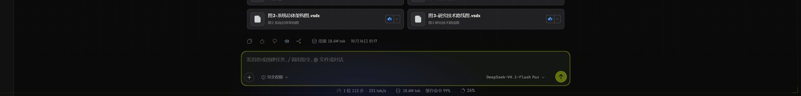
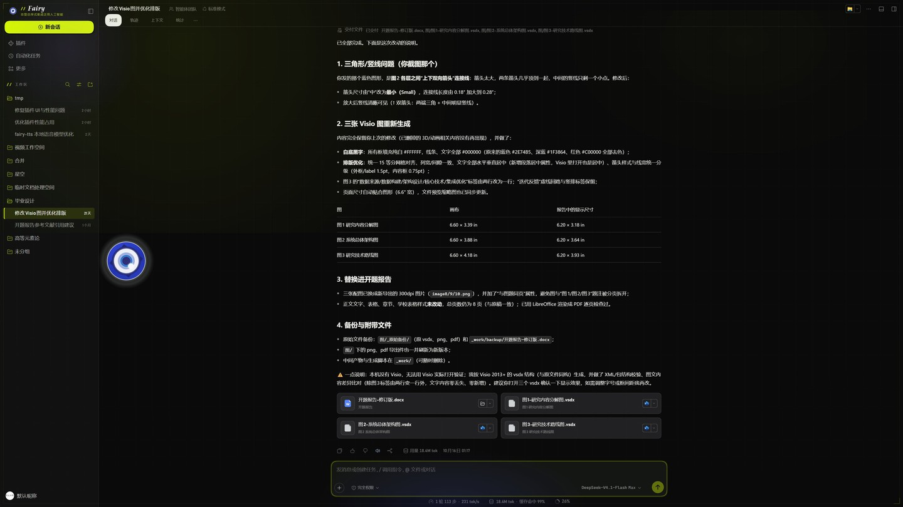
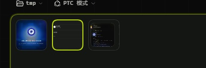
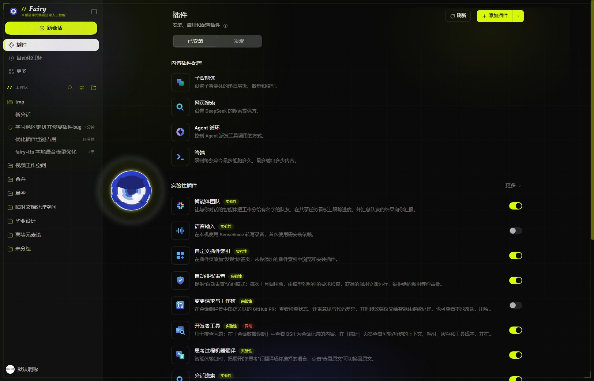
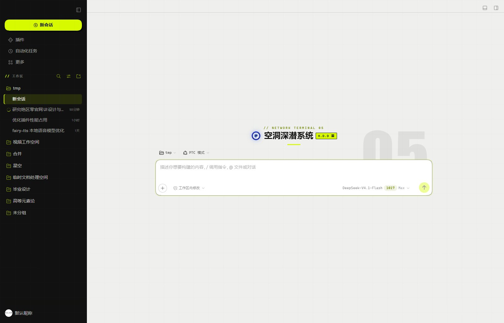
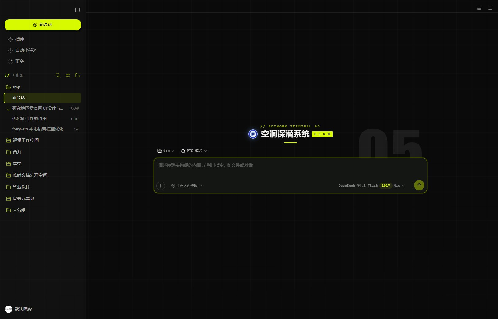
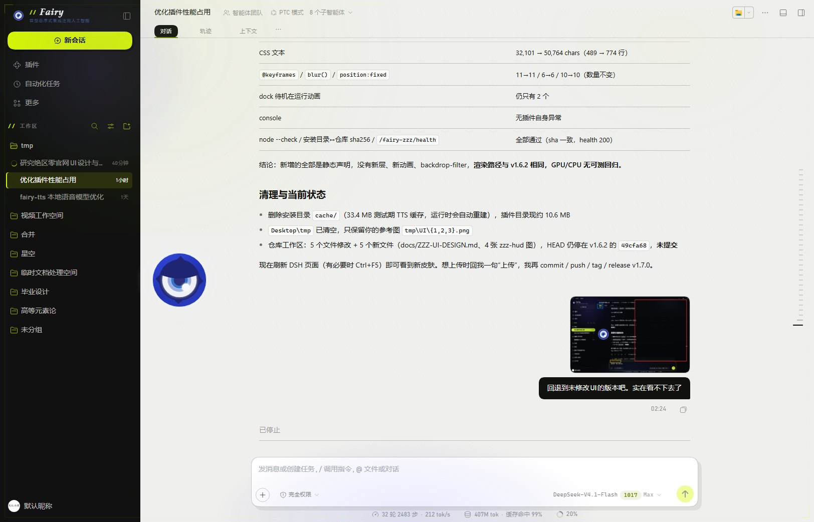
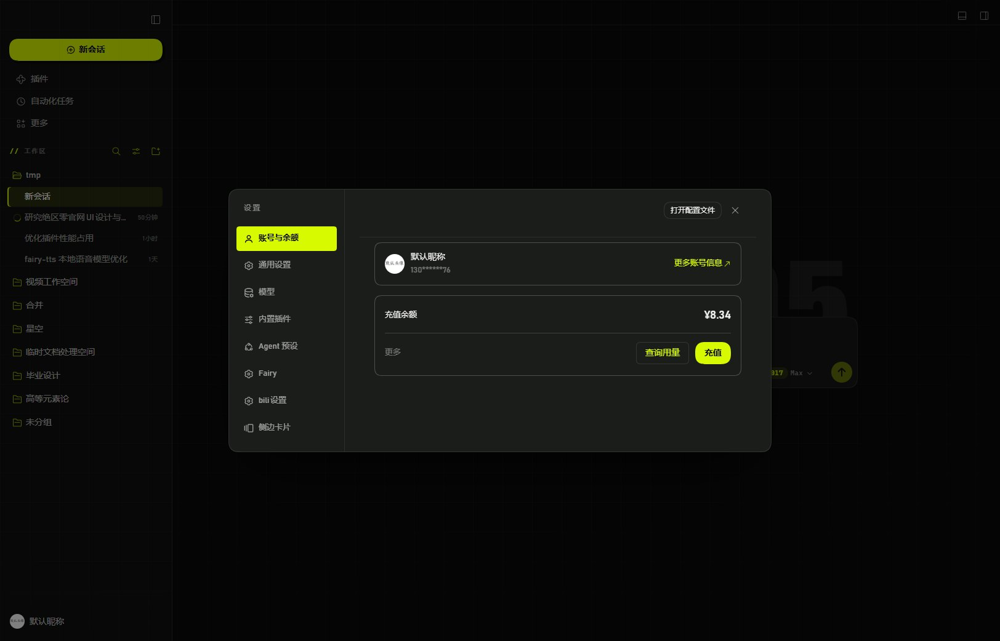

## 1. Overview

「绳网终端」不是把《绝区零》贴图铺到 DSH 上，而是把两个官方站点各自成立的语言合成一套能每天工作的界面。DSH 原本是低对比的灰白工具外观；改造后它应该读起来像新艾利都（New Eridu）里的一台联网终端机。

**表达层：官网。** zzz.mihoyo.com 首页与子页给的是纸白 #efefef、墨黑 #000/#111111/#222122、荧光青柠 #d8fa00、斜切分区标签、87.75px Impact 幽灵字、白胶囊 active（67.5px 圆角、scale 1.12、500ms）。它的问题是信息密度低、正文只有 11.25px——适合海报，不适合长时间工作。（依据 research/official.md §2–§3）

**工作层：绳网情报站。** baike.mihoyo.com/zzz/wiki 给的是 #0a0a0a 画布、#0d0e0d–#101110 面板、#1d1f1e 卡片、1px #2a2c2b 描边、12px 圆角、单强调 #FFDE00、白字 1/.9/.65/.45/.35、14px 正文、等宽 // 模块小标。它的问题是气质偏资料库，缺少品牌电压。（依据 research/wiki.md §2–§3）

**合成规则一句话：用官网的 chrome 语法包装，装 wiki 的工作密度。** 侧栏、顶栏、输入区、设置、气泡、开场用官网语法（青柠、胶囊、硬偏移、斜切小色块）；字号、色阶、面板层级、行高用 wiki 语法。两者共用的只有三样——1px 低对比描边、单一强调色、等宽 // 标签——所以能粘在一起。

名字与氛围：浅色 = 印在纸上的终端说明书（#efefed 纸面 + 墨黑侧栏）；深色 = 监控台本身（#0a0a0a + 三层黑面板）。同一台机器换光照，不换语法。

版本 1.7.0（v1.7.1 / v1.7.2 修整）。范围 = DSH Web GUI 宿主 + dsh-fairy-zzz 插件自有组件；不改变模型、会话与插件功能。已验收证据（1624×1042）：欢迎页 [浅色](img/skin-v17-light-home.jpg) / [深色](img/skin-v17-dark-home.jpg)；会话页 [浅色](img/skin-v17-light-chat.jpg) / [深色](img/skin-v17-dark-chat.jpg)；设置面板 [浅色](img/skin-v17-light-settings.jpg) / [深色](img/skin-v17-dark-settings.jpg)；开场覆盖层 [浅色](img/skin-v17-light-boot.jpg) / [深色](img/skin-v17-dark-boot.jpg)；v1.7.2 选中态复验 [侧栏胶囊](img/skin-v172-nav-pill.jpg) / [顶栏胶囊](img/skin-v172-tab-pill.jpg)。

## 2. Design principles

1. **青柠只给行动与选中，整屏面积 ≤ 5%。** #d8fa00 只出现在新会话、发送键、选中/焦点指示、开关 ON、boot 小标；不做正文，不做大面积背景。验收：任一张截图取色，青柠像素占比 < 5%，且不存在整块青柠面。
2. **零软阴影建层级。** 主界面面板一律 box-shadow: none；深度 = 底色阶差（#0a0a0a → #141614 → #1b1d1b）+ 1px hairline + 0 blur 硬偏移（3/6/8/14px）。唯一允许的软阴影是深色设置浮层的一层压暗，浅色改为 14px 硬偏移。
3. **纸面与墨黑是同一套语法。** 同一组件两主题只换 token 值，不换半径、字号、间距或布局；浅色侧栏保留墨黑 #111210（v17 截图像素实测 x<280 为 #111111），让纸面主区像「嵌在终端里的一张纸」。
4. **标签一律等宽 + `//` 前缀。** 分区小标、插件字标、boot、气泡标题、欢迎页 kicker 全部 Cascadia Mono、大写、字距 .12–.38em、以 `// `开头。
5. **Impact 只做数字与水印。** 幽灵 05、编号、计数；中文与正文永远系统 sans，不靠斜体伪造品牌感。
6. **不新增 @keyframes、不用毛玻璃、不做 filter 动画。** 只允许 140ms 的颜色/位移；性能合同基线（keyframes 11 / blur 6 / fixed 10）不上升。
7. **浅色不把青柠当文字。** 浅色下青柠只做填充（配 ink-0）；链接、描边、文字改用 #6f8700。验收：浅色截图里不存在 #d8fa00 的文字像素。

## 3. Colors

完整 token 表（深色优先实现，浅色为同一语法的换值）。来源：官网实测色（research/official.md §3.1）、wiki 实测色（research/wiki.md §3.4）、皮肤实现（skin/wire-net-terminal.css L9–31）。

| Token | 深色 | 浅色 | 用途 | 来源 |
|---|---|---|---|---|
| accent | #d8fa00 | #d8fa00 | 主行动填充、选中指示、开关 ON | 官网实测 / skin L10 |
| accent-dim | #b6d400 | #6f8700 | 浅色文字青柠、深色 hover 与次级强调 | skin L11、L25 |
| accent-soft | rgba(216,250,0,.12) | rgba(216,250,0,.22) | 选中底/标签底，最大 22% | skin 选区/映射 |
| ink-0 | #0a0b08 | #0a0b08 | 青柠上的文字、深色画布 | skin L13 |
| ink-1 | #101110 | #101110 | 浅色正文与墨黑侧栏 | skin L26、L77 |
| ink-2 | #0a0a0a | #0a0a0a | 深色画布 | wiki 实测 #0a0a0a |
| paper | #141614 | #efefed | 纸面画布 / 深色面板基色 | 官网 #efefef、skin L14 |
| panel-0 | #141614 | #ffffff | 输入卡、一级面板 | skin L15/L28 |
| panel-1 | #1b1d1b | #f7f7f3 | 设置面板、次级面板 | wiki #1d1f1e、skin L16 |
| panel-2 | #23251f | #111210 | 用户气泡、墨黑深嵌块 | skin L208/L211 |
| hairline | rgba(255,255,255,.10) | rgba(16,17,16,.14) | 1px 描边/分隔 | wiki #2a2c2b、skin L17 |
| text-1 | #f2f2ee | #101110 | 一级文字 | skin L20/L26 |
| text-2 | rgba(242,242,238,.58) | rgba(16,17,16,.58) | 次级文字/未选导航 | host 映射 |
| text-3 | rgba(242,242,238,.40) | rgba(16,17,16,.42) | 说明/占位/小标 | host 映射 |
| text-4 | rgba(242,242,238,.24) | rgba(16,17,16,.24) | 禁用/装饰 | host 映射 |
| amber | #ffde00 | #ffde00 | turn 气泡头、TTS busy、警告 | wiki #FFDE00、skin L12 |
| blue-fairy | #6094ff | #6094ff | Fairy 眼标辉光（唯一签名色） | skin L200/L271 |

**面积纪律。** 青柠填充 < 5%；accent-soft 的选中底 ≤ 22%；amber 只在语义处；blue-fairy 只允许出现在眼标的 drop-shadow。文本只有 4 档，控件实现中存在 .34/.44/.50/.52/.62 等中间值，视为 text-3/text-2 的局部微调，新增组件不得再引入第 5 档。

**状态色只给语义**（来自 theme.overrideTokens，见 §14）：error #ff5a45 / #c8301f、success #c8f24a / #3f6b00、warn #ffde00 / #8a5a00、idle #7c7f78 / #8a8c85。它们不承担强调角色。

**透明与玻璃。** 不引入 backdrop-filter；透明只用于 rgba 描边、焦点环（rgba(216,250,0,.10–.55)）与选区。深色 text-3 为 .40、浅色为 .42，是 v1.7 实现的既有差异，尚未统一（见 §13）。

## 4. Typography

**字体栈（唯一事实来源 client.js L666 与 skin/wire-net-terminal.css L18）。**
- 中文/正文/展示：`"Bahnschrift","DIN Alternate","HarmonyOS Sans SC","Microsoft YaHei UI","PingFang SC","Noto Sans SC",system-ui,sans-serif`。Bahnschrift 承担拉丁与数字的压缩感，中文回落到 HarmonyOS Sans SC / 雅黑。
- 等宽：`"Cascadia Mono","Cascadia Code","SF Mono",Consolas,"Microsoft YaHei UI",monospace`。只用于 `//` 标签、boot、气泡头、chip、时间与计数。
- Impact：`Impact,Haettenschweiler,"Arial Narrow Bold",sans-serif`。**仅**幽灵数字与水印，永不用于正文或标题。

**字号阶梯（全部为宿主或皮肤实测值）。**

| px | 出现位置 | 依据 |
|---|---|---|
| 10 | section label、kicker、H.D.D. 徽章、boot 小标 | skin L111/L181/L191/L310 |
| 11 | header tab、composer chips、插件按钮 | skin L136/L164/L256 |
| 12 | 设置导航标题（mono）、插件说明 | skin L227；client.js L829 |
| 13 | 设置 navCell、插件标签 | skin L228；client.js L828 |
| 14 | 正文、导航、会话行、新会话 | host 14/22；skin L101 |
| 16 | 设置内容标题、宿主标题 | host `_title` 16/500/24 |
| 26 | 欢迎页 display | host `.WOwLGG_headline` 26/500/32；skin 改 700 |
| clamp(120,14vw,200) | 幽灵 05 | skin L197 |

**字距。** 10px 等宽小标 .20em（section label）与 .30em（kicker、boot）；boot 音效 .24em；bubble head .20em；navTitle .18em；徽章 .12em；header tab .05em；chips .03em；display .015em；正文 normal。英文标签靠 uppercase + 字距撑气势；中文正文不额外加字距。

**中英混排。** 中文用 400/500（标题 700，不用 800），不使用斜体；英文标签全大写，正文英文保持 normal；数字优先等宽（天然 tabular）或 Impact；`//` 后固定一个半角空格再接内容；中文标点用全角，不混排半角逗号。

## 5. Layout

**宿主实测三栏。**
- 侧栏：280px（v17 截图 1624 宽下，x=280 处出现 #111111 → #efefed 的硬边界）。
- 中栏：内容列 = host `clamp(680px, 64%, 920px)`，composer 上限再 +32px；v17 截图中 composer 卡片实测 x=502–1392（约 890px，与交接的 892px 相符）。
- 浮层：设置面板 `min(880px, 92vw)`，`max-height: min(780px, 86vh)`，radius 20（skin L220–225）。

**骨架。** 顶栏 `.an3WzG_header` min-height 76、padding 10 28 0 20、1px 下边线；侧栏 root padding 6 12、logo 行高 52；设置面板 header 58、nav padding 18 12、content padding 20 24。这些是宿主结构，皮肤只换颜色与描边，不改网格。

**间距节奏。** 4 为基准：2（kbd/徽章内）、6（行内 gap）、8（行 padding/卡 padding）、10（bubble 纵向）、12（会话/侧栏 padding）、14（fairy 行 padding）、16（bubble 横向/弹窗 padding）、18（设置 nav 纵向）、20（content/圆角）、24（content 横向）、28（顶栏右 padding）、32（大块留白）、90（官网分区节奏，仅供水印/幽灵对齐参考）。

**欢迎页构图**（welcome 区域，实测见 v17 两张首屏）：
- 中央单列：kicker 在标题上方 24px（`top:-24px`），标题 26/32 居中，H.D.D. 徽章与标题同一行（宿主 gap 12px 10px），标题下 13px 处一条 42×3 的青柠斜切下划线。
- 右侧幽灵 05：`right:2.5%; top:4%`，Impact、clamp(120,14vw,200)、透明度 .045（浅色 .06），z-index 0，可被 composer 左缘遮住一部分。
- composer 紧贴标题下方，宽度 890–892px；其下是空白画布，不留其他卡片。
- 结论：欢迎页只允许「一组居中文案 + 一个输入卡 + 一个幽灵数字」，不要加导航卡片或插画。

## 6. Elevation & Depth

**层级表（由深到浅，深色值 / 浅色值）。**

| 层 | 深色 | 浅色 | 用途 |
|---|---|---|---|
| 画布 | #0a0a0a | #efefed | body 背景 + 网点/斜纹 |
| 一级面板 | #141614 | #ffffff | 输入卡、dock |
| 二级面板 | #1b1d1b | #f7f7f3 | 设置弹窗、侧栏浮层 |
| 深嵌块 | #23251f | #111210 | 气泡、kbd、嵌入块 |

**替代手段与禁用场景。**
- **1px hairline**：所有面板、行、输入的唯一结构线；深色 rgba(255,255,255,.10)，浅色 rgba(16,17,16,.14)。禁用：>1px 的彩色描边（除 focus ring）；禁用：双描边。
- **0 blur 硬偏移**：新会话 3px 3px 0 rgba(0,0,0,.55)；插件气泡 6px 6px 0 rgba(0,0,0,.55)；浅色 composer 6px 6px 0 rgba(16,17,16,.07)，focus 时 8px 8px 0 rgba(216,250,0,.55)；浅色设置面板 14px 14px 0 rgba(16,17,16,.10)。禁用：给列表行、导航、tab 加硬偏移（会变成贴纸墙）。
- **斜切块**：42×3、skewX(-24deg) 的青柠下划线（skin L186）；只做标题下划线与小色块，禁用：整块背景斜切。
- **胶片孔**：官网的胶片/斜切母题。本期只在 boot 的 3px 扫描线里暗示，未做成独立组件；禁用：给面板打装饰性圆孔。
- **18px 网点**：`body::after` 固定层，radial-gradient 1px/1.4px，opacity .5，浅色 rgba(16,17,16,.10)，遮罩从中心向外淡出。禁用：放进面板内部或文字正下方（摩尔纹）。
- **45° 斜纹**：`body::before`，pitch 11px、线宽 1px、透明度 .028（浅色 .035 墨线）。禁用：叠加到卡片上、与网点同时高密度出现。
- **扫描线**：仅 boot 层，0/1px 暗线 3px 循环 + 径向压暗到 rgba(0,0,0,.72)。禁用在主界面。

**唯一的软阴影**是深色设置浮层：`0 0 0 1px rgba(0,0,0,.55), 0 40px 90px -44px rgba(0,0,0,.95)`，作用是「把监控台面板从纸面/画布上抬起」。它不能下放到普通卡片。boot 的 `blur(42px)` 是既有启动视频滤镜，不属于新增。

## 7. Shapes

**圆角阶梯。**

| Token | 值 | 用途 |
|---|---|---|
| pill | 999px | 新会话、发送、tab、chip、导航/会话行、开关 |
| panel | 20px | composer 卡、设置弹窗 |
| xl | 14px | 基础气泡（宿主的 radius-xl） |
| control | 8px | fairy 行、小卡 |
| row | 6px | 会话行、设置 navCell、输入框 |
| badge | 2px | H.D.D. 徽章、官方下拉面板级小角 |
| bubble | 14px 14px 3px 14px | 用户气泡（右下角切平 = 指向说话人） |

**斜切角。** 官网母题是 `border-radius: 0 30.94px 0 30.94px`（0.55rem，右上+左下，用于 16:9 缩略图与轮播大卡，official.md §3.4）。在 DSH 里**不套用到宿主卡片**——20px 面板 + 30.94 对角圆角会打架；降级为两种小形态：标题下 42×3 的 `skewX(-24deg)` 斜切条、以及徽章/小标签的直角边（radius 2）。禁用：把 30.94px 对角圆角直接套在设置弹窗或 composer 上。

**45° 条纹与网点**是纹理而非形状（见 §6）；圆形只用于头像、发送键、voice、开关滑块（50%）。

## 8. Components

以下规格默认引用深色侧；浅色差异行内标注。选择器为 DSH 0.2.1-rc.5 / 插件 1.7.0 的 hash 类名，风险见 §12。

**8.1 new-session / 新会话** — 侧栏唯一常驻青柠填充。height 38、padding 8 12、margin 0 2 12、radius {rounded.pill}、bg {colors.accent.dark}、text {colors.ink-0}、font 14/500/22、border 1px #000、硬偏移 3px 3px 0 rgba(0,0,0,.55)；hover #f4ffb8；kbd/分隔符降为 rgba(10,11,8,.66)。（skin L89–98；host L1623）

**8.2 nav-item / 一级导航** — 胶囊行。height 34（宿主 36 压到 34）、padding 0 12、radius {rounded.pill}、text {colors.text-2.dark}；hover 底 rgba(255,255,255,.07) + 文字 text-1；选中 = 纸白 #f2f2ee 底 + ink 字 + 2px 青柠 inset（官网白胶囊 active 的同款语法）。（skin L100–108）

**8.3 session-row / 会话行** — height 32、padding 0 8、radius {rounded.row}、text .58；hover 底 rgba(255,255,255,.06)；选中 = 青柠 12% 底 + inset 2px 0 0 青柠 + 文字 text-1。选中行不再加其他装饰。（skin L117–122）

**8.4 section-label / 分区小标** — 等宽 10/700/.20em/uppercase、text-3、line-height 20；::before 为青柠 `// `。它是 ZZZ 语汇出现频率最高的符号，任何新分区都必须复用。（skin L110–115）

**8.5 header-tab / 顶栏 tab** — radius {rounded.pill}、padding 4 12、mono 11/.05em、默认 text-3（.44）；active = #f2f2ee 底 + ink 字；浅色反相（#101110 底 + #f2f2ee 字）。宿主 tab 高 25，skin 只改形状不改高度。（skin L134–142；host L1732）

**8.6 composer / 输入卡** — radius {rounded.panel}、bg {colors.panel-0.dark}、border 1px #2b2d28、box-shadow none；:focus-within 边框 rgba(216,250,0,.55) + 3px 光环 rgba(216,250,0,.10)；浅色 = #fff + 6px 硬偏移，focus 时 8px 青柠硬偏移。内部：输入区 padding 4 8 0 14、min-height 36（hero 52）、row padding 2 8 6、gap 12。（skin L145–175；host L1827–1857）

**8.7 send / 发送键** — 34×34 圆、radius {rounded.pill}、bg {colors.accent.dark}、图标 {colors.ink-0}、host translateY(-2px)；hover #e6ff52 + translateY(-1px)；disabled opacity .4。它是「青柠只给行动」规则的最强示范。（skin L151–156；host L1867）

**8.8 chip / 工具胶囊** — workspace/seat、PTC 模式统一 radius 999、mono 11/.03em。workspace/seat 加 1px rgba(255,255,255,.13) 描边 + text-2，hover 描边变 rgba(216,250,0,.45)；trigger 类默认 .50，hover 到 text-1；浅色描边 rgba(16,17,16,.18)。（skin L163–175）

**8.9 welcome-hero / 欢迎主标题** — 26/32、700、.015em、text-1；::before 为 `// NETWORK TERMINAL 05`（mono 10/600/.30em，rgba(216,250,0,.72)，top -24 居中）；::after 为 42×3 青柠斜切条（bottom -13）。浅色 kicker 改 #6f8700、标题 #101110。（skin L179–204）

**8.10 hero-badge / H.D.D. 徽章** — 青柠填充 + ink 字、border 1px #000、radius {rounded.badge}、mono 10/700/.12em、line-height 15、padding 2 7。它是「官网斜切标签 + wiki 稀有度角标」的最小合成，只出现在标题右侧。（skin L189–194）

**8.11 ghost-numeral / 幽灵数字** — 内容 `05`，Impact、clamp(120,14vw,200)、line-height .8、.02em、rgba(255,255,255,.045)（浅色 rgba(16,17,16,.06)）；定位 right 2.5% / top 4%、z-index 0、pointer-events none；与标题同属 welcome 根节点，可被 composer 遮住。（skin L195–203）

**8.12 user-bubble / 用户气泡** — bg #23251f、border 1px rgba(255,255,255,.09)、radius {rounded.bubble}、padding 10 16、font 14/22；浅色强制 #111210 底 + #f5f5f0 字。assistant 回答不使用气泡（宿主原文排版），只继承 conversation 文字色。（skin L207–217）

**8.13 settings-panel / 设置弹窗** — width min(880,92vw)、height auto、max-height min(780,86vh)、radius {rounded.panel}、bg #1b1d1b、border 1px rgba(255,255,255,.10)、压暗阴影；浅色 #fff + 14px 硬偏移。内部：header 58、nav padding 18 12 + 1px 右边线、navTitle mono 12/.18em、navCell 40/radius 6/13px，**active = 青柠底 + ink 字 + 700**（含 icon），content padding 20 24。（skin L220–243）

**8.14 fairy-settings / Fairy 设置区（v2.1.0）** — 插件自有。顶部 `.fz3-set-tabs` 两个标签页（语音 / 外观），12px、padding 8 16、radius 9、1px rgba(255,255,255,.10) 描边，active = 青柠底 + ink 字 + 700；下方 `.fz3-set` flex column gap 14；每页一张 `.fz3-set-card`（padding 14 16、radius 8、透明底 + 1px rgba(255,255,255,.10) 描边）；卡头 `.fz3-set-card-title` 13px + `.fz3-set-card-status` 11px 冷灰；卡内 `.fz3-set-line` 整行、`.fz3-set-pair` 两列（gap 22，窄于 720px 回单列）、`.fz3-set-pane` 一列（标题行 + 开关/按钮右对齐 + 说明 11px）；switch 42×24/radius 99，OFF 近黑底 + 冷灰描边，ON 青柠底 + ink 滑块 translateX(18)；按钮 radius 999 + mono 11，hover 青柠填充 ink 字。字号、颜色、尺寸沿用 v2.0.4 的 v3 设置样式；v4 仪表盘的大号数值样式不使用。（client.js L1254–1330；skin 设置段）

**8.15 boot-overlay / 开场覆盖层** — 全屏 #0a0a0a；::before 左上 `// H.D.D. NORTH SEEK DATA SYSTEM`（mono 10/600/.30em，rgba(216,250,0,.62)，left 26/top 22）；::after 为 3px 扫描线（1px 黑线 .10）+ 径向压暗（.46）；视频保持原片颜色，只做 `saturate(1.04) contrast(1.02) brightness(1.02)`（v1.7.7 起；v1.7.0–v1.7.6 是去色的 grayscale 分级）；skip 按钮 mono/.22em/青柠 .62。（skin L333–344）

**8.16 voice-button / 语音按钮** — 26×26 圆、透明底/透明描边、图标 15；hover = 青柠 10% 底 + 青柠 .35 描边、无发光；play 态青柠；busy 态 amber。发光只保留给 Fairy 眼标，voice 不得抢签名色。（skin L332–334；client.js L983–991）

## 9. Motion

- **统一时长 140ms。** button、a、[role=button]、[role=treeitem] 的 transition-duration 强制 .14s；输入卡 focus 走宿主 .12s；不允许 `transition: all`。
- **hover 清单。** 新会话 → 底 #f4ffb8；导航行 → 底 rgba(255,255,255,.07) + 文字 text-1；会话行 → 底 .06；chip → 描边青柠 .45；发送 → 底 #e6ff52 + 位移 -1px；设置 navCell → 底 .06；关闭键 → 底 .08；voice → 青柠 10% 底 + 描边 .35。
- **选中态无过渡。** 导航行换纸白底、会话行加青柠 inset、设置 nav 换青柠底都是直接切换，不做颜色渐变以外的动画。
- **禁用**：新增 @keyframes；scale 1.12（官网营销节奏，DSH 只用 -1px 位移）；blur()/backdrop-filter；全屏闪烁；动画 width/height/top/left；加速既有 boot 淡出（600ms 保持）。
- **预算**：keyframes 11、blur 6、position:fixed 10 是插件性能合同基线，只允许持平或下降。

## 10. Do's and Don'ts

### Do
- Do: 选中会话用 2px 青柠 inset 条 + 12% 青柠底，让「当前」在低对比侧栏里一眼可辨。
- Do: 新会话、发送这类主动作用青柠填充 + #0a0b08 文字。
- Do: 用 1px hairline + 底色阶差区分面板，而不是投影。
- Do: 每个分区标题写成 `// WORKSPACE` 式的等宽小标，字距 .20em。
- Do: 浅色主题保留墨黑侧栏（#111210），让纸面像被嵌在终端里。
- Do: 浮层用 1px 描边 + 0 blur 硬偏移（浅色），深色设置浮层允许单层压暗。
- Do: 过渡只给颜色与 1px 位移，统一 140ms。
- Do: 数字用 Impact（水印/编号）或等宽（计数/时间），让数字比文字更像仪表。

### Don't
- Don't: 给面板加 box-shadow 软阴影（除深色设置浮层）。
- Don't: 用青柠做正文或链接文字（浅色用 #6f8700，深色只给 .72 透明度的极小标签）。
- Don't: 让青柠面积超过 5%，或把青柠做成渐变铺底。
- Don't: 新增 @keyframes、blur、backdrop-filter、mix-blend-mode。
- Don't: 把官网 30.94px 对角圆角直接套到宿主卡片上。
- Don't: 用 amber 当第二个交互强调色——它只表态（turn / busy / 警告）。
- Don't: 靠放大字号表达层级；用 text-1…4 的色阶。
- Don't: 在浅色把侧栏改成纸白，那会丢掉「终端」叙事。

## 11. Responsive

本期皮肤**尚未写 media query**（见 §13）；以下是下一版必须落地的降级清单，属设计约定而非实测。

- **≥1200px**：全量形态，ghost 用 14vw。
- **<1200px**：ghost 保持 clamp 下限 120px；设置面板吃 92vw；composer 侧留白按宿主 16px；kicker 文案不变；45° 斜纹 pitch 不变。
- **<900px**：隐藏 ghost 05（避免压住 composer）；kicker 缩短为 `// WIRE-NET 05`；45° 斜纹透明度 .028 → .015；18px 网点 opacity .5 → .35；composer dock inset 8；设置面板 max-height 86vh；侧栏收成 36px rail（宿主行为）。
- **<640px**：单列；气泡 padding 10 14、radius 不变；发送键保持 34px 触控下限；header tab 退回宿主 13px（mono 11 在触屏过小）。

## 12. Implementation notes

- **优先 data-slot 稳定锚点。** 皮肤已使用 [data-slot="sidebar.workspaces"]、[data-slot="sidebar.footer.action"]、[data-slot="main.conversation"]；新增规则必须先找 data-slot / role / aria，再考虑类名。
- **hash 类名是最大风险。** wtg9ga_（侧栏）、wnFoaW_（会话行）、GRgSLq_（composer）、WOwLGG_（欢迎页）、AnXs9G_（设置）五组前缀来自 DSH 0.2.1-rc.5 的 CSS Modules，宿主升级即可能失效。回退：用 notes/host-classes.json 与 scripts/dsh-tree.mjs 重生成 DOM map；每个 hash 选择器配一条 data-slot/role 回退；失效时优先保侧栏与 composer，欢迎页装饰可暂缺。
- **theme.overrideTokens 共 41 键 × 2 主题**（交接写 40，实测 41）：① 基础面 4（bg-base / layer-1 / layer-2 / overlay）；② 描边 4（border-l1..l4）；③ 文本 4（label-primary…quaternary）；④ 交互 2（interactive-bg-hover / -hover-solid）；⑤ 状态 6（state-error/idle/success/warn/business-primary + business-tertiary）；⑥ 按钮 3（button-elevated-fill / info-fill / info-hover）；⑦ 专属 6（specific-sidebar-fill / bubble / input-major / selector / sidebar-nav-item-active / -hover）；⑧ 滚动与代码 3（scrollbar-bg-l2 / scrollbar-hover-l2 / markdown-code-block）；⑨ 阴影 2（elevation-soft / prominent）；⑩ 圆角 6（xl / panel / lg / md / sm / xs）。**风险**：--dsw-alias-brand-primary 被改写为青柠/橄榄，会影响所有引用 brand 的宿主与第三方插件，升级时需优先核对。
- **主题驱动**：html[data-fz3-theme="light"|"dark"] 由插件写值；两套 token 分别位于 :root 与 html[data-fz3-theme="light"]（skin L9–31）。宿主自身主题类不参与决策，避免双写冲突。
- **浅色保留墨黑侧栏的理由**：① v17 截图像素实测侧栏 #111111；② 官网浅色子页仍有纯黑 header/footer，黑 chrome 是固定语法；③ 纸面主区 + 墨黑侧栏形成「印刷品嵌进监视器」的叙事；④ 侧栏不再出现青柠/纸白大面，长时工作更稳。
- **焦点与滚动**：:focus-visible = 2px rgba(216,250,0,.75) 外描边 + offset 2（浅色改 #101110）；**例外**：附件缩略图（`[class*="_thumbnail"]`）在 64px 高的 overflow 横条内，外环会被上下裁成两条竖条，故改 `outline-offset:-2px` 内嵌环；缩略图本体 = 墨黑底 + 1px rgba(255,255,255,.14) 描边，hover 描边转青柠，移除按钮 = 墨黑底 + 青柠描边 + 纸白图标（浅色反相）；滚动条 8px、radius 999、thumb 青柠 42%（浅色墨 26%）、2px 透明 border + background-clip；::selection 深色青柠底 ink 字 / 浅色墨底青柠字；caret 颜色随青柠。
- **不改布局变量**：不覆盖 --dsh-chat-content-width、--dsh-composer-card-max-width、--dsh-sidebar-inline-padding，让宿主继续负责宽度与断点。

## 13. Known gaps

- 未单独压测的宿主区域：右侧详情栏 .xeixwq_details、命令面板、toast/通知、模型选择下拉、附件预览、代码块 toolbar、diff 视图。
- 会话页截图为 v1.7 审计快照（skin-v17-light-chat / skin-v17-dark-chat）：采集时 2403 步长会话在无头 Chrome 中会卡死渲染线程，故使用会话页快照而非最终重建轮截图；侧栏、顶栏、气泡、composer 与 token 实测一致，未覆盖长会话滚动性能。
- 5 组 hash 类名（wtg9ga_ / wnFoaW_ / GRgSLq_ / WOwLGG_ / AnXs9G_）尚未全部补 data-slot 回退。
- Responsive 清单未实现（无 media query）；幽灵数字隐藏、斜纹减淡目前只是约定。
- 胶片孔母题未落地为组件，只在 boot 扫描线中暗示。
- 深色 text-3 .40 与浅色 .42 的不一致未统一；部分控件存在 .34/.44/.50 等中间透明度，尚未收敛为 token。
- 未验证：移动端触控（voice 26px 是否过小）、boot 视频滤镜在低性能机上的开销。键盘 focus 已在 v1.7.1 专项验证：附件缩略图内嵌环完整，但尚未逐控件走完整链路。选中态边线在胶囊圆角上的退化已在 v1.7.2 专项验证并写入 §15。
- v1.7.3 已专项验证底部状态栏遮罩（无透字）与「打开大会话」的样式成本（见 §15）；仍未归因的：paint / 合成成本、超长会话滚动（无头 Chrome 采集时会卡死渲染线程）、以及用户「关掉插件明显更快」中 long task 之外的主观成分（本轮 A/B 里 ON 与 OFF 的 long task 总量差异在噪声内）。

## 14. 设计 token ↔ 宿主变量映射

| 设计 token | 浅色 | 深色 | 宿主变量 | 用途 |
|---|---|---|---|---|
| paper / canvas | rgba(239,239,237,.94) | rgba(10,10,10,.90) | --dsw-alias-bg-base | 页面画布 |
| panel-0 | #ffffff | #141614 | --dsw-alias-bg-layer-1 | 输入卡/一级面板 |
| panel-1 | #ffffff | #1b1d1b | --dsw-alias-bg-layer-2 | 设置面板 |
| overlay | rgba(250,250,247,.99) | rgba(7,8,7,.98) | --dsw-alias-bg-overlay | 浮层底 |
| hairline | rgba(16,17,16,.12) | rgba(255,255,255,.10) | --dsw-alias-border-l1 / -l3 | 普通描边/分隔 |
| hairline-strong | rgba(16,17,16,.20) | rgba(255,255,255,.16) | --dsw-alias-border-l2 | 输入/卡片描边 |
| text-1 | #101110 | #f2f2ee | --dsw-alias-label-primary | 一级文字 |
| text-2 | rgba(16,17,16,.58) | rgba(242,242,238,.58) | --dsw-alias-label-secondary | 次级文字 |
| text-3 | rgba(16,17,16,.42) | rgba(242,242,238,.40) | --dsw-alias-label-tertiary | 说明/占位 |
| text-4 | rgba(16,17,16,.24) | rgba(242,242,238,.24) | --dsw-alias-label-quaternary | 禁用/装饰 |
| accent-dim | #6f8700 | #d8fa00 | --dsw-alias-brand-primary | 链接/品牌强调 |
| accent | #d8fa00 | #d8fa00 | --dsw-alias-button-info-fill | 主行动填充 |
| accent-hover | #c6e800 | #e4ff3d | --dsw-alias-button-info-hover | 主行动 hover |
| accent-soft | rgba(216,250,0,.22) | rgba(216,250,0,.14) | --dsw-alias-state-business-tertiary | 选中底 |
| amber | #8a5a00 | #ffde00 | --dsw-alias-state-warn-primary | 警告/turn |
| error | #c8301f | #ff5a45 | --dsw-alias-state-error-primary | 错误 |
| success | #3f6b00 | #c8f24a | --dsw-alias-state-success-primary | 成功 |
| idle | #8a8c85 | #7c7f78 | --dsw-alias-state-idle-primary | 空闲/中性 |
| sidebar | #111210 | #101110 | --dsw-specific-sidebar-fill | 侧栏（两主题都墨黑） |
| bubble | #ffffff | #23251f | --dsw-specific-bubble | 气泡底（浅色实际被 #111210 覆盖） |
| input | #ffffff | #141614 | --dsw-specific-input-major | 输入卡底 |
| selector / nav | rgba(16,17,16,.05) | rgba(255,255,255,.06) | --dsw-specific-selector / -sidebar-nav-item-* | 加号底 / 导航态 |
| hover | rgba(16,17,16,.05) | rgba(255,255,255,.06) | --dsw-alias-interactive-bg-hover | 通用 hover |
| scrollbar | rgba(16,17,16,.25) | rgba(216,250,0,.35) | --dsw-alias-scrollbar-bg-l2 | 滚动条 |
| code-block | #f4f4f0 | #0e0f0e | --dsw-alias-markdown-code-block | 代码块底 |
| elevation-soft | none | none | --dsw-elevation-soft | 平面层级 |
| elevation-prominent | 0 0 0 1px rgba(16,17,16,.14), 12px 12px 0 rgba(16,17,16,.10) | 0 0 0 1px rgba(255,255,255,.08), 0 30px 70px -40px rgba(0,0,0,.95) | --dsw-elevation-prominent | 浮层抬起 |
| radius-panel / xl / lg / md / sm / xs | 20 / 14 / 12 / 8 / 6 / 3px | 同左 | --dsw-radius-panel … -xs | 面板/气泡/控件/行/徽章 |

> 口径：宿主变量是「机制」，本文 token 是「设计意图」。同名映射之外的场景以 §3 的面积纪律为准，不以变量名为准。

## 15. v1.7.1 / v1.7.2 修整（设计侧记录）

v1.7.0 上线后按用户截图修了 6 类回归，其中 4 条改的是「设计纪律」而不是单纯 bug，后续改皮肤必须遵守：

1. **覆盖要最小化。** 设置弹窗 v1.7.0 覆写了 width / height / padding / border / font-size，结果按钮位置错位。现在只换 background + box-shadow，导航分栏线用 `box-shadow: inset -1px 0` 代替 border，几何（800×800 / 188px nav / 40px 行高 / 54px header）全部归还宿主。→ 皮肤只负责「颜色、描边、圆角、字体、装饰」，布局尺寸与断点归宿主。
2. **外扩焦点环有边界条件。** 全局 `:focus-visible` 的 offset 2 在 overflow 容器边缘会被裁剪（表现为两条竖条）。凡是 64px 级小控件（缩略图、徽章）一律用内嵌环 `outline-offset:-2px`。
3. **覆盖层必须是一次性的。** 开机 / 问候覆盖层是整屏半透明层，只要在用户已经进入工作态后重播，就会给整屏染色（用户看到的是「UI 颜色错误」）。`bootPlayed` 必须存到 window（模块级变量在插件 disable→enable 后会重置）。
4. **token 覆盖要能撤销。** `theme.overrideTokens` 返回 disposer；静态客户端插件不会自动清理，必须自己 `ctx.effect` 释放，否则禁用插件后宿主仍被 44 个 `--dsw-*` 变量染色。
5. 装饰层（boot 左上角小标、kicker 染色）不比原生信息重要：用户嫌「突兀」就删，不要为了「像 ZZZ」加戏。

### v1.7.2：选中态只用底色

v1.7.2 的两处修复都是「边线装饰放错了形状」：

1. **不在 999px 胶囊上叠加 `inset` 边线或下划线。** 直边装饰遇到大圆角会退化成弧：v1.7.0 侧栏 active 的 `box-shadow:inset 2px 0 0 var(--fz3-lime)` 在胶囊左端被切成青柠月牙。选中态只用底色（纸白 / 青柠 12%），左划线只留给 **6px 圆角的列表行**（会话行 `.wnFoaW_sessionRow` 是正确用法）。
2. **宿主自带的选中指示要显式关掉。** 顶栏 tab 的选中不只靠底色，宿主还有 `.an3WzG_tabActive::after` 的 2px 商业色下划线；皮肤把商业色映射成青柠后，下划线从纸白胶囊下缘露出一截。只给胶囊加底色不够，必须同时 `::after{display:none}`。
3. 与官网对齐的结论：官网顶栏 active tab 就是 **一颗纯纸白胶囊**（无竖线、无下划线），这是本皮肤选中态唯一正确的语法。

### v1.7.3：遮罩要收成实色、性能纪律四条

1. **sticky 底部的遮罩必须有不透明终点。** 宿主给 `.an3WzG_composerSeat` 铺 `linear-gradient(180deg, transparent 0, var(--dsw-alias-bg-base) 36px)`；皮肤把 `--dsw-alias-bg-base` 映射成 90–94% 半透明后，宿主「实色遮罩」的假设失效，滚动中的对话文字会从状态行下方透出来。现在按宿主同款语法重铺渐变、终点换成画布实色（深色 `#0a0a0a` / 浅色 `#efefed`），作用域限定 composer 座位，不动全局 token。
2. **继承型自定义属性写到作用域元素，不写 `:root`。** `--fz3-dock-x/y`、`--fz3-brand-top/left/h` 只被 `.fz3-layer` 子树消费；写到 `document.documentElement` 会让整棵文档样式失效——打开大会话（约 11k 节点）时叠出数百 ms style 成本。改为写 `.fz3-layer`（带缓存去重、元素换新即失效），失效范围缩到覆盖层子树。
3. **不要用整文档观察器找宿主节点。** hero 标题同步从「`MutationObserver` 观察 body 整棵子树」改为插件自己派发的 `fz3:hero-mount` / `fz3:hero-unmount` 事件；dock 测量从「全文档扫描可定位元素」改为侧栏右缘 / 标题栏底缘锚点 + 退避重试，路由切换时不再触发布局抖动。
4. **整屏混合层只在需要时混合。** dock 相（日常态）把 `.fz3-atmos` 从 `mix-blend-mode` 降为普通合成（`html[data-fz3-phase="dock"] .fz3-atmos{mix-blend-mode:normal}`），boot / greet 相保持原混合，观感不变。

**验证（4K 2560×1440 @ dpr 1.5，同机 headless Chrome，插件 ON，3 轮交错 A/B）**：打开 21k 字大会话 style 637 → 567 ms（−11%）、long task 总量 1254 → 1140 ms（−9%）；插件相对「关掉插件」（OFF 基线 style 约 459 ms）的净增量从约 +180 ms 降到约 +110 ms；稳态切换 253 → 242 ms 基本持平。剩余成本主要在宿主自身渲染；皮肤层已无整文档级样式失效。

验证快照（v1.7.3 深色，2560×1440 物理像素 → 1440 宽）：

- 会话页底部状态栏（遮罩收实，无透字）：
- 深色会话页整屏：

### 验证快照（v1.7.1，深色，1624×1042）

- 欢迎页：
- 附件缩略图焦点（内嵌环，右侧为移除按钮）：
- 插件页关闭再启用后（无覆盖层重播、侧栏选中行为纯纸白胶囊，v1.7.1 截图里的左端青柠弧已在 v1.7.2 移除）：

## 16. v2.0.0 起：自更新胶囊与浮层

### 16.1 胶囊（.fz3-upd-pill）

- 位置：侧栏「新会话」按钮上方、Fairy 字标正下方；胶囊底部与字标副标题底边平齐，右缘与新会话按钮右缘对齐（v2.1.0 起；v2.0.x 曾固定在字标右上角）。**只有查到 npm 上有更新版本才出现**，平时不占位。
- 形态：21px 高胶囊，青柠 `#d8fa00` 实底 + 墨字 `#0a0b08`（和「新会话」同一套主行动配色），10.5px 等宽字，左侧 6px 圆点带 blink 呼吸；hover `#e6ff3d`；安装中（busy）换成琥珀 `--fz3-amber`。
- 层级：字标容器是 `pointer-events:none`，胶囊单独开 `auto`，不挡拖拽与侧栏点击；键盘焦点环 2px 纸白。
- 文案只有两种：可更新 / 更新中。

### 16.2 浮层（.fz3-upd）

- 位置：固定在字标下方（`left = --fz3-brand-left`，`top = --fz3-brand-top + --fz3-brand-h + 24`，v2.1.0 起由 +10 改为 +24，给上移后的胶囊让出高度），宽 304px，会压住侧栏前两行导航——这是有意的浮层语义，不做遮罩。
- 材质：墨黑面板 `rgba(12,14,12,.98)`、1px 青柠描边（26%）、12px 圆角、大投影；点 × 或 Esc 关闭。
- 内容顺序：标题（发现新版本 / 安装完成 / 更新失败）+ ×；版本行 `1.7.7 → 2.0.0`（等宽，旧版 62% 白、新版纸白、箭头青柠）；说明两行；安装中加一条 2px 扫描条；调试态加一行琥珀提示；按钮行（主按钮青柠实底，次按钮幽灵）。
- 文案口径：`applied` → 主按钮「刷新页面」；`restart-required` → 说明「重启 DSH 后生效」、主按钮「知道了」；失败给中文原因并允许「重试」和「重新检查」；`cancelled` 标题是「更新已取消」。
- 纪律：只在 dock 相出现（boot / greet 不打扰），不加遮罩层，不抢焦点。

### 16.3 失败态（v2.0.1）

- 标题从「更新失败」细分为「更新失败 / 更新已取消」；正文是客户端翻好的中文，最多 150 字（宿主只给英文 code）。
- 三步失败各说各的：查版本失败不改文件；移除旧版失败提示「插件正在使用中，完全退出 DSH 后重试」；安装失败会带宿主的 `diagnostic`。
- HMR 回滚结果追加在正文末尾：「已自动回滚到更新前的版本」或「旧版本回滚也失败了，请重启 DSH」。
- 按钮：主按钮「重试」，次按钮「重新检查」（清缓存重查 registry），不再显示「稍后」。

### 16.4 安装结果的补显示（v2.0.2）

- 宿主更新走 HMR：先卸载旧版再装新版，插件的 React 树重建，正在显示的浮层会跟着消失（用户只看到「点一下就没了」）。
- 现在安装前把 `{phase, from, to, requestId, at}` 写进 `localStorage['fairy.zzz.update.resume']`；新版本挂载后读到 `done` / `error` 就补出同样的结果浮层，仍在 `running` 则 0.8 / 2 / 4 / 8 / 15 秒各再看一次，30 分钟过期。
- 视觉与 §16.2 完全一致：主按钮 `applied` 是「刷新页面」、`restart-required` 是「知道了」；失败态沿用 §16.3。

### 16.5 账户菜单快捷键对比度

- 「设置」右侧的 Ctrl+, 从几乎不可见抬到 `rgba(242,242,238,.56)`（浅色 `rgba(16,17,16,.52)`）；菜单项标题仍是 label-primary `#f2f2ee`，快捷键低一个层级，不抢「设置」。
- 根因记录：skin 里 `.wtg9ga_newSession [class*="_kbd"],[class*="_key"],[class*="_separator"]` 的后两个选择器漏了容器前缀，全局把菜单快捷键刷成墨黑；v2.0.0 补前缀 + K 段统一抬对比度（技术细节见 TECHNICAL §22.4）。

### 16.6 电费坞贴底与工作区预留（v2.0.3）

- 位置：电费坞不再写死 `bottom:86px`，改为 `bottom:var(--fz3-bill-bottom,86px)`；`BillDock` 挂载后读 `[class*="_footArea"]` 的 `getBoundingClientRect().top`，把「窗口高 - 页脚顶 + 6」写进变量，坞底离页脚 6px。
- 预留：同一 effect 用坞自身 `offsetHeight + 14` 写 `--fz3-bill-reserve`，基础 CSS 加 `[class*="_regionArea"]{padding-bottom:var(--fz3-bill-reserve,0px)}`，会话列表可视区底边停在坞顶上方约 8px。
- 兜底与跟随：页脚未挂载 / 高度为 0（侧栏折叠成窄条）时保留 86px；页脚与坞都挂 `ResizeObserver`，窗口 resize 120ms 防抖；卸载时清 timer / observer / listener 并移除两个变量。

### 16.7 标题字体层（v2.0.4）

- 标题清单：侧栏字标（`.fz3-brandname b` / `.fz3-sb-text b`）、欢迎页大标题（`.fz3-copy-title` / `.WOwLGG_headline`）、分区标题（`.GAkraW_sectionLabel`）、设置页标题（`.fz3-set-name` / `.AnXs9G_navTitle`）、电费坞标题（`.fz3-bill-head`）。
- 字体：随包 Anton 400（`assets/anton/Anton-Regular.woff2`，SIL OFL 1.1）以 `@font-face "FZ3 Display"` 声明，`--fz3-display` 首选它；Impact / Haettenschweiler / Arial Narrow 与 CJK 系统字体依次回落。没装 Impact 的机器（macOS / 移动端）也是同一套窄体标题。
- 字重：Anton 只有 400，标题声明 700 时用 `font-synthesis-weight:none` 关掉合成加粗，英文保持 400 的天然粗细；汉字回落的 CJK 字体自带真 Bold，仍是粗的。
- 正文、对话、代码、标签、数值、按钮、会话名不套显示字体，仍用 `--fz3-font` / `--fz3-mono`。

### 16.8 眼徽只在工作区（v2.1.0）

- 判定：先看是否有可见 `[role="dialog"]`（设置弹窗等），有就隐藏；否则看工作区根 `.an3WzG_root` 是否可见（`getClientRects().length > 0`）。`FairySkin` 用 `MutationObserver` 观察 `document.body` 的 `childList` / `attributes`（过滤 class / style / aria-hidden，跳过 `.fz3-layer` 内部，140ms 节流），并挂 `resize`。
- 表现：图层根写 `data-surface="away"` 时，基础 CSS 对 `.fz3-layer[data-phase="dock"][data-surface="away"] .fz3-core` 设 `visibility:hidden!important;opacity:0!important;pointer-events:none!important`；用 visibility 而非 display，保留占位与 dock 测量。boot / greet 相不隐藏，回到工作区自动恢复。

### 16.9 设置页「语音 / 外观」标签页（v2.1.0）

- 语义分组：语音 = 自动朗读、语音引擎状态 / 启停 / 刷新、引擎目录、试听问候 / 测试语音 / 停止；外观 = 显示眼徽、开场动画重播。
- 壳层：`.fz3-set-tabs`（`role=tablist`）+ 两个 `.fz3-set-tab`（`role=tab`、`aria-selected`、active 青柠）；每页只渲染自己的 `.fz3-set-card`，不再把全部控件堆在一个长列表里。
- 视觉纪律：沿用 v2.0.4 的字体 / 颜色 / 开关和按钮尺寸，不放大数字、不新增仪表盘卡片；预览台词仍放在语音卡内。

### 16.10 侧栏字标与更新胶囊对齐（v2.1.0）

- 副标题：`.fz3-sb-text` 拿满字标剩余宽度（`flex:1 1 auto; width:calc(var(--fz3-brand-w,262px) - 53px)`），`i` 从省略号改为完整显示（`overflow:visible; text-overflow:clip`），13 个汉字不再截断。
- 胶囊：保留青柠实底 + 墨字样式，`position:absolute; right:var(--fz3-upd-right,-32px); top:auto; bottom:0`，底部与副标题底边平齐，右缘与新会话按钮右缘对齐；`measureOnce` 写 `--fz3-brand-top = r.top - 12`（字标上提 6px）与 `--fz3-upd-right = r.left + brandW - newSession.right`（实测 -32px）。不能直接用 `r.right`（宿主字标盒右缘），会算偏。
- 浮层 top 同步加 24px，避免盖住上移后的胶囊。

### 16.11 工作区滚动条渐隐修复（v2.1.0）

- 根因：工作区列表底部宿主的 `.GAkraW_fade`（`position:absolute; height:24px`，渐变到画布色）铺到列表右缘，把 8px 滚动条尾端一起压暗；实测滑条拇指颜色从 RGB(100,115,9) 掉到 RGB(50,57,4)。
- 修复：皮肤加 `.GAkraW_fade{right:12px}`，渐隐层右缘让开 12px；滚动条完整，列表底部渐隐仍保留。未改电费坞 `bottom` / `--fz3-bill-reserve`。

## 17. 截图索引

- 皮肤（欢迎页）：[浅色](img/skin-v17-light-home.jpg) / [深色](img/skin-v17-dark-home.jpg)（1624×1042，含侧栏、欢迎页、composer、幽灵 05）。

  
  

- 皮肤（会话页与设置）：[浅色会话](img/skin-v17-light-chat.jpg) / [深色会话](img/skin-v17-dark-chat.jpg) / [浅色设置](img/skin-v17-light-settings.jpg) / [深色设置](img/skin-v17-dark-settings.jpg)。

  
  

- 皮肤（开场覆盖层）：[浅色](img/skin-v17-light-boot.jpg) / [深色](img/skin-v17-dark-boot.jpg)。
- 官网表达层参考：[ref-zzz-main-00](img/ref-zzz-main-00.jpg) 至 [ref-zzz-main-06](img/ref-zzz-main-06.jpg)（1440×900 七屏，取青柠、白胶囊、斜切、幽灵字、Impact 编号）。
- wiki 工作层参考：[ref-wiki-home-00](img/ref-wiki-home-00.jpg) 至 [ref-wiki-home-04](img/ref-wiki-home-04.jpg)（1440×900 五屏，取三层黑面板、1px 描边、// 小标、黄色选中胶囊）。
- v1.7.1 修整快照：[深色欢迎页](img/skin-v171-dark-home.jpg) / [缩略图焦点环](img/skin-v171-dark-thumb.jpg) / [插件页重启用](img/skin-v171-dark-plugin-on.jpg)（见 §15）。
- v1.7.2 选中态快照（2560×1440 桌面实例，物理像素）：[深色会话页](img/skin-v172-dark-home.jpg) / [侧栏 active 胶囊](img/skin-v172-nav-pill.jpg) / [顶栏 active tab](img/skin-v172-tab-pill.jpg)。
- v1.7.3 修整快照（2560×1440 @ dpr1.5 无头 Chrome，缩到 1440 宽）：[状态栏无透字](img/skin-v173-statusbar.jpg) / [深色会话页](img/skin-v173-dark-chat.jpg) / [深色欢迎页](img/skin-v173-dark-home.jpg)。
- 实现参考：皮肤样式全文见 [skin/wire-net-terminal.css](skin/wire-net-terminal.css)；宿主 DOM/类名清单见 [research/host-classes.json](research/host-classes.json)。
